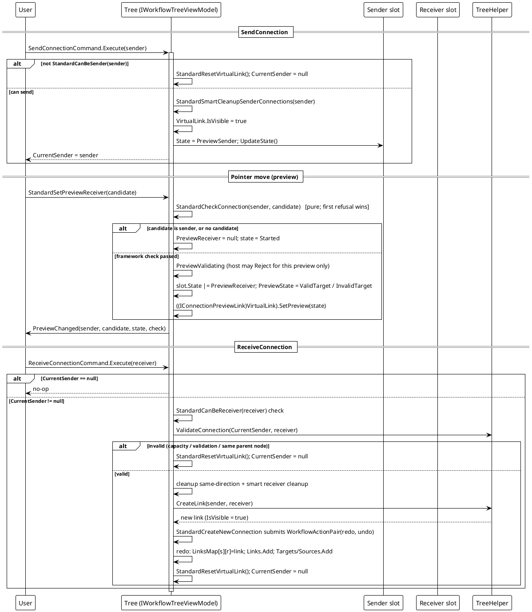

# 工作流系统 — 连接构建流程

`SendConnection` → `SetPreviewReceiver`（零次或多次）→ `ReceiveConnection` → `CreateLink`。

连接分两阶段建立，中间夹一个预览阶段。`SendConnection(sender)` 校验发送能力、清理冲突的发送端连接、显示 `VirtualLink` 并设置 `CurrentSender`。指针移动时，`SetPreviewReceiver(candidate)` 计算框架检查、标记候选并发布阶段。`ReceiveConnection(receiver)` 校验接收能力 + 自定义 `ValidateConnection` + 同节点规则、清理同向冲突，然后 `StandardCreateNewConnection` 向树 Helper 申请新连线，并把整个连接作为一个可撤销 `WorkflowActionPair` 提交。

预览与完成共用**同一套规则**（`StandardCheckConnection`），所以红/绿橡皮筋与最终接受不可能在方向、同节点或宿主 `ValidateConnection` 上不一致。释放时的 `IWorkflowTreeEvents.Connecting` 否决被刻意**排除**在预览之外：它是只在释放时抛出的逐次决定。

提交的对立即执行（`redo`）并压入撤销栈；之后 `StandardUndo`/`StandardRedo` 运行 `undo`/`redo` 并交换栈（见设计模式维度的命令模式页）。任何校验失败都会重置虚拟连线，不留下连接。

*源码：`Src/Core/VeloxDev.Core/WorkflowSystem/StandardEx/WorkflowTreeEx.cs` —— `StandardSendConnection` 105-137 行、`StandardSetPreviewReceiver` 150-152、`StandardRefreshConnectionPreview` 162-174、`StandardCheckConnection` 195-216、`StandardReceiveConnection` 253-307、`StandardCreateNewConnection` 517-570；`StandardEx/WorkflowSlotEx.cs` —— `StandardUpdateState` 93-106。预览行为：`Src/Core/VeloxDev.Core.Test/WorkflowSystem/WorkflowConnectionPreviewTests.cs`。*
