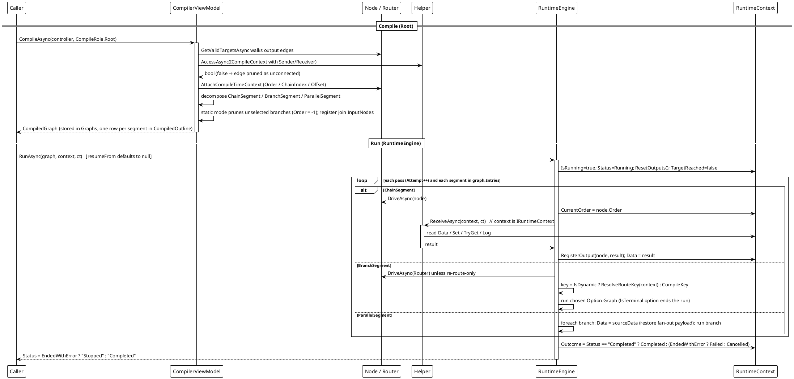

# 工作流系统 — 编译与运行（Root）

`CompileAsync(role: Root)` → `RuntimeEngine.RunAsync` → `ReceiveAsync`。

两个阶段。**编译**从控制器出发走过可达子图，构建不可变分段：线性段成为 `ChainSegment`，实现 `ICompileTimeRouter` 的节点成为 `BranchSegment`，多目标扇出成为 `ParallelSegment`。每条节点出边都用 `ICompileContext` 调用发送端 `AccessAsync` 做静态校验（被拒边视为未连接并略去）；每个可达节点通过 `ICompileTimeAware` 获得固定编译身份（`Order`/`ChainIndex`/`Offset`），多输入 join 点登记其输入源节点。**运行**驱动这些分段：引擎拥有下游派发，用 `IRuntimeContext` 直接调用 `Helper.ReceiveAsync`，把返回值写回 `context.Data`，并注册每个节点的输出。

取消路径：`ct.ThrowIfCancellationRequested()` 中止本趟；节点抛出的 `OperationCanceledException` 立即重抛（取消**不是**重定向），`RunAsync` 设置 `Status = "Stopped"` 并记录 `RunOutcome.Cancelled` —— **没有** `[Error]` 日志行，因为宿主停止自己的运行不是失败。

*源码：`Src/Core/VeloxDev.Core/WorkflowSystem/CompilerEx/Compile/CompilerViewModel.cs`、`CompilerEx/Runtime/RuntimeEngine.cs`。Demo：`Examples/Workflow/Common/Lib/ViewModels/Workflow/ControllerViewModel.cs`。测试证据：`CompilerEx/RuntimeEngineRunTests.cs`、`CompilerEx/EntrySemanticsTests.cs`。*
