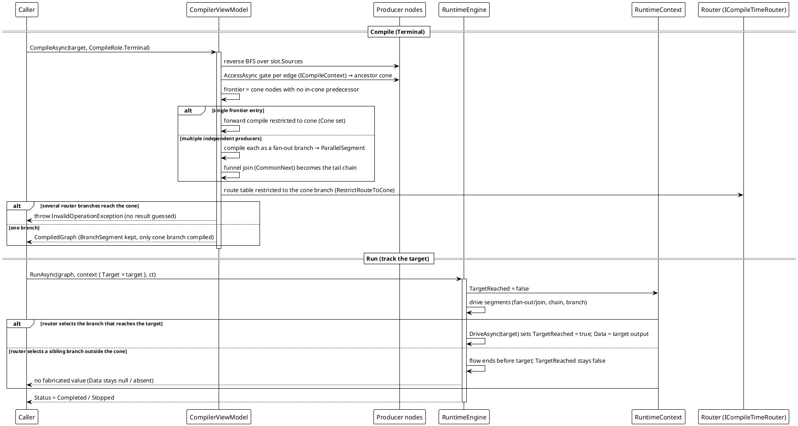

# 工作流系统 — 反向 / 终端锥流程

`CompileAsync(role: Terminal)` → 带 `Target` 运行。

`CompileRole.Terminal` 从**祖先锥**计算汇聚节点的结果：沿 `Sources` 做反向 BFS，用发送端 `AccessAsync` 校验每条边（被拒边不算祖先）。锥自身的入口前沿（锥内无输入前驱的节点）自动推导 —— 不需要控制器/起点节点。锥上的路由器**保持真实的 `BranchSegment` 语义**，但只编译通往锥内的那条分支（`RestrictRouteToCone`）；多个独立生产者先汇成 `ParallelSegment`，再接一段公共 join 链。可达性由 `RuntimeContext.Target`/`TargetReached` 报告；绝不虚构值。



**已验证行为**（对随附库复现；三节点链 `Ticker → Bias → Printer`，目标为中间节点）：

```text
[3] result: Completed data=tick->bias reached=True
```

运行在 `Bias` 之后停止 —— `data` 是目标自身的输出，**不是** `tick->bias->print` —— 因为该节点确实被驱动，`TargetReached` 为 `true`。

*源码：`Src/Core/VeloxDev.Core/WorkflowSystem/CompilerEx/Compile/CompilerViewModel.Reverse.cs`、`CompilerViewModel.cs` 的 `RestrictRouteToCone`。测试证据：`CompilerEx/CompileToReverseTests.cs`（`RouterOnConePath_SelectedBranchMatchesTarget_ReachesAndReturnsResult`、`RouterOnConePath_SelectedSiblingBranch_TargetNotReached_FlowEndsWithoutValue`、`FanOutJoin_TargetAfterJoin_CompilesConeFunnel_GroupDataAtJoin`、`MultiLevelFanInAcrossIndependentEntries_ThrowsInformative`）。*
