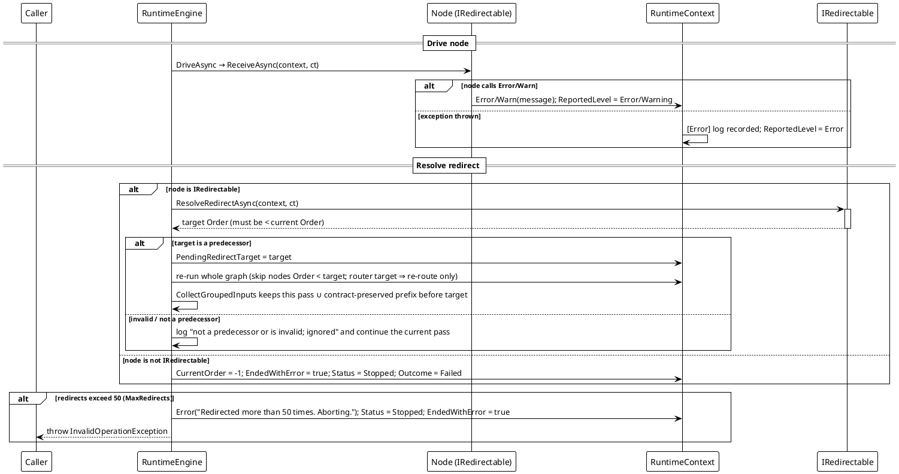

# 工作流系统 — 重定向重跑

`RuntimeContext.Error()` → `IRedirectable` → 整图重跑。

节点内 `Error()`/`Warn()` 调用或 `ReceiveAsync` 异常是一次重定向请求。实现 `IRedirectable` 时，节点返回一个前驱 `Order`；`RunAsync` 朝该状态重跑整张图 —— `Order < target` 的节点被跳过，因此重定向可以跨链向前跳过并在之后恢复。输出注册表在趟与趟之间**不**清空；过期输出按趟戳与 `ActiveRedirectTarget` 过滤，join 因此绝不会聚合被重跑取代的结果。



**已验证行为**（对随附库复现；`boom` 节点总是抛异常，未实现 `IRedirectable`）：

```text
[10] compensate: status=Stopped outcome=Failed currentOrder=-1 reversed=[BoomNode]
```

`Status = Stopped`、`Outcome = Failed`，状态码降到 `-1`，运行中已成功的节点被交给补偿器。

**两个级别，两种结果。** `Warn` 是注记 —— 写一行日志，运行带着节点返回值继续。`Error` 与未捕获异常是停止：该次驱动视作产出了 `null`；除非 `IRedirectable` 把运行安置到别处，否则流程以状态 `-1` 结束。路由器或重定向契约**抛异常**同样会结束它，阶段为 `ExecutionFailurePhase.Router` / `.Redirect` —— 已经没有答案可给（`EngineHostContractFailureTests`）。

*源码：`Src/Core/VeloxDev.Core/WorkflowSystem/CompilerEx/Runtime/RuntimeEngine.cs`、`CompilerEx/Runtime/Model/RuntimeContext.cs`、`CompilerEx/Runtime/Contracts/IRedirectable.cs`。测试证据：`CompilerEx/RuntimeRedirectTests.cs`。*
