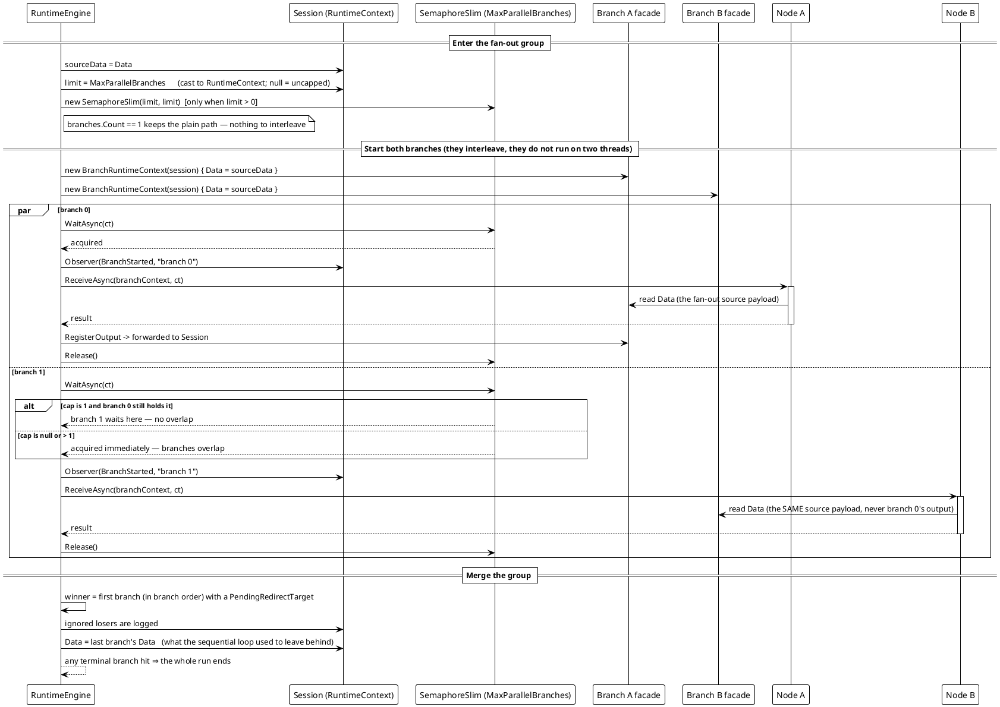

# 工作流系统 — 并行扇出与并发上限

`ParallelSegment` **并发**运行它的分支 —— 交错异步操作而非线程 —— `MaxParallelBranches` 限制同时在飞的分支数。

每个分支都有自己的 `BranchRuntimeContext`，负载、重定向请求与日志缓冲按分支隔离，而身份、进度、输出注册表与共享变量仍留在宿主的单一会话上。每个分支从**扇出源节点**的负载开始，永远看不到兄弟分支的输出。日志是**转发**而非缓冲，所以行序就是真实发生顺序。



**确定性来自分支顺序。** 多个分支请求重定向时，**分支顺序最靠前者**胜出，其余记录日志并忽略 —— 按*顺序*而不是墙钟，运行因此可复现。会话中留下的负载是最后一个分支的。任一分支内命中终端分支会结束整个运行。与早期顺序引擎的一处刻意变化：抛异常的分支不再中途中止兄弟分支 —— 异常在整组完成后才浮出。

**已验证行为**（对随附库复现；两个 120 ms 分支）：

```text
[11] segments: ChainSegment, ParallelSegment
[11] MaxParallelBranches=null: overlap=True
[11] MaxParallelBranches=1:    overlap=False
```

无上限时两个分支同时在对飞（总墙钟约等于一个分支而非两个）；`MaxParallelBranches = 1` 时第二个分支的开始晚于第一个分支的结束。

没有 demo 设置 `MaxParallelBranches`；契约由 `ParallelExecutionTests` 钉住（`Branches_AreInFlightAtTheSameTime`、`MaxParallelBranches_SerialisesTheGroupWhenSetToOne`、`EachBranch_SeesOnlyTheFanOutSourcePayload`、`LogLines_KeepTheOrderTheyHappened`、`TwoBranchesAskingToRedirect_TheFirstInBranchOrderWins_AndTheOtherIsLogged`）。

*源码：`Src/Core/VeloxDev.Core/WorkflowSystem/CompilerEx/Runtime/RuntimeEngine.cs`（`RunParallelAsync`、`RunOneBranchAsync`）、`CompilerEx/Runtime/Model/BranchRuntimeContext.cs`。*
