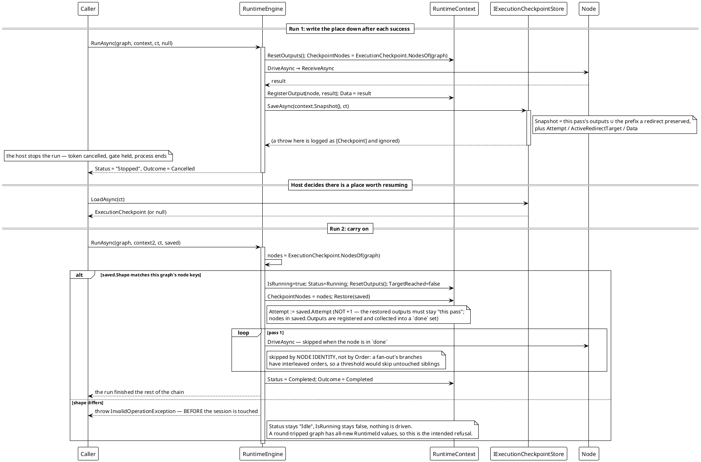

# 工作流系统 — 从检查点恢复

引擎在每个节点成功后记下运行的*当前*位置，`RunAsync` 可以把它作为 `resumeFrom` 参数收回。记录为完成的节点不会再次驱动；对另一张图取下的检查点会在触碰会话之前被拒绝。



**已验证行为**（对随附库复现；三节点链，第一个节点后停止）：

```text
[7] checkpoint: attempt=1 outputs=1 shape=<three RuntimeId GUIDs>
[7] resume: status=Completed data=tick->bias->print outcome=Completed
[7] refused on a serialized copy: The checkpoint does not belong to this graph status=Idle
```

恢复从停下的位置走完链；对往返副本取下的检查点被拒绝，`Status` 仍读作 `Idle`，因为什么都没被触碰。

**说明：**

- **一个存储，一次运行。** 引擎写的是运行的*当前*状态，不是历史 —— 一个存储只保留一份最新检查点。保留多次运行位置的宿主应使用多个存储，或按 `IRuntimeContext.Uid` 给自己的实现分键。
- **保存是尽力而为。** 抛异常的存储得到一行 `[Checkpoint]`，运行继续。
- **`resumeFrom` 这一趟保持检查点的 `Attempt` 不变**，而不是 `+1`：输出注册表用它打戳，递增会把恢复的输出降级为过期，join 会立刻看不到它们。之后的普通重定向重跑仍会递增。
- **组负载按节点键存储，而不是节点引用。** `Snapshot()` 把 `IGroupData` 改写成普通 `Dictionary<string, object?>` —— 节点引用写不进文件，序列化它还会把整棵树拖进来。
- **数字经文件会丢类型。** 检查点是 JSON，JSON 只有一种整数类型：`int` 回来是 `long`。引擎自己的字段是精确的，但按 `int` 模式匹配负载的节点在经 `FileCheckpointStore` 恢复后不会匹配。`InMemoryCheckpointStore` 没有这个缺口。`ExecutionCheckpoint.Rekey(checkpoint, target)` 是宿主明知另一标识的图结构相同时的显式选择。

*源码：`Src/Core/VeloxDev.Core/WorkflowSystem/CompilerEx/Runtime/RuntimeEngine.cs`（`RequireSameShape`、`Restore`、`SaveCheckpointAsync`）、`CompilerEx/Runtime/Model/ExecutionCheckpoints.cs`、`CompilerEx/Runtime/Model/RuntimeContext.cs`（`Snapshot` 为 internal、`ResetOutputs`）。测试证据：`CompilerEx/ExecutionCheckpointTests.cs`。*
