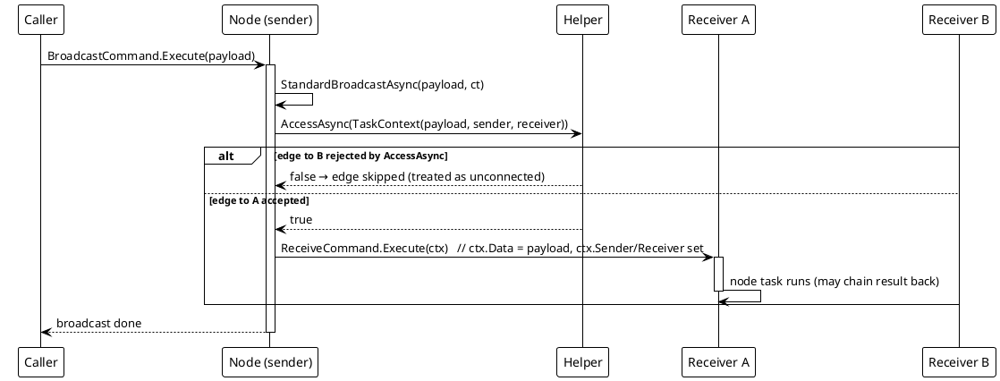

# 工作流系统 — 广播派发（非 Compiler）

`StandardBroadcastAsync` —— stateless、边级路径。

模型有三个执行入口：① 单节点任务（`ReceiveCommand.Execute(ctx)` + `ITaskContext`），② 边级广播，③ 链级编译运行。本图展示入口 ②：`StandardBroadcastAsync` 遍历节点的输出槽目标，每条边构造 `TaskContext(parameter, sender, receiver)`，应用运行期 `AccessAsync` 闸门 —— 被拒边视为未连接并跳过 —— 再通过 `ReceiveCommand.Execute(ctx)` 投递每条通过的边。入口 ③ 从不使用这条路径：编译引擎自己派发下游，绝不触发节点命令。

join 聚合（`IGroupData`）、重定向契约与序列化往返都是 Compiler 路径的关注点，在 `01_编译与运行` 与 `02_终端锥` 页分析。非 Compiler 路径没有 join、没有重定向、没有可达性模型：多输入节点只是每条入边运行一次。

*源码：`Src/Core/VeloxDev.Core/WorkflowSystem/StandardEx/WorkflowNodeEx.cs`，`StandardBroadcastAsync`；反向为 `StandardReverseBroadcastAsync`（遍历 `Sources`）。测试证据：`CompilerEx/EntrySemanticsTests.cs`（`StandardBroadcast_DeliversTaskContextPerValidEdge_SkipsAccessRejectedEdge`、`CompiledRun_DrivesOnlyThroughHelper_NeverExecutesNodeCommands`）。*
