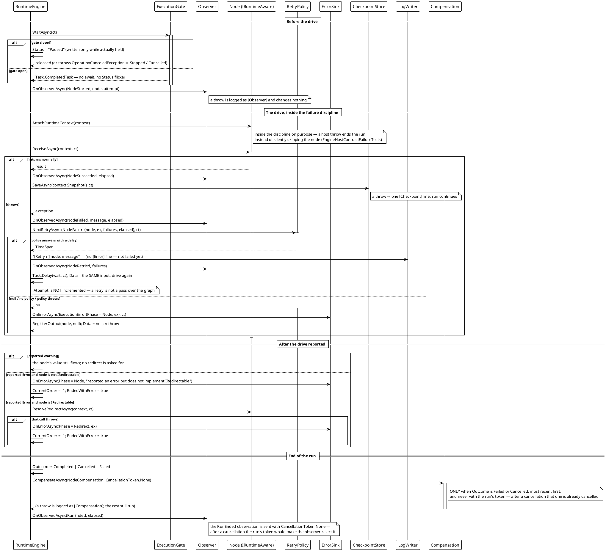

# 工作流系统 — 一次驱动周围的宿主能力

包在单次节点驱动周围的七个可选接缝（2026-09-27）。每一项都通过私有 `Session()` 辅助方法从具体 `RuntimeContext` 读取，因此也能在扇出内工作；每一项不设置时都精确复现 2026-09-27 之前的行为。



## 顺序就是契约

| # | 步骤 | 从哪读 | 抛异常意味着 |
|---|---|---|---|
| 1 | `ExecutionGate.WaitAsync(ct)` | `RuntimeContext.ExecutionGate` | `OperationCanceledException` ⇒ `Stopped` / `Cancelled` |
| 2 | `Observer` —— `NodeStarted` | `.Observer` | 记 `[Observer]`，运行不变 |
| 3 | `IRuntimeAware.AttachRuntimeContext` | 节点 | **运行结束**（不是静默跳过） |
| 4 | `ReceiveAsync` | 节点 | 进入第 5 步 |
| 5 | `RetryPolicy.NextRetryAsync` | `.RetryPolicy` | 视为「不再重试」 |
| 6 | `ErrorSink.OnErrorAsync` | `.ErrorSink` | 吞掉，记 `[ErrorSink]` |
| 7 | `CheckpointStore.SaveAsync` | `.CheckpointStore` | 记 `[Checkpoint]`，运行继续 |
| 8 | `Compensation.CompensateAsync` | `.Compensation` | 记 `[Compensation]`，其余仍运行 |
| — | `LogWriter.Write` | `.LogWriter` | 丢弃，报告在 `RuntimeContext.LogWriteFailed` |

两条规则贯穿所有项：**引擎不为取消写日志行**，以及**报告绝不会让做出报告的那次运行失败**。

**已验证行为**（对随附库复现 —— 每项能力一个会话）：

```text
[5] paused: status=Paused isPaused=True running=True data=<null>
[6] observed: NodeStarted:TickerNode, NodeSucceeded:TickerNode, NodeStarted:BiasNode, NodeSucceeded:BiasNode, NodeStarted:PrinterNode, NodeSucceeded:PrinterNode
[6] sink on a clean run: 0 records
[8] retry: status=Completed data=ok drives=3 attempt=1
[8] retry logs: 01. FlakyNode | 02. [Retry 1] FlakyNode: flaky #1 | 03. [Retry 2] FlakyNode: flaky #2
[9] logfile: fileLines=3 retained=2      (the writer keeps every line; Logs keeps the newest 2)
[10] compensate: status=Stopped outcome=Failed currentOrder=-1 reversed=[BoomNode]
```

*源码：`Src/Core/VeloxDev.Core/WorkflowSystem/CompilerEx/Runtime/RuntimeEngine.cs`、`CompilerEx/Runtime/Model/RuntimeContext.cs`。Demo：`Examples/Workflow/Common/Lib/ViewModels/Workflow/WorkflowDemoSession.cs` 的 `ConfigureRun`。测试：`CompilerEx/Execution{Gate,Observer,Retry,ErrorSink,Compensation}Tests.cs`、`NodeReportTests.cs`、`CompilerLogWriterTests.cs`。*
