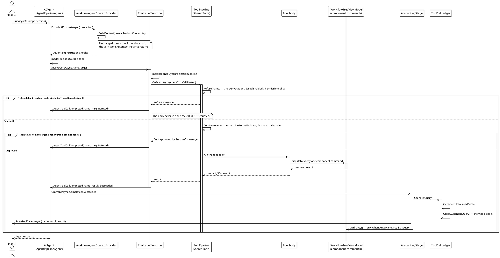

# 数据流 —— 一次工具调用，端到端

每次工具调用 —— 内置、开发者注册、MCP 来源、技能来源或子代理 spawn —— 都走同一条路径：模型调用 `TrackedAIFunction`，它编组到宿主上下文并把调用交给作用域的**唯一共享 `ToolPipeline`**，后者在工具体运行前施加预算/宿主策略拒绝与权限闸门。函数体派发组件命令，完成事件由 accounting 阶段计数。

源码：`WorkflowAgentToolkit.cs`（`CreateTools`、`CheckInvocation`、`ConfirmMutationAsync`、`AccountAsync`、`CreateAccountingStage`）、`TrackedAIFunction.cs`、`ToolPipeline.cs`、`WorkflowAgentContextProvider.cs`。

## 图钉住的事实

- **模型看不到闸门会拒绝的工具。** `CreateTools` 把关闭的工具从列表中过滤掉，**并且** `CheckInvocation` 在调用时拒绝它们 —— 测试 `SwitchedOffTool_IsRefusedAtCallTime_NotJustHidden` 在开关前捕获 `AIFunction`、开关后调用，钉住的是拒绝而非省略。
- **拒绝发生在函数体之前。** 被拒绝或失败的调用从不运行函数体，因此不计数：`AccountingStage` 只统计 `AgentToolOutcome.Succeeded`。测试 `ARefusedTool_IsReportedToTheModel_AndDoesNotCountAsACall` 断言 `CallCount == 0`。
- **一个策略，每个切片。** 闸门实例与 MCP、技能提供器共享，因此 MCP 来源的工具与内置工具记入同一账本、受同一开关约束。
- **`ResetToolCallLimit` 豁免。** 它通过拒绝钩子（逃生舱挺过它本就为之存在的闸门），在用户同意后清零**整条**账本链，且自身从不计数。
- **消费沿链行走。** 对派生子代理，`Spend` 递归到 `Outer`，因此根账本的总数是整棵树任何位置发生的调用数。
