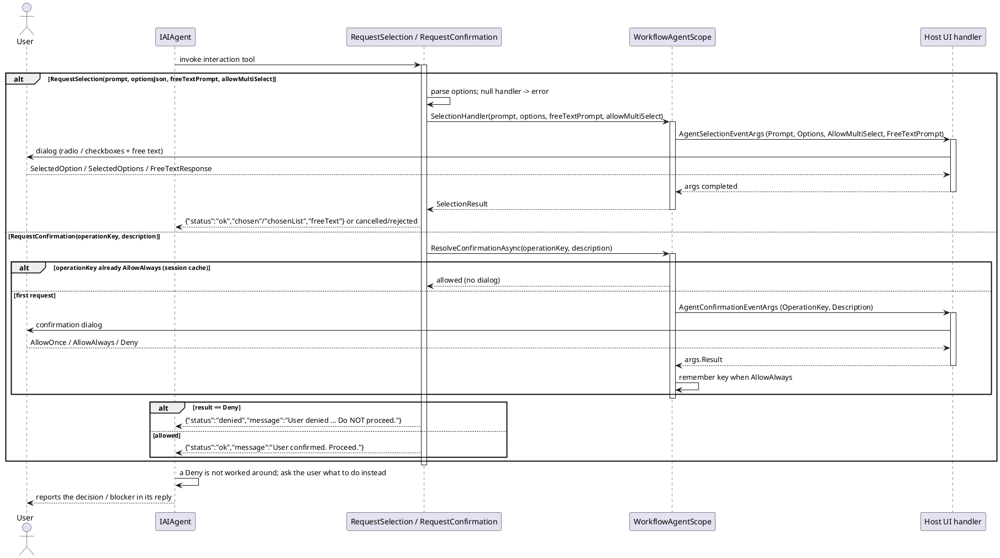

# 数据流 —— 交互与确认

当 agent 遇到含糊或破坏性动作时，它可以暂停并把决定交给宿主 UI。`RequestSelection` 让用户从选项中挑选（外加自由文本）；`RequestConfirmation` 请求允许/拒绝决定，`AllowAlways` 批准按 `operationKey` 在余下会话中记住（`ResolveConfirmationAsync`）。

说明：

- 对应处理器存在时才注册交互工具；已无安全级别闸门。`RequestSelection` / `RequestConfirmation` 是 `AgentActionCategory.Interact`，任何权限模式都不会把它交给用户。
- `Ask` 权限决定（来自模式或规则）以**工具名**为键到达同一个确认处理器；`Deny` 决定从不询问，直接返回 `DescribePermissionRefusal`，点名模式或规则。
- `EnterPlanMode` / `ExitPlanMode` 在切换模式前，以 `mode:plan` / `mode:exit-plan` 键经确认处理器询问。
- `SelectionResult`（单选/多选/自由文本）从宿主层返回工具包（`WorkflowAgentScope.SelectionResult`）。

> 源码：`WorkflowAgentScope.cs`（`WithSelectionHandler`、`WithConfirmationHandler`、`ResolveConfirmationAsync`、`PermissionPolicy`）；`WorkflowAgentToolkit.cs`（`RequestSelection`、`RequestConfirmation`、`EnterPlanMode`、`ExitPlanMode`）。
