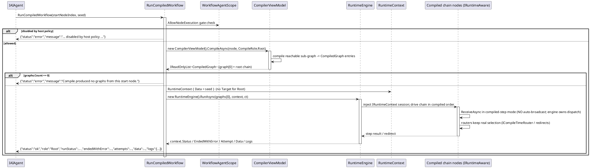

# 数据流 —— 根链运行（`RunCompiledWorkflow`）

`RunCompiledWorkflow(startNodeIndex, seed)` 是链级执行入口 —— 与示例 Run 按钮相同的路径。它用 `CompileRole.Root` 编译从起始节点可达的子图，并让 `RuntimeEngine` 驱动整条链。这与 `ExecuteNode` 不同，后者经 `ReceiveCommand` 执行单个节点（节点级 EXEC）。

说明：

- 因为引擎负责下游派发，编译步节点不自动广播；分支选择在运行时经编译期路由器发生，使结果与同一张图的 GUI 运行完全一致。
- `GetNodeResult` 是兄弟 *Terminal* 入口，从祖先锥计算单节点结果 —— 见[终结点结果](../04_终结点结果执行/index.md)。

> 源码：`WorkflowAgentToolkit.cs`（`RunCompiledWorkflow` 与共享的 `RunCompiledRoleAsync`）；`WorkflowLifecycleFidelityTests` 覆盖闸门与 terminal 运行契约。
