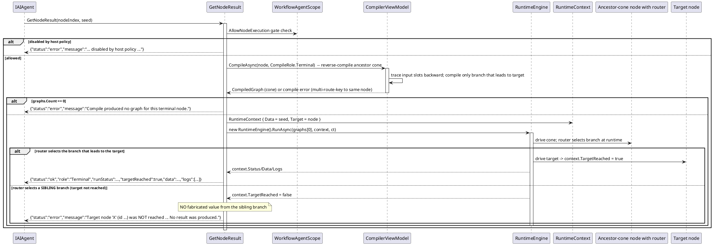

# 数据流 —— 终结点结果（`GetNodeResult`）

`GetNodeResult(nodeIndex, seed)` 隔离计算单个节点的结果。它用 `CompileRole.Terminal` 反向编译节点的**祖先锥**（喂给它输入槽的上游生产者），并用运行时引擎驱动该锥，因此不需要 controller/起始节点。锥内的路由器保持真实分支语义：只编译通往目标的分支。

这正是内嵌提示规范（与 `RunCompiledRoleAsync`）执行的错误契约：若锥上的路由器选择了兄弟分支，目标**未**被到达，工具返回点名目标的 `status:error` —— 绝不把其他分支的最终载荷当作本节点的结果。要成功，先把路由器指向通往该节点的分支，或请求一个位于实际选中分支上的节点。

> 源码：`WorkflowAgentToolkit.cs`（`GetNodeResult` 与共享的 `RunCompiledRoleAsync`，`Target`/`TargetReached` 语义）；测试 `WorkflowLifecycleFidelityTests.GetNodeResult_*`。
