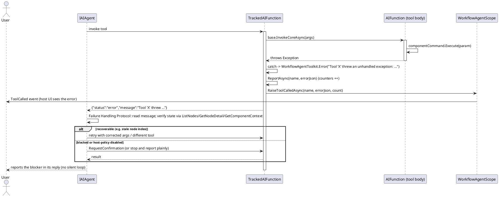

# 数据流 —— 错误与恢复

当工具体抛异常时，`TrackedAIFunction.InvokeCoreInnerAsync` 把异常转成紧凑 JSON `{"status":"error"}`，而不是让 SDK 失败浮现；跟踪（计数 + `ToolCalled`）仍会触发。agent 随后执行注入的 Failure Handling Protocol：读取 `message`/`reasons`/`hint`/`preferredAlternative`，核实当前状态，换一个工具重试 —— 或者询问用户。被宿主策略禁用的工具会被报告，绝不绕过。

说明：

- 未挂载组件的操作按框架设计是静默空操作；协议让模型在重试前核实挂载状态（`ListNodes` / `GetNodeDetail`）。
- 受闸控的工具（`ExecuteNode`、`ExecuteCommandOnNode`、`ExecuteCommandById`、`RunCompiledWorkflow`、`GetNodeResult`）在宿主未启用时返回结构化的 `disabled by host policy` 错误；模型被告知不要绕过。
- 权限拒绝（`Deny`）同样以结构化错误返回，并点名模式或规则，而不是预算消息。

> 源码：`Agent/TrackedAIFunction.cs`（`InvokeCoreInnerAsync`）；`WorkflowAgentScope.cs`（`DescribePermissionRefusal` 与失败处理协议提示）。
