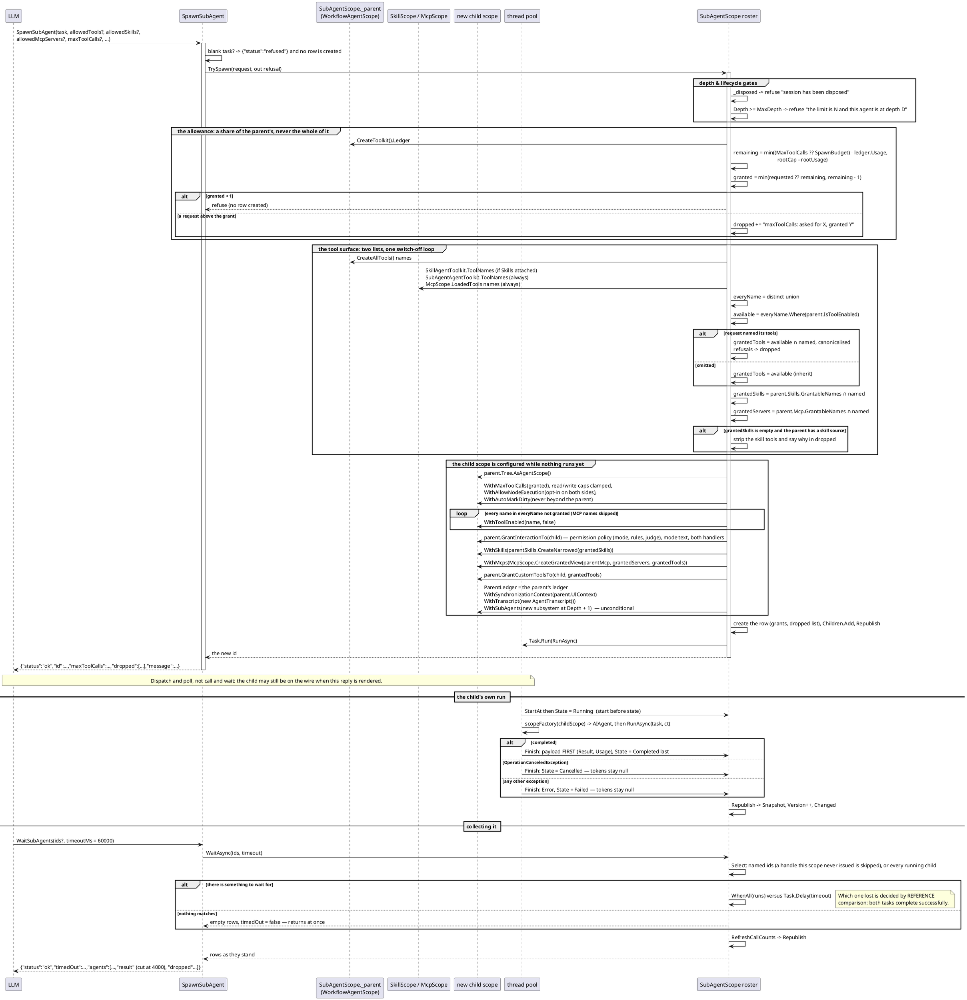

# 数据流 —— 子代理派发（`SpawnSubAgent` → `WaitSubAgents`）

子代理流是一个启动后台运行的工具调用，加第二个收集它的调用。值得追踪的是：所有收窄都**同步发生在第一个工具体内** —— 在宿主 UI 线程上、子代理存在之前 —— 而子代理自己的运行进入线程池。本页从模型的参数列表追到一行已结算的名册，再追读取它的 wait。

说明：

- **`Task.Run` 之前的一切与其他 spawn、与面板串行**，因为它发生在名册线程上。只有子代理自己的运行被交出去 —— 这让 spawn 可像任何只读工具调用一样处理，而子代理并行工作。
- **`SpawnSubAgent` 被归类为只读**（`SubAgentAgentToolkit.ToolNames` 并入 workflow 工具包的查询列表），因此 spawn 与 wait 记入读计数，绝不标脏。`SubAgentBudgetTests.ASpawnIsAQuery_AndSoIsNotChargedToTheMutationBudget` 断言两个方向，包括读预算耗尽时 spawn 被拒、写预算耗尽时不受影响。
- **spawn 本身是对共享锅的一次调用**，因此授予是 `remaining - 1` 而非 `remaining`：即使那次记账尚未发生，`- 1` 也让递减授予不变量成立。
- **子代理从第一次调用起就记在树上**，因为 `ParentLedger` 在工具包存在前设置。`SubAgentBudgetTests.AChildsCalls_AreCountedOnTheRootsLedger` 断言根用量等于 spawn 加子代理调用。
- **被拒的 spawn 不留下行。** 拒绝是 JSON 对象，模型应读 `message`；没有任何东西被半创建。
- **子代理自己的名册起初为空**，只有它自己派发时才填充；这里没有任何东西让兄弟句柄可达。

> 源码：`SubAgentScope.cs`（`TrySpawn`、`RunAsync`、`Finish`、`WaitAsync`）；`SubAgentAgentToolkit.cs`（五个工具）；`WorkflowAgentScope.cs`（`GrantInteractionTo`、`GrantCustomToolsTo`、`WithSubAgents`）；`ToolCallLedger.cs`。测试：`SubAgentDispatchTests`、`SubAgentBudgetTests`、`SubAgentHierarchyTests`、`SubAgentCapabilityGrantTests`。
