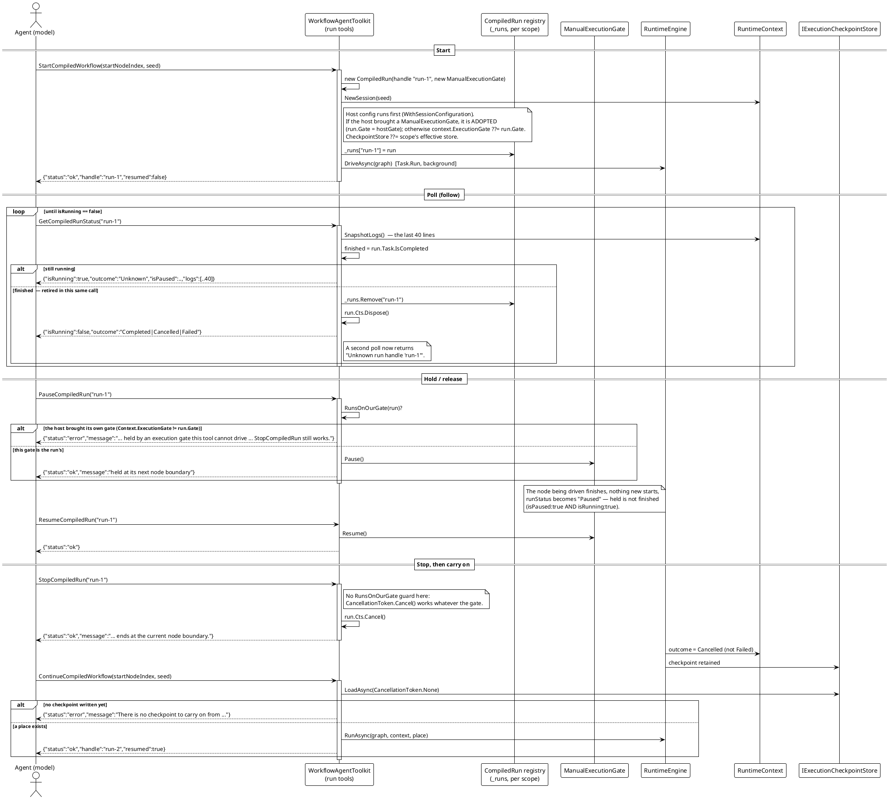

# 数据流 —— 编译运行句柄生命周期

`RunCompiledWorkflow` 等待结束；需要持有、跟进或停止的运行做不到。运行句柄家族在后台启动同一条编译链并返回句柄。本页追踪整个生命周期：启动 → 轮询 → 持有/放行 → 停止/继续，包括两个记录在案的行为（句柄退休与 `RunsOnOurGate` 守卫）。

源码：`WorkflowAgentToolkit.cs`（`StartCompiledAsync`、`DriveAsync`、`GetCompiledRunStatus`、`PauseCompiledRun`、`ResumeCompiledRun`、`StopCompiledRun`、`NewSession`、`RunsOnOurGate`、`GateNotOurs`、`CompiledRun`）；`RunOutcome.cs`；`RuntimeContext.SnapshotLogs`。

## 图钉住的行为

- **退休就是答案。** `GetCompiledRunStatus` 读取一次 `run.Task.IsCompleted`，并在同一次调用中在结束时移除句柄、释放其 `CancellationTokenSource`。答案与退休描述同一状态，因此轮询循环在 `isRunning == false` 退出，之后的调用是未知句柄。测试：`CompiledRunControlTests.WaitForEndAsync` —— 唯一退出条件是 `isRunning == false`。
- **工具驱动的闸门必须是引擎等待的闸门。** `NewSession` 采纳宿主的 `ManualExecutionGate`，因此 `PauseCompiledRun` / `ResumeCompiledRun` 操作真实闸门；当宿主的闸门*不是*运行的闸门时，两者返回错误，而不是报告一次未发生的暂停。测试：`AStartedRun_CanBeHeld_LetGo_AndFollowedToItsEnd`；守卫本身**仅源码核验**（`Agent/**` 中没有测试断言它）。
- **停止是取消，不是失败。** `StopCompiledRun` 取消 token；运行在节点边界以 `outcome: Cancelled` 结束，它留下的检查点正是 `ContinueCompiledWorkflow` 读取的 —— 因此被停止的运行可以稍后恢复。测试：`AStoppedRun_EndsAsCancelled_AndTheAgentCanCarryOnFromIt`。
- **继续绝不凭空开始。** 什么都还没写时返回“no checkpoint”，而不是静默开始全新运行。测试：`CarryingOn_WithNothingWrittenYet_IsRefused`。
- **失败与日志随结果返回。** 会话上启用重试策略时，`failures` 携带 `Warning` 与 `Error` 记录，`logFile` 是包含重试行的绝对路径。测试：`TheFailureRecords_AndTheLogFile_TravelWithTheResult`。

**运行声明：** ⚠️ 本次修订未运行 —— 2026-10-18 对照当前源码静态核验。四个 `CompiledRunControlTests` 曾在 2026-10-01 的记录运行中通过，但那次运行早于权限模式重构；`RunsOnOurGate` 守卫与 40 行日志尾部仅对照源码核验。
