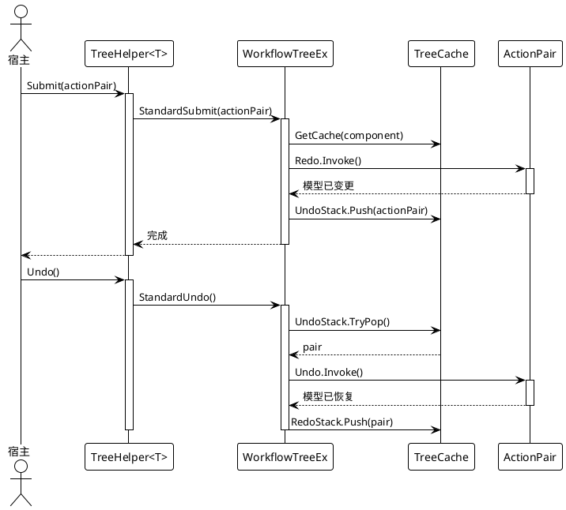

# 工作流编辑与历史

每一次编辑——创建、删除、连线、布局——都作为 `IActionPair` 提交。树持有两个栈，`Submit`、`Undo`、`Redo` 是仅有的写入者。

## 被提交的操作

`ActionPair` 是持有两个委托的 readonly struct。除此之外没有任何地方记录改了什么；这个对子就是记录。

```csharp
public readonly struct ActionPair(Action redo, Action undo) : IActionPair
{
    public Action Redo { get; } = redo;
    public Action Undo { get; } = undo;
}
```

> 来源：`Src/Core/VeloxDev.Core/WorkflowSystem/ActionPair.cs` 第 6-12 行。

## 正常流程：提交、撤销、重做



`StandardSubmit` 立即调用 redo，只有正常返回才入栈；异常被记录，历史不变。`StandardUndo` 与 `StandardRedo` 把同一个对子在两个栈之间搬移。

```csharp
public static void StandardSubmit(this ITreeComponent component, IActionPair actionPair)
{
    var cache = GetCache(component);
    try
    {
        actionPair.Redo.Invoke();
        cache.UndoStack.Push(actionPair);
    }
    catch (Exception ex)
    {
        Debug.WriteLine(ex);
    }
}
```

> 来源：`Src/Core/VeloxDev.Core/WorkflowSystem/StandardEx/WorkflowTreeEx.cs` 第 352-364 行。

```csharp
public static void StandardUndo(this ITreeComponent component)
{
    var cache = GetCache(component);
    if (cache.UndoStack.TryPop(out var pair))
    {
        try
        {
            pair.Undo.Invoke();
            cache.RedoStack.Push(pair);
        }
        catch (Exception ex)
        {
            Debug.WriteLine(ex);
        }
    }
}
```

> 来源：`Src/Core/VeloxDev.Core/WorkflowSystem/StandardEx/WorkflowTreeEx.cs` 第 367-382 行。

## 复合编辑

更高层的操作把多处模型变更包进一个对子，因此一次撤销能全部回退。

- **创建节点**：先脱离旧父级，再提交 add/remove。
- **删除节点**：收集两端都在同一棵树里的连线，然后提交一个对子；redo 删除连线、清空插槽父级、移除节点，undo 全部恢复（`WorkflowNodeEx.cs` 第 295-359 行）。
- **删除插槽**：收集两侧连线，再围绕插槽与连线提交 remove/restore（`WorkflowSlotEx.cs` 第 132-192 行）。
- **删除连线**：仅当该连线仍是其 sender/receiver 的当前映射时才操作（`WorkflowLinkEx.cs` 第 17-34 行）。
- **创建插槽**：节点已挂到树上时走树的 `Submit`；未挂时直接添加、不进历史（`WorkflowNodeEx.cs` 第 37-58 行）。

```csharp
tree.GetHelper().Submit(new ActionPair(
    () => { ExecuteNodeDeletion(tree, component, distinctConnections); },
    () => { RestoreNode(tree, component, oldParent, distinctConnections); }));
```

> 来源：`Src/Core/VeloxDev.Core/WorkflowSystem/StandardEx/WorkflowNodeEx.cs` 第 345-356 行。

## 错误与边界路径

- `StandardSubmit`、`StandardUndo`、`StandardRedo` 捕获委托抛出的所有异常并写到 `Debug`；栈仍然移动，因此失败的 redo 不会破坏栈。
- 对未挂载的节点或插槽调用 `StandardDelete` 会走 `WorkflowGuard.Fail` 并直接返回，不写历史。
- `StandardCreateSlot` 按引用幂等：已在 `Slots` 里的插槽被忽略，避免幽灵撤销记录。
- `StandardClearHistory` 通过按组件存放的 `ConditionalWeakTable` 缓存清空两个栈。

> 来源：`Src/Core/VeloxDev.Core/WorkflowSystem/StandardEx/WorkflowTreeEx.cs` 第 14-25、334-390、688-691 行；`Src/Core/VeloxDev.Core/WorkflowSystem/StandardEx/WorkflowNodeEx.cs` 第 24-58 行；`Src/Core/VeloxDev.Core/WorkflowSystem/StandardEx/WorkflowSlotEx.cs` 第 132-138 行。
