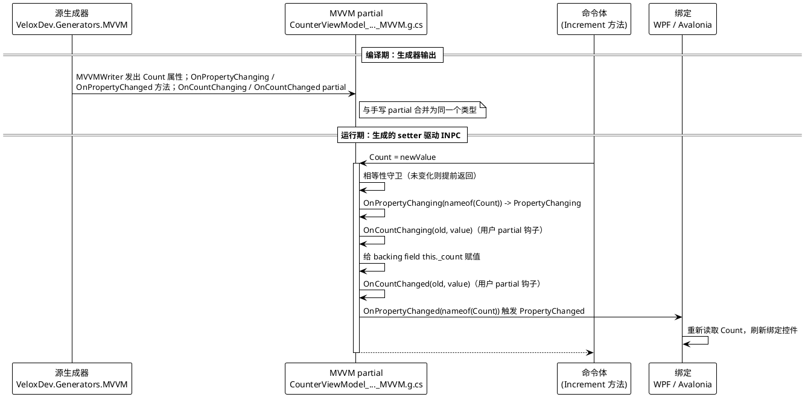
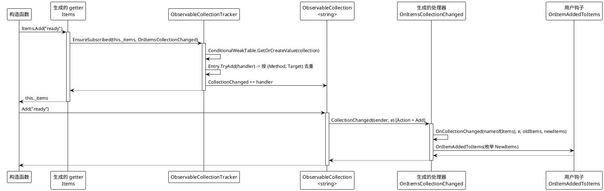
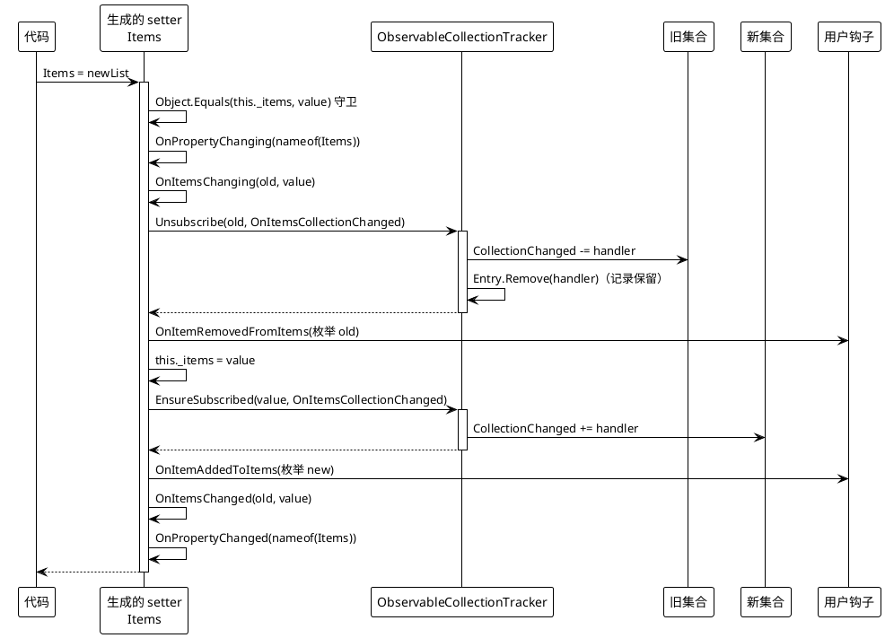

# 数据流 — 属性与集合

标量属性路径与集合路径形状相同：生成器在编译期发出骨架，setter 在运行期驱动它。集合路径额外加入惰性订阅，使字段初始化器（`= []`）无法让 `CollectionChanged` 失去观察。

## (a) 生成器输出 → INPC 流



> 源码：setter 形状由 `MVVMPropertyFactory.GetSetterBodyLines`（`Src/Generators/VeloxDev.Core.Generator/Base/Analizer.cs`）产出。

```csharp
// Source: Src/Generators/VeloxDev.Core.Generator/Base/Analizer.cs（Default setter 模式）
set
{
    if(global::System.Object.Equals(this._count, value)) return;
    var old = this._count;
    OnPropertyChanging(nameof(Count));
    OnCountChanging(old, value);
    this._count = value;
    OnCountChanged(old, value);
    OnPropertyChanged(nameof(Count));
}
```

## (b) 集合流：初始化器 → getter 订阅 → 按动作钩子

关键一步是构造函数里的第一次 `Items.Add("ready")`。字段初始化器直接给 `this._items` 赋值，setter 从未运行；订阅之所以存在，只是因为通往 `Add` 的路上读取了 **getter**。



> 源码：`MVVMPropertyFactory.GenerateCollectionMembers`（`Base/Analizer.cs`）；tracker 行为 —— `Src/Core/VeloxDev.Core/MVVM/ObservableCollectionTracker.cs`。

```csharp
// Source: Base/Analizer.cs —— 生成的集合 getter
get
{
    global::VeloxDev.MVVM.ObservableCollectionTracker.EnsureSubscribed(this._items, OnItemsCollectionChanged);
    return this._items;
}
```

## (c) 替换整个集合

替换是 `Unsubscribe` 发挥作用的场景：没有它，被丢弃的集合会继续持有指回本视图模型的处理器。



> 源码：`MVVMPropertyFactory.GetSetterBodyLines` 与 `GenerateCollectionMembers`（`Base/Analizer.cs`）；`Unsubscribe` —— `ObservableCollectionTracker.cs`。

## 按动作分发

生成的 `OnItemsCollectionChanged` 先调用 `OnCollectionChanged<T>`，再把 `NotifyCollectionChangedAction` 映射到用户钩子：

```csharp
// Source: Base/Analizer.cs —— GenerateCollectionMembers
var oldItems = e.OldItems is null ? null : EnumerateItemsItems(e.OldItems);
var newItems = e.NewItems is null ? null : EnumerateItemsItems(e.NewItems);
OnCollectionChanged(nameof(Items), e, oldItems, newItems);
switch (e.Action)
{
    case NotifyCollectionChangedAction.Add when e.NewItems is not null:
        OnItemAddedToItems(EnumerateItemsItems(e.NewItems));
        break;
    case NotifyCollectionChangedAction.Remove when e.OldItems is not null:
        OnItemRemovedFromItems(EnumerateItemsItems(e.OldItems));
        break;
    case NotifyCollectionChangedAction.Replace:
        if (e.OldItems is not null)
        {
            OnItemRemovedFromItems(EnumerateItemsItems(e.OldItems));
        }
        if (e.NewItems is not null)
        {
            OnItemAddedToItems(EnumerateItemsItems(e.NewItems));
        }
        break;
    case NotifyCollectionChangedAction.Move when e.NewItems is not null:
        OnItemMovedInItems(EnumerateItemsItems(e.NewItems));
        break;
    case NotifyCollectionChangedAction.Reset:
        OnItemsResetInItems();
        break;
}
```

## 错误与边界路径

| 路径 | 行为 |
| --- | --- |
| 值未变化 | 相等性守卫在任何通知或钩子之前返回。 |
| 集合不实现 `INotifyCollectionChanged` | `EnsureSubscribed` / `Unsubscribe` 立即返回。 |
| `null` 集合 | 同样提前返回；不抛异常。 |
| 处理器是新的方法组委托 | 按 `(Method, Target)` 去重，因此调用列表不会增长。 |
| 集合被垃圾回收 | 它的 `ConditionalWeakTable` 条目随之消失 —— 无泄漏。 |
| 处理器抛异常 | 集合处理器是普通 .NET 事件订阅者，不受 tracker 保护。 |
