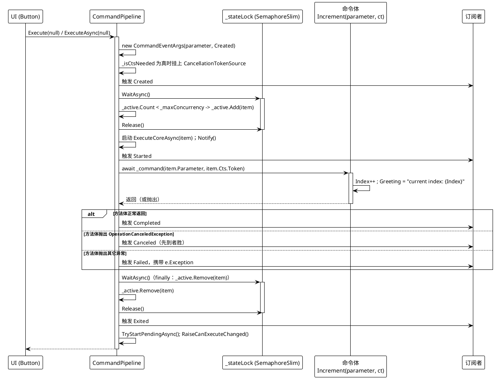
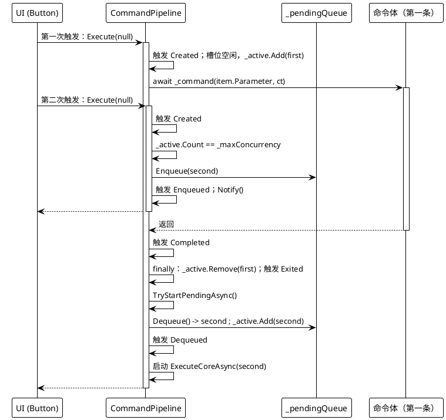
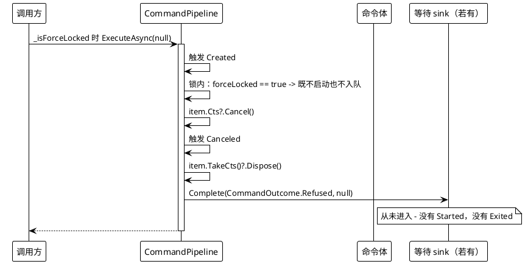
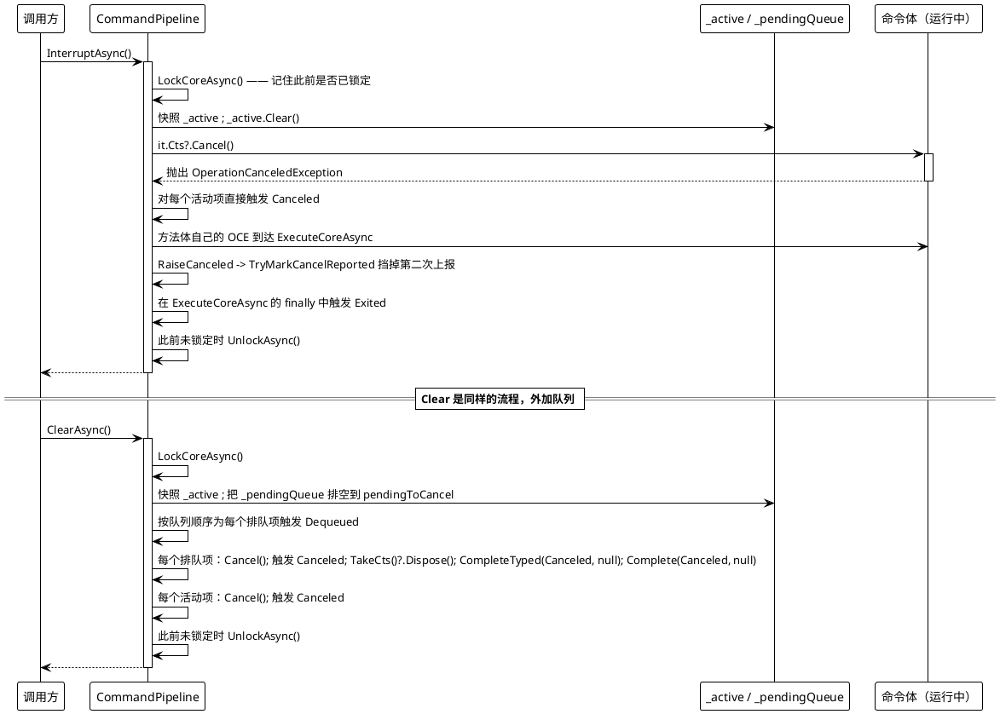
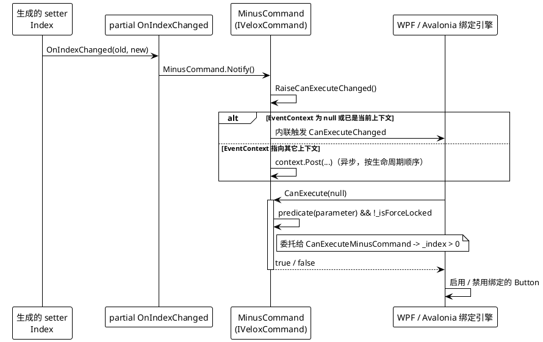

# 数据流 — 命令生命周期

执行管线位于 `Src/Core/VeloxDev.Core/MVVM/CommandPipeline{TParam,TResult}.cs`。设计所依赖的不变量在源码中写明：`_stateLock` 是 `SemaphoreSlim(1,1)`，因此**不可重入** —— 持锁期间不得运行任何用户代码（事件处理器、命令体都不行）。每个事件都在 `Release()` 之后触发。

## (a) 立即运行：Created → Started → Completed → Exited



> 源码：`CommandPipeline{TParam,TResult}.cs` —— `ExecuteCore`、`ExecuteCoreAsync`、`OnExecutionCompletedAsync`、`TryStartPendingAsync`。

## (b) 容量已满时排队：Enqueued … Dequeued



> 源码：`ExecuteCore` 的入队分支；`TryStartPendingAsync`。

## (c) 锁下拒绝：Created → Canceled，别无其它



> 源码：`ExecuteCore` 的 `forceLocked` 分支。这是产生 `CommandOutcome.Refused` 的唯一路径，也是 `CommandEventType` 无法表达拒绝的原因。

## (d) 取消与清空



> 源码：`InterruptAsync`、`ClearAsync`、`RaiseCanceled`、`TryMarkCancelReported`。

```csharp
// Source: Src/Core/VeloxDev.Core/MVVM/CommandPipeline{TParam,TResult}.cs
// 一次执行最多上报一条 Canceled。Interrupt/Clear 会及时上报；
// 方法体随后抛出的 OperationCanceledException 会被 TryMarkCancelReported 挡掉。
private void RaiseCanceled(CommandEventArgs<TParam, TResult> item)
{
    if (item.TryMarkCancelReported())
    {
        RaiseCommandEventAs(Canceled, item, CommandEventType.Canceled);
    }
}
```

## (e) `canValidate` 闸门：属性钩子 → Notify → CanExecuteChanged



> 源码：`CommandPipeline{TParam,TResult}.cs` 中的 `Notify` / `RaiseCanExecuteChanged` / `CanExecute`；钩子位于 `Examples/MVVM/WPF/Demo/MainWindowViewModel.cs`。

## 错误路径汇总

| 路径 | 行为 |
| --- | --- |
| 方法体抛出非取消异常 | `outcome = Failed`，触发带 `CommandEventArgs.Exception` 的 `Failed`；`Exited` 仍会在 `finally` 中触发。 |
| 方法体抛出 `OperationCanceledException` | `outcome = Canceled`，触发 `Canceled` —— 除非 `Interrupt` / `Clear` 已为该执行上报过。 |
| 锁定时触发 | 既不启动也不入队；触发 `Canceled`，并以 `Refused` 完成 sink。 |
| 队列中有调用时执行 `Clear` | 每个排队项先 `Dequeued` 再 `Canceled`；该项永不到达 `Started` / `Exited`。 |
| 取消回调抛异常 | 被吞掉（`AggregateException`），否则逃逸会跳过 `UnlockAsync`，让命令永久锁定。 |
| `Cancel` 时遇到 `ObjectDisposedException` | 被吞掉：方法体可能已经结束并释放了自己的源。 |
| 订阅者抛异常 | 被捕获并通过静态 `HandlerException` 上报；生命周期不受影响。 |
| `OnExecutionCompletedAsync` 抛异常 | 嵌套 `finally` 仍会完成 sink 并释放源。 |
