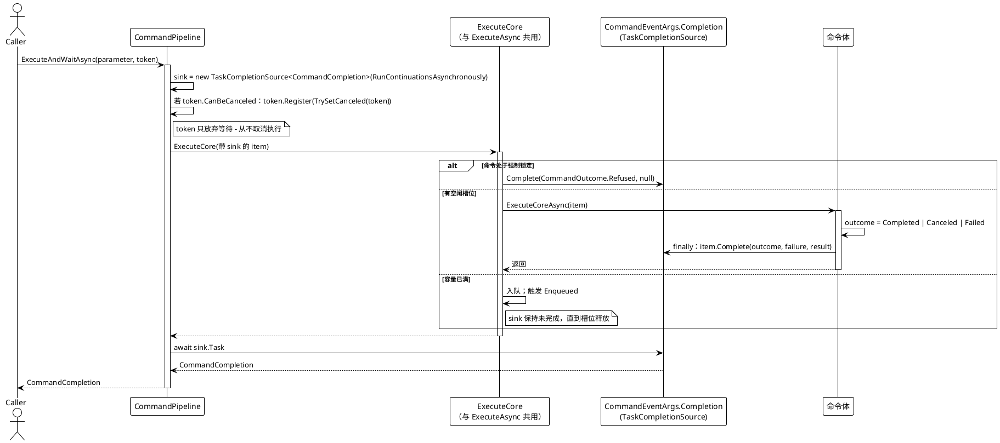
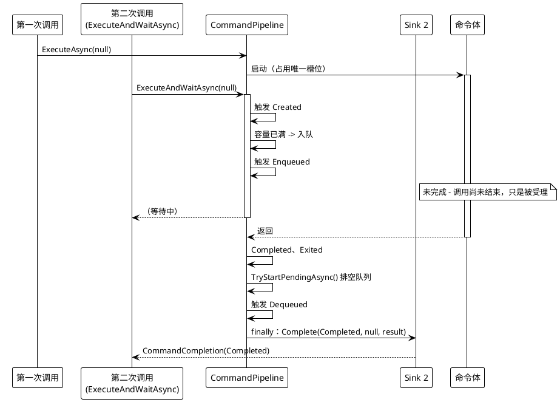
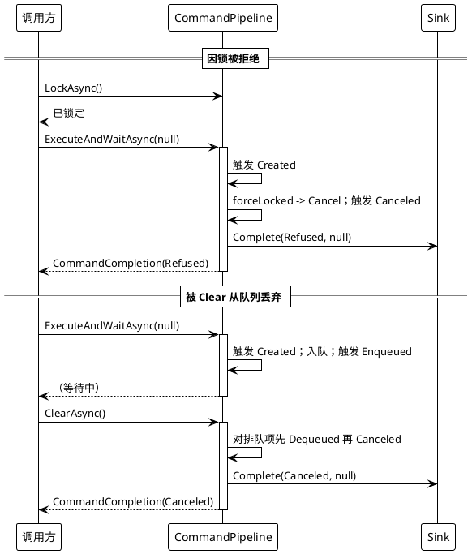

# 数据流 — `ExecuteAndWaitAsync`

`ExecuteAndWaitAsync` 就是 `ExecuteAsync` 加一个 sink。两者共用 `ExecuteCore`；区别只在是否挂上 `TaskCompletionSource<CommandCompletion>`，而每条路径都负责恰好完成它一次。

## (a) 等待路径



> 源码：`Src/Core/VeloxDev.Core/MVVM/CommandPipeline{TParam,TResult}.cs` —— `ExecuteAndWaitAsync`、`ExecuteCore`、`CommandEventArgs.Complete`。

## (b) 结局在哪里决定

结局在**执行内部计算**，不从事件回读：

```csharp
// Source: Src/Core/VeloxDev.Core/MVVM/CommandPipeline{TParam,TResult}.cs
private async Task ExecuteCoreAsync(CommandEventArgs<TParam, TResult> item)
{
    RaiseCommandEventAs(Started, item, CommandEventType.Started);

    // 结局在这里算出，而不是从事件或 item 回读：
    // 等待的 sink 不能依赖「有人订阅了 Failed」
    var outcome = CommandOutcome.Completed;
    Exception? failure = null;
    TResult result = default!;

    try
    {
        if (_resultCommand is not null)
        {
            result = _isCtsNeeded
                ? await _resultCommand(item.ResolveParameter(), (item.Cts ?? new()).Token).ConfigureAwait(false)
                : await _resultCommand(item.ResolveParameter(), _defct).ConfigureAwait(false);
        }
        else if (_isCtsNeeded)
        {
            await _command(item.ResolveParameter(), (item.Cts ?? new()).Token).ConfigureAwait(false);
        }
        else
        {
            await _command(item.ResolveParameter(), _defct).ConfigureAwait(false);
        }
        RaiseCommandEventAs(Completed, item, CommandEventType.Completed);
    }
    catch (OperationCanceledException)
    {
        outcome = CommandOutcome.Canceled;
        RaiseCanceled(item);
    }
    catch (Exception ex)
    {
        outcome = CommandOutcome.Failed;
        failure = ex;
        RaiseCommandEventAs(Failed, item, CommandEventType.Failed, ex);
    }
    finally
    {
        try
        {
            await OnExecutionCompletedAsync(item).ConfigureAwait(false);
        }
        finally
        {
            if (item.Completion is not null)
            {
                item.Complete(outcome, failure, result);
            }

            item.CompleteTyped(outcome, failure, result);
            item.TakeCts()?.Dispose();
        }
    }
}
```

这正是该 API 可用的关键：从未订阅 `Failed` 的调用方仍能拿到带异常的 `CommandOutcome.Failed`。

## (c) 为什么排队调用的 sink 保持待定



> 源码：`ExecuteCore` 的入队分支；`TryStartPendingAsync`。

## (d) 拒绝与队列丢弃：手写等待会挂起的两种情况

被拒绝的调用与被队列丢弃的调用都不会触发 `Exited`，这正是"订阅 `Exited` + `Failed`"不能作为等待手段的原因。



> 源码：`ExecuteCore` 的 `forceLocked` 分支与 `ClearAsync` 的排队项循环；`CommandCompletion.cs`。

## (e) 放弃等待

调用方的 token 在 `ExecuteCore` 运行前注册，它只取消 `TaskCompletionSource`：

```csharp
// Source: Src/Core/VeloxDev.Core/MVVM/CommandPipeline{TParam,TResult}.cs
var sink = new TaskCompletionSource<CommandCompletion>(TaskCreationOptions.RunContinuationsAsynchronously);

// 这个 token 只放弃等待，不取消执行 —— 取消执行是 Interrupt / Clear 的职责
using var registration = cancellationToken.CanBeCanceled
    ? cancellationToken.Register(
        static state =>
        {
            var (source, token) = ((TaskCompletionSource<CommandCompletion>, CancellationToken))state!;
            source.TrySetCanceled(token);
        },
        (sink, cancellationToken))
    : default;

var item = CommandEventArgs<TParam, TResult>.FromBoxed(parameter, CommandEventType.Created);
item.Completion = sink;
await ExecuteCore(item).ConfigureAwait(false);

return await sink.Task.ConfigureAwait(false);
```

## (f) 强类型结果通道

强类型命令使用同一形状，但内部是 `TaskCompletionSource<TypedCompletion<TResult>>`（`ExecuteAndWaitTypedAsync`）；调用方直接得到 `TResult`，而不是装箱的 `object?`。`ExecuteAndWaitTyped` 是阻塞版本。

`CommandCompletion.Result` 是未强类型路径的装箱值；`GetResultOrThrow` / `GetResultOrThrow<TR>` 把完成结果变成值，或重新抛出原始异常。

## 与 `ExecuteAsync` 的对比

| 维度 | `ExecuteAsync` | `ExecuteAndWaitAsync` |
| --- | --- | --- |
| Sink | `null` | 一个 `TaskCompletionSource<CommandCompletion>` |
| 完成时机 | 调用被受理时 | 该次调用结束时，包括被拒绝与被丢弃的调用 |
| 结果通道 | 仅事件 | 一个 `CommandCompletion`（及其 `Result`） |
| 拒绝可观察 | 上报为 `Canceled`，与取消不可区分 | `CommandOutcome.Refused` |
| 需要 `Failed` 订阅者 | 是，才能观察方法体失败 | 否 |
| Token 语义 | 不适用 | 只放弃等待 |
| 续体 | 不适用 | `RunContinuationsAsynchronously`，完成 sink 不会在管线上内联运行用户代码 |

最后一点刻意缺失的设计：`CommandEventArgs.With` 产生的副本不携带 sink，因此投影不能完成别人的等待。
