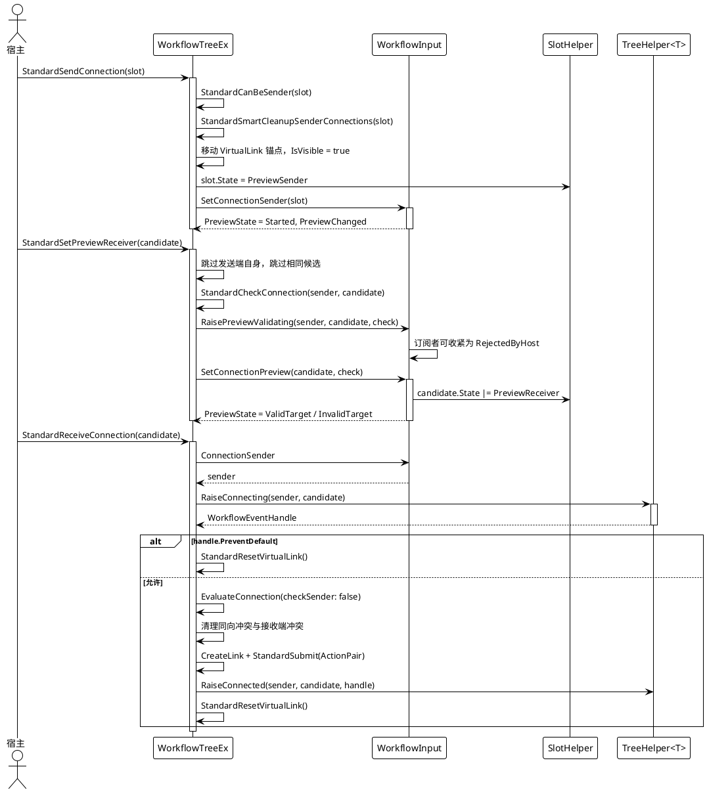

# 连接规则与预览

一次连线拖拽分三段：从发送端建立虚拟连线、报告指针下的候选端、松手时落定。预览与落定共用同一套规则，因此绿色橡皮筋与被接受的连线不可能对规则给出不同结论。

## 规则

`StandardCheckConnection` 是纯函数。它依次检查方向、同节点、以及 helper 的 `ValidateConnection`，返回第一个拒绝原因。

```csharp
private static ConnectionCheck EvaluateConnection(
    ITreeComponent component,
    ISlotComponent sender,
    ISlotComponent receiver,
    bool checkSender)
{
    if (checkSender && !sender.StandardCanBeSender())
        return ConnectionCheck.Rejected(ConnectionRejectReason.SenderCannotSend);

    if (!receiver.StandardCanBeReceiver())
        return ConnectionCheck.Rejected(ConnectionRejectReason.ReceiverCannotReceive);

    if (ReferenceEquals(sender.Parent, receiver.Parent))
        return ConnectionCheck.Rejected(ConnectionRejectReason.SameNode);

    return component.GetHelper().ValidateConnection(sender, receiver)
        ? ConnectionCheck.Valid
        : ConnectionCheck.Rejected(ConnectionRejectReason.RejectedByRule);
}
```

> 来源：`Src/Core/VeloxDev.Core/WorkflowSystem/StandardEx/WorkflowTreeEx.cs` 第 216-234 行。

## 正常流程：开始、预览、落定



落定路径先问事件、再问规则；任一拒绝都会重置拖拽，不创建连线。

```csharp
var helper = component.GetHelper();
var events = helper as ITreeEvents;
var handle = events?.RaiseConnecting(sender, slot) ?? new WorkflowEventHandle();
if (handle.PreventDefault)
{
    component.StandardResetVirtualLink();
    return;
}

if (!EvaluateConnection(component, sender, slot, checkSender: false).IsValid)
{
    component.StandardResetVirtualLink();
    return;
}
```

> 来源：`Src/Core/VeloxDev.Core/WorkflowSystem/StandardEx/WorkflowTreeEx.cs` 第 285-299 行。

## 预览状态

`WorkflowInput` 独占拖拽状态：只有它知道发送端、候选端、检查结果与阶段。`SetConnectionPreview` 标记候选插槽、发布阶段并触发 `PreviewChanged`。

```csharp
internal void SetConnectionPreview(ISlotComponent? receiver, ConnectionCheck check)
{
    if (connectionSender is null)
    {
        ClearConnectionPreview();
        return;
    }

    var nextCheck = receiver is null ? (ConnectionCheck?)null : check;
    var next = receiver is null
        ? ConnectionPreviewState.Started
        : check.IsValid ? ConnectionPreviewState.ValidTarget : ConnectionPreviewState.InvalidTarget;
    // ...
    if (receiver is not null)
    {
        receiver.State |= SlotState.PreviewReceiver;
        receiver.GetHelper().UpdateState();
    }
    SetPreviewState(next);
    RaisePreviewChanged();
}
```

> 来源：`Src/Core/VeloxDev.Core/WorkflowSystem/GUI/Events/WorkflowInput.cs` 第 124-156 行。

## 错误、否决与异步校验

- **未挂载**：插槽没有树时 `StandardSendConnection` 调用 `WorkflowGuard.Fail`。
- **发送端不能发送**：重置虚拟连线，不进入预览。
- **候选是发送端自身**：按无候选处理，拖拽刚开始时不会把自己画成非法。
- **松手时宿主否决**：`ITreeEvents.Connecting` 可设置 `PreventDefault`，连线不创建。
- **预览期宿主否决**：`WorkflowInput.PreviewValidating` 只能把框架认为合法的检查收紧为 `RejectedByHost`，不能把拒绝改成通过。
- **异步校验**：订阅 `PreviewValidating` 启动宿主侧工作，结论返回后调用 `StandardRefreshConnectionPreview`。重复同一候选否则是空操作。

> 来源：`Src/Core/VeloxDev.Core/WorkflowSystem/StandardEx/WorkflowTreeEx.cs` 第 111-144、157-181、236-268 行；`Src/Core/VeloxDev.Core/Interfaces/WorkflowSystem/Connections/ConnectionCheck.cs` 第 3-23 行。

## 相关规则

通道容量不是拒绝理由。落定时会按 `SlotChannel` 清理冲突，因此通过检查只表示“可接受，可能在清理之后”。

> 来源：`Src/Core/VeloxDev.Core/Interfaces/WorkflowSystem/Connections/ConnectionCheck.cs` 第 25-41 行；`Src/Core/VeloxDev.Core/WorkflowSystem/StandardEx/WorkflowTreeEx.cs` 第 406-517、557-584 行。
