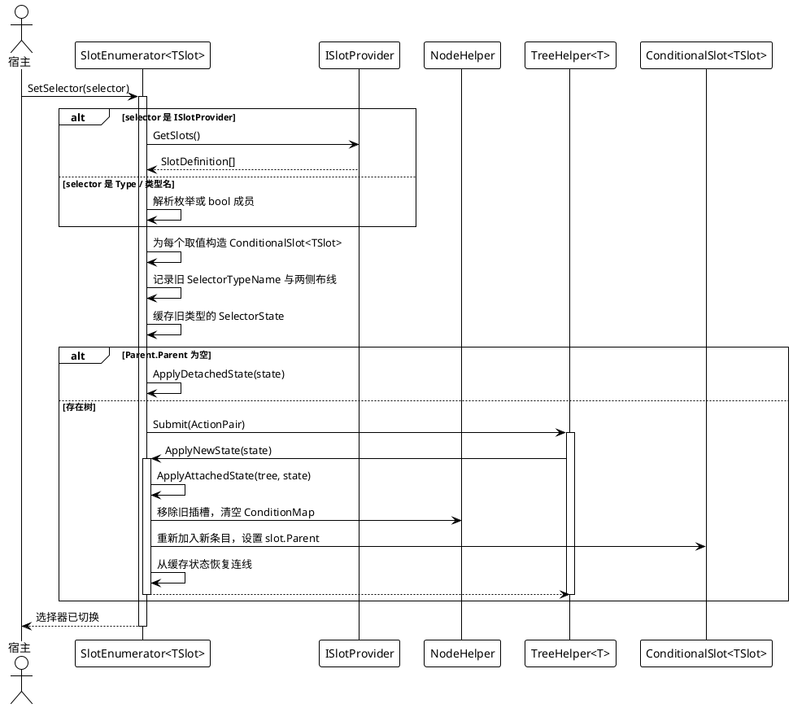

# 动态插槽枚举

`SlotEnumerator<TSlot>` 把一个选择器——枚举、`bool` 或 `ISlotProvider`——变成每个取值一个插槽。切换选择器会把整套插槽作为一次可撤销步骤替换，并把新分支接回旧分支原有的邻居。

## 正常流程：设置选择器



`SetSelector` 是唯一入口。它构建条目列表、按选择器类型名捕获旧状态，然后提交替换：

```csharp
var tree = Parent.Parent;
if (tree is null)
{
    ApplyDetachedState(newState);
    return;
}

tree.GetHelper().Submit(new ActionPair(
    () => ApplyNewState(tree, newState, isFresh ? previousSelectorTypeName : null, isFresh ? previousWiring : null),
    () => ApplyAttachedState(tree, oldState)));
```

> 来源：`Src/Core/VeloxDev.Core/WorkflowSystem/SelectorEx/SlotEnumerator.cs` 第 413-423 行。

`ApplyAttachedState` 先移除触及当前插槽的每条连线、把每个插槽从节点上摘下，再从缓存状态重建 `ConditionMap` 与 `Items`。它先设 `SelectorType` 再设 `SelectorTypeName`，确保刷新派生值的消费者看到新类型。

```csharp
SelectorType = state.Type;
SelectorTypeName = state.TypeName;
ConditionMap.Clear();

Items.Clear();
foreach (var item in state.Items)
{
    if (item.Value is not null)
        ConditionMap[item.Value] = item.Slot;
    Items.Add(item);
}
```

> 来源：`Src/Core/VeloxDev.Core/WorkflowSystem/SelectorEx/SlotEnumerator.cs` 第 569-579 行。

## 插槽注册

向 `Items` 添加条目会把插槽注册到父节点。节点未挂载时直接添加；已挂载时走 `CreateSlotCommand`，因此这次添加是一次可撤销步骤。

```csharp
if (!_isDeserializing && Parent is { } parent)
{
    if (parent.Parent is null)
        parent.StandardCreateSlot(item.Slot);
    parent.CreateSlotCommand.Execute(item.Slot);
}
```

> 来源：`Src/Core/VeloxDev.Core/WorkflowSystem/SelectorEx/SlotEnumerator.cs` 第 114-126 行。

## 路由查找

`TrySelect` 只是对当前 `conditionMap` 的字典查找；不分配，也不遍历条目列表。

```csharp
public bool TrySelect(object value, out TSlot? slot)
{
    return conditionMap.TryGetValue(value, out slot);
}
```

> 来源：`Src/Core/VeloxDev.Core/WorkflowSystem/SelectorEx/SlotEnumerator.cs` 第 279-282 行。

`NormalizeValue` 把外来值映射到当前选择器类型：枚举按名称解析，其余走 `Convert.ChangeType`；转换失败返回原值而不是抛异常。

> 来源：`Src/Core/VeloxDev.Core/WorkflowSystem/SelectorEx/SlotEnumerator.cs` 第 133-160 行。

## 错误与边界路径

- **未安装**：`Parent` 为空时 `SetSelector` 调用 `WorkflowGuard.Fail`。
- **无法解析选择器**：无法解析的类型名，或既非枚举也非 `bool` 的类型，会命中 `Debug.Fail` 并直接返回，不改变集合。
- **类型相同**：再次选择当前枚举类型会提前返回，不重建集合。
- **provider 复用**：`ISlotProvider` 以实例而非类型为键，新 provider 不会继承旧 provider 的缓存插槽。
- **布线恢复**：`Targets` 与 `Sources` 都会重放。只恢复 `Targets` 会静默丢掉所有喂给重建输入集的连线。
- **重入保护**：`_isApplyingState`、`_isDeserializing`、`_isDeduplicating` 防止集合回调在状态安装期间重建状态。

> 来源：`Src/Core/VeloxDev.Core/WorkflowSystem/SelectorEx/SlotEnumerator.cs` 第 260-276、285-362、399-457、683-686 行；`Src/Core/VeloxDev.Core/WorkflowSystem/SelectorEx/ConditionalSlot.cs` 第 24-34 行；`Src/Core/VeloxDev.Core/Interfaces/WorkflowSystem/Providers/ISlotProvider.cs` 第 16-23 行。
