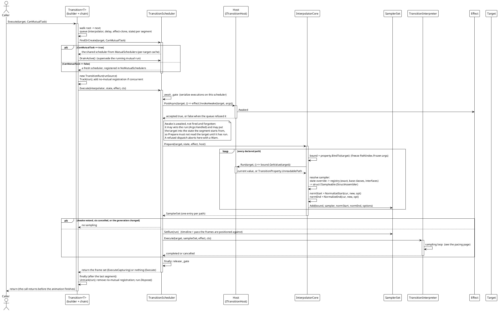
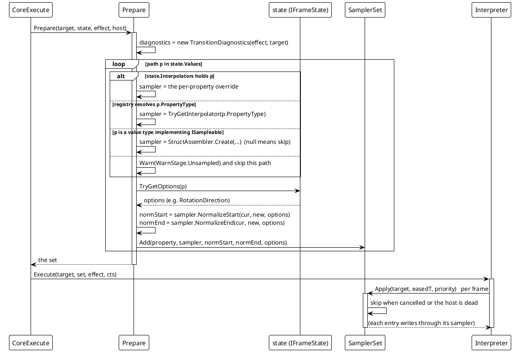
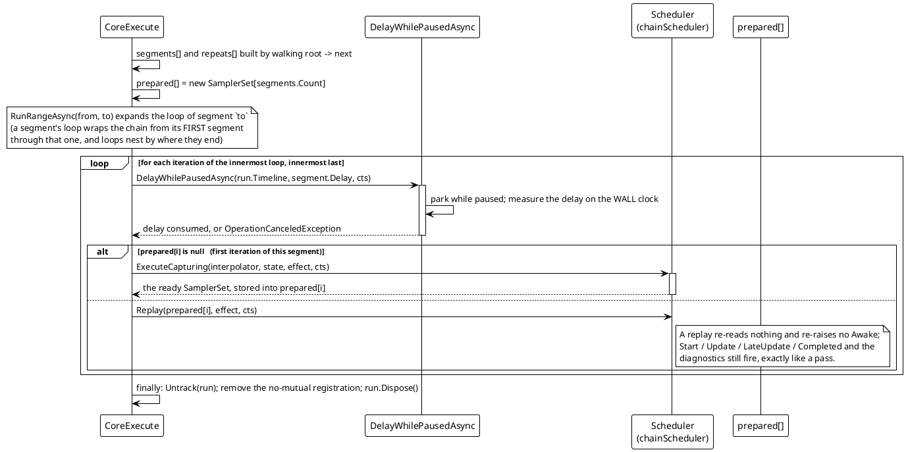

# 数据流 — 过渡动画：运行生命周期

从流式构建器到最后一帧的一次 `Execute` 调用。有特色的一步是 `Prepare`：解释器从不触碰已声明的状态，只触碰 `Prepare` 产出的 `SamplerSet`，而那个集合就是本引擎中「状态快照」的含义 —— 每条声明路径一个条目，各自持有采样器与两个**归一化端点值**。

## (a) 一次运行，一个段

> 源：`Src/Core/VeloxDev.Core/TransitionSystem/Effects/Transition.cs`（`CoreExecute`、`ExecuteCoreAsync`、`RunSegmentAsync`）、`TransitionScheduler.cs`（`FindOrCreate`、`ExecuteCore`、门、代际、`Track`/`Untrack`）、`Interpolator.cs`（`Prepare`）、`SamplerSet.cs`。

## (b) 准备好的状态是什么

`Prepare` 是唯一读取目标的地方。其后的所有东西都基于产出的 `SamplerSet<TPriorityCore>` 工作，其条目恰好是 `(property, sampler, normalizedStart, normalizedEnd, options)`，外加惰性创建的 `working` 暂存：

> 源：`Src/Core/VeloxDev.Core/TransitionSystem/Sampling/Interpolator.cs`（`Prepare<TPriorityCore>`）、`SamplerSet.cs`（`Add`、`Apply`、`CanSetValue`）、`StructAssembler.cs`。

关于这个集合的三件事让引擎其余部分保持简单：

- **它在一趟运行内固定。** 已声明值与采样器只解析一次；一帧从不重读状态、重新解析路径或重新解析类型。这就是 `Repeat` 能*重放*首次迭代准备的集合并得到完全相同动画的原因。
- **端点已经归一化。** `NormalizeStart` / `NormalizeEnd` 用起点、终点与选项各跑一次；帧路径只对它们求值一个缓动时间。
- **准备不了的路径被跳过，而非致命。** `UnreadablePath`（路径不匹配此目标的运行时类型）与「解析不到采样器」都产生一次 `Warn` 和一个缺失条目 —— 集合其余部分仍动画。`StructAssembler` 返回 `null` 是同一结果。唯一*致命*的情况发生在更早、同步的 `Execute` 中：声明了引用类型路径却什么都解析不到时抛 `TransitionPathUnsampleableException`。

## (c) 分段链接与循环

> 源：`Src/Core/VeloxDev.Core/TransitionSystem/Effects/Transition.cs`（`RunSegmentAsync`、`RunBodyAsync`、`RunRangeAsync`、`DelayWhilePausedAsync`）、`TransitionScheduler.cs`（`ExecuteCapturing`、`Replay`）。

段间延迟按**墙钟**（`Stopwatch`）计量，而不是按时间源：速率为零会冻结源却不暂停它（`IsPaused` 仍为 false），按冻结时钟计量的延迟永远不会减少。采样循环刻意相反 —— 它用时间轴，因为在那里时间轴才决定动画走了多远。
