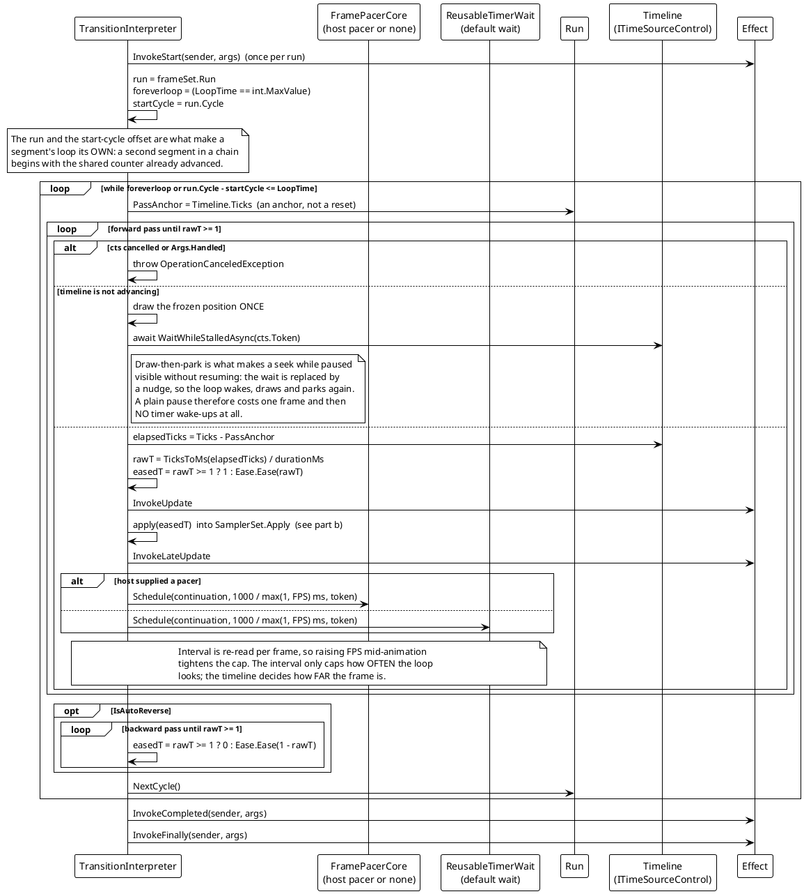
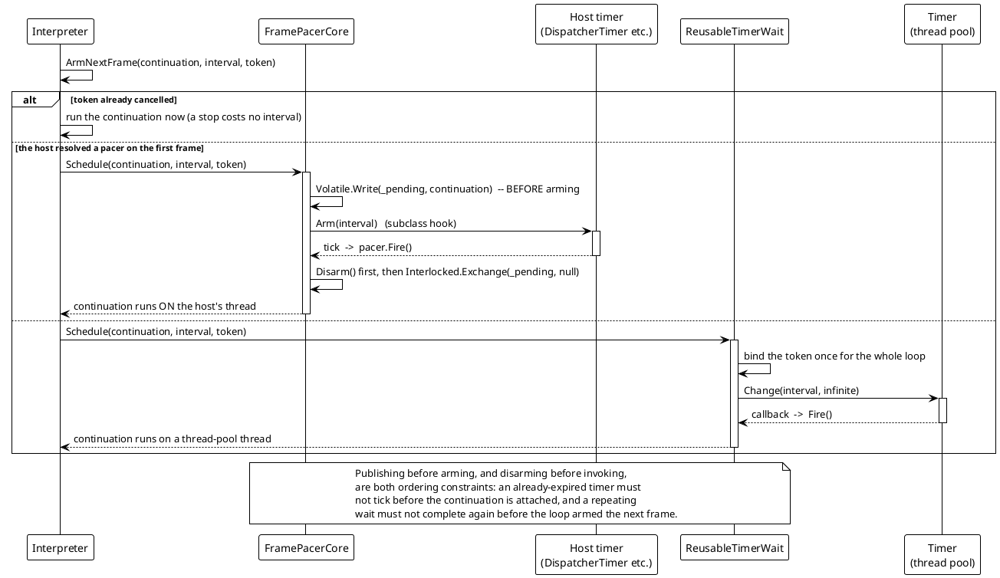
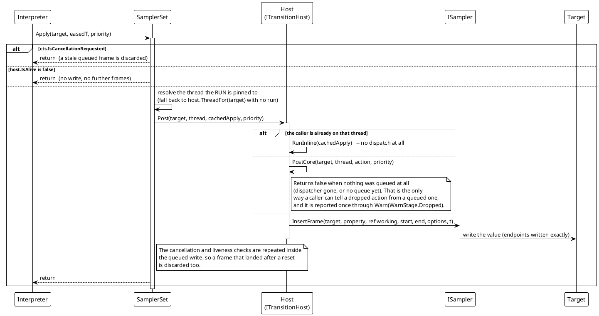

# 数据流 — 过渡动画：节拍与编组

每帧发生两件事：循环决定*何时*采样（节拍），以及每次采样的值在目标自己的线程上写入（编组）。它们是关注点不同、失败模式也不同的两件事，因此分开画。

## (a) 一趟：时间轴驱动的采样

> 源：`Src/Core/VeloxDev.Core/TransitionSystem/Runtime/TransitionInterpreter.cs`（`ExecuteSamplingLoopAsync`、`RunPassAsync`、`EmitFrame`、`ArmNextFrame`）、`FramePacerCore.cs`、`ReusableTimerWait.cs`、`TransitionRun.cs`。

承重的一行是 `run.PassAnchor = timeline.Ticks`。一趟是绝对时间轴上的**锚点**，绝不是重置 —— 因此多个运行可以共享一个源（各自保留自己的趟与位置），而 `Transition.Seek` 不过是写入另一个锚点。图里显示两个后果：一趟只在唯一位置结束（它的远端），因为时间轴只向前走；且一趟的最后一帧是**精确**端点（正向 `easedT = 1`、反向 `0`），与 `Ease(1)` 是否精确为 `1` 无关。

`FPS` 值得重申：它是*上限*，不是栅格。`ArmNextFrame` 每帧重读 `1000 / max(1, FPS)`，因此在运行中的动画上收紧上限会立即生效；晚醒只是画出更靠后的一帧。

## (b) 等待：宿主节拍器，否则一个复用的定时器

> 源：`Src/Core/VeloxDev.Core/TransitionSystem/Runtime/{FramePacerCore,ReusableTimerWait,TransitionInterpreter}.cs`、`Src/Adapters/*/PlatformAdapters/TransitionInterpreter.cs`。

为什么自定义 awaiter 不被编组回去：`FrameWait` 实现 `INotifyCompletion`，刻意**不**实现 `ICriticalNotifyCompletion`，因此构建器会流动调用方的 `ExecutionContext` —— 但恢复 `SynchronizationContext` 是 `Task` 的职责，所以自定义 awaiter 的续体在完成等待的任意线程上恢复。因此，在 UI 线程上启动的循环会在第一帧后漂到线程池线程，*除非宿主提供了节拍器*。这就是节拍接缝存在的全部理由，也是宿主必须从与写路径相同的答案推导节拍器的原因：与 `Post` 不一致的节拍器会把每一帧变成一次派发。

## (c) UI 线程跳跃

> 源：`Src/Core/VeloxDev.Core/TransitionSystem/Sampling/SamplerSet.cs`（`Apply`、`ApplyCore`、缓存闭包、`SetRun`）、`Src/Core/VeloxDev.Core/Threading/ThreadDispatcherBase.cs`、`Src/Adapters/*/PlatformAdapters/UIThreadInspector.cs`。

这个流程中有三个避免分配的决定：

- **缓动时间放在字段里，不是闭包里。** `Apply` 为每个目标保留一个缓存 `Action`，并用 `Interlocked.Exchange(ref _cachedTimeBits, BitConverter.DoubleToInt64Bits(t))` 存 `t`，因此每次采样编组零分配。
- **线程不逐帧重新推导。** 运行在调度器启动它时一次性钉住自己的 `ThreadRef`，因为写路径跑在采样循环的线程上，而那个线程对一个「答案取决于调用方」的宿主（Blazor 回路的 renderer）给不出答案。
- **检查在排队写入内部重复。** `ApplyCore` 重新检查 token 与存活标志，因为写入发生在消息被泵送时，而动画可能已在中间被取消；只在排队前检查会让已经过期的帧覆盖一次重置。
