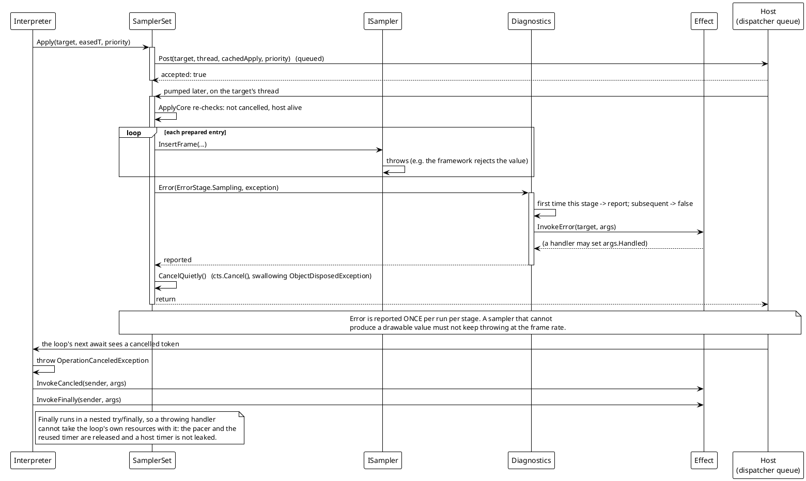
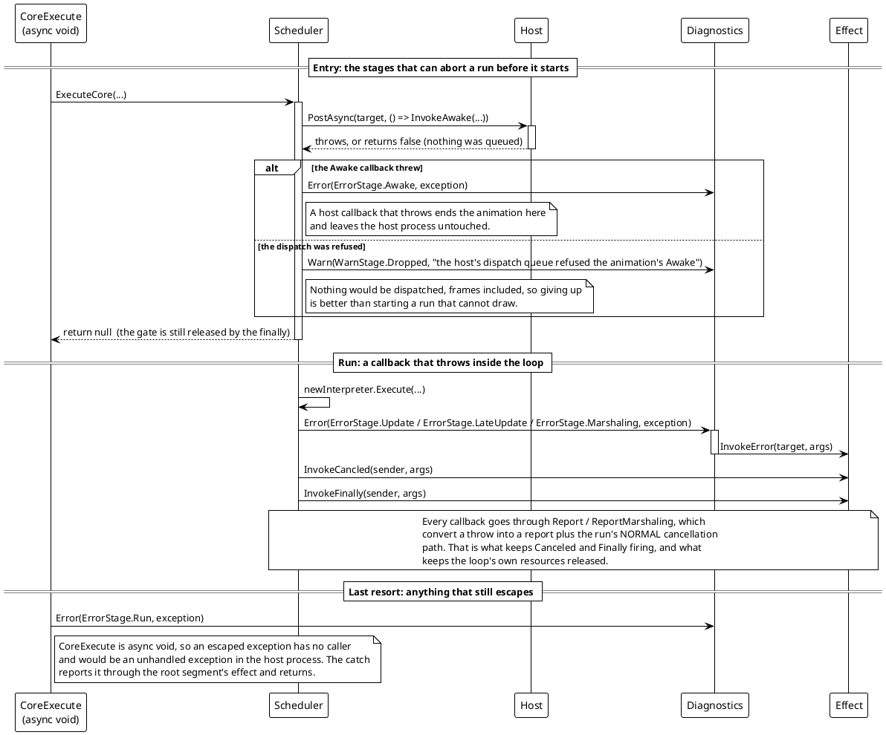

# 数据流 — 过渡动画：错误路径

引擎的失败模式是**沉默**：采样器在 UI 线程的 dispatcher 回调里运行，那里无人捕获，而 `Execute` 是 `async void`，没有调用方能接收抛出。设计答案是单一内部中介（`TransitionDiagnostics`）与循环无条件保持的一条规则：*异常绝不离开循环；它变成一次报告，然后运行沿正常取消路径收尾。*

## (a) 帧中途抛异常的采样器

> 源：`Src/Core/VeloxDev.Core/TransitionSystem/Sampling/SamplerSet.cs`（`ApplyCore`、`CancelQuietly`）、`TransitionDiagnostics.cs`、`TransitionInterpreter.cs`（`ExecuteSamplingLoopAsync`、`Report`、`ReleaseLoopResources`）。

两个细节值得说明：

- **异常不传播，token 被*安静地*取消。** `CancelQuietly` 吞掉 `ObjectDisposedException`，因为动画或适配器可能已经释放了 token 源 —— 没有可取消的东西，这不是新的失败。
- **`Error` 每个阶段只上报一次。** `TransitionDiagnostics` 持有逐实例的 `HashSet<ErrorStage> _reported` / `HashSet<WarnStage> _warned`；已上报的阶段返回 `false`。这阻止逐帧条件产生逐帧日志，也是报告命名*阶段*而不是帧的原因。

## (b) 抛异常的回调，以及入口处会中止的阶段

> 源：`Src/Core/VeloxDev.Core/TransitionSystem/Runtime/TransitionScheduler.cs`（`ExecuteCore`）、`Transition.cs`（`CoreExecute`）、`TransitionInterpreter.cs`（`Report`、`ReportMarshaling`、`ExecuteSamplingLoopAsync` 的 catch 子句）。

## (c) 操作者实际看到的诊断

每次报告都是一个带类型的 `TransitionEventArgs<TStage, TValue>`，其 `Stage` 是 `ErrorStage` 或 `WarnStage` 值，因此一行日志就命名了失败步骤，无需重跑：

| `Stage` | 以何上报 | 含义 |
|---|---|---|
| `ErrorStage.Awake` | `Error` | `Awaked` 处理器抛出；运行在准备前中止 |
| `ErrorStage.Prepare` | `Error` | 归一化抛出；运行中止 |
| `ErrorStage.Update` / `ErrorStage.LateUpdate` | `Error` | 某个 effect 回调抛出；该趟结束 |
| `ErrorStage.Marshaling` | `Error` | 宿主的写路径（`Apply`）抛出 |
| `ErrorStage.Sampling` | `Error` | 某个 `ISampler.InsertFrame` 抛出；运行被安静取消 |
| `ErrorStage.Run` | `Error` | 有东西逃出了循环自己的 catch —— `async void` 的最后防线 |
| `ErrorStage.Start` / `Completed` / `Canceled` / `Finally` | `Error` | 该生命周期事件的某个订阅者抛出 |
| `WarnStage.Dropped` | `Warn` | 宿主拒绝一帧，或拒绝 `Awake` 派发 |
| `WarnStage.Unreadable` | `Warn` | 某声明路径不匹配目标运行时类型；跳过 |
| `WarnStage.Unsampled` | `Warn` | 某声明路径解析不到采样器；跳过 |

`Warn` / `Error` 处理器与生命周期事件一样由 `WeakDelegate` 支撑，在其内部置 `Handled = true` 要求终止运行 —— 这是诊断被允许*改变*行为的唯一地方。没有处理器时报告仍会到达 `Debug.WriteLine`，因此在调试器里静默降级的运行仍可见。
