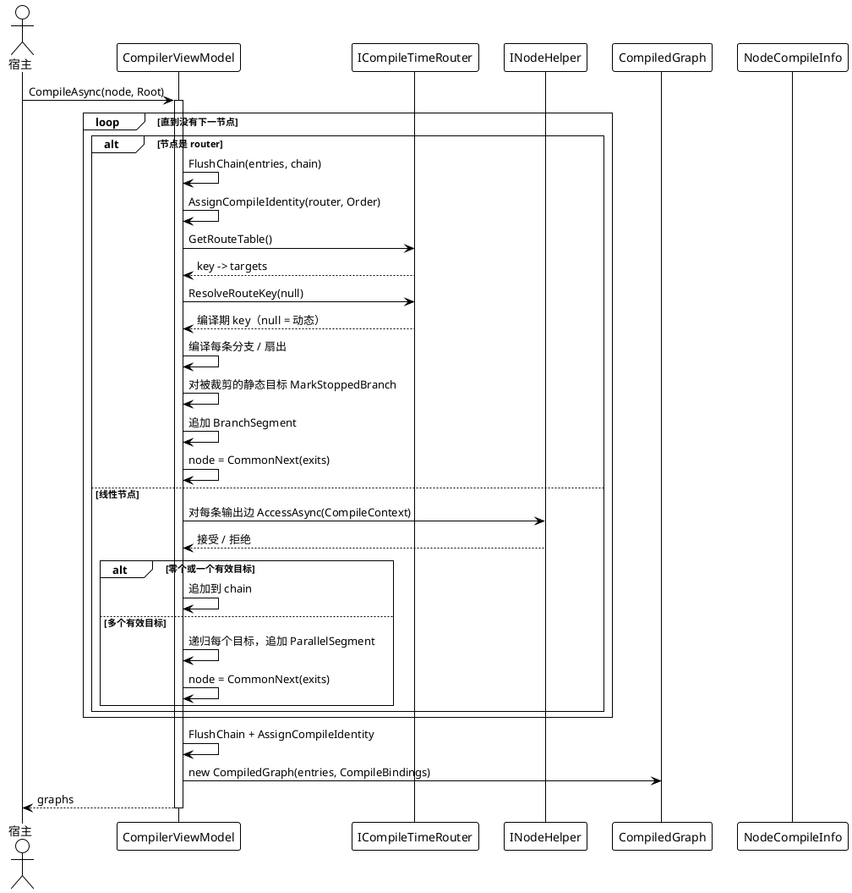
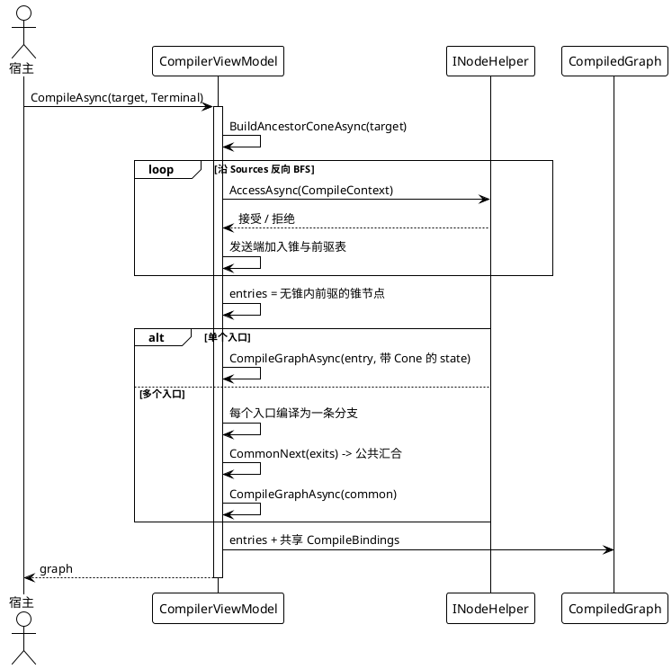

# 工作流编译器

`CompilerViewModel.CompileAsync` 把一个节点可达的图变成 `CompiledGraph`：由链段、分支段、并行段组成的有序列表。编译产物描述所有可能路径，运行时选择其中一条。

## 入口

```csharp
public async Task<IReadOnlyList<CompiledGraph>> CompileAsync<T>(
    T component, CompileRole role, CancellationToken ct = default)
    where T : IWorkflowComponent
{
    if (component is not INodeComponent node)
        throw new ArgumentException(
            $"CompileAsync requires an INodeComponent as the {role} node; received {component?.GetType().Name}.");

    CompiledGraph graph = role switch
    {
        CompileRole.Root => await CompileGraphAsync(node, new CompileState(), ct).ConfigureAwait(false),
        CompileRole.Terminal => await CompileConeAsync(
            node, await BuildAncestorConeAsync(node, ct).ConfigureAwait(false), ct).ConfigureAwait(false),
        _ => throw new ArgumentOutOfRangeException(nameof(role), role, null),
    };
```

> 来源：`Src/Core/VeloxDev.Core/WorkflowSystem/CompilerEx/Compile/CompilerViewModel.cs` 第 38-52 行。

## 根编译



线性遍历把多输入节点当作汇合边界：停下并交回父图从它继续，因此边界节点不会被子的遍历标记为已访问。

```csharp
if (!ReferenceEquals(node, start) && !resumedAfterBranch && HasMultipleInputs(node, state.Cone))
    break;

if (!state.Visited.Add(node))
    break;
```

> 来源：`Src/Core/VeloxDev.Core/WorkflowSystem/CompilerEx/Compile/CompilerViewModel.cs` 第 74-79 行。

每个进入编译产物的节点都会得到 `NodeCompileInfo`，且所有嵌套图共享同一份绑定表实例。

```csharp
var info = new NodeCompileInfo(
    order,
    chainIndex,
    offset,
    state.JoinInputs.TryGetValue(node, out var inputs) ? inputs : null);

state.Bindings[node] = info;

if (node is ICompileTimeAware aware)
{
    try
    {
        aware.AttachCompileTimeContext(new CompileContext
        {
            Order = info.Order,
            ChainIndex = info.ChainIndex,
            Offset = info.Offset,
            InputNodes = info.InputNodes,
        });
    }
    catch (Exception)
    {
    }
}
```

> 来源：`Src/Core/VeloxDev.Core/WorkflowSystem/CompilerEx/Compile/CompilerViewModel.cs` 第 272-298 行。

节点上的副本只是通知。权威身份留在 `CompiledGraph.CompileBindings`，因此既不实现 `ICompileTimeAware` 也不实现 `ICompileTimeRouter` 的节点仍然参与汇合与重定向。

> 来源：`Src/Core/VeloxDev.Core/WorkflowSystem/CompilerEx/Compile/Model/CompiledGraph.cs` 第 19-47 行。

## 终端编译

`CompileRole.Terminal` 编译目标的祖先锥。`BuildAncestorConeAsync` 沿 `Sources` 反向遍历，只保留发送端 `AccessAsync` 接受的边。`CompileConeAsync` 从锥的入口前沿开始编译；多个独立生产者会变成一个 `ParallelSegment` 后接公共汇合。



> 来源：`Src/Core/VeloxDev.Core/WorkflowSystem/CompilerEx/Compile/CompilerViewModel.Reverse.cs` 第 34-135 行。

## 错误路径

- **组件类型错误**：参数不是 `INodeComponent` 时 `CompileAsync` 抛 `ArgumentException`。
- **未知 role**：switch 抛 `ArgumentOutOfRangeException`。
- **锥内分支歧义**：同一 router 有多条分支能到达终端时，`RestrictRouteToCone` 抛 `InvalidOperationException`；单次前向运行不可能走两条分支，编译器拒绝而不是猜测。
- **无公共汇合**：锥内独立生产者没有在目标之前汇合到同一 join 时，`CompileConeAsync` 抛 `InvalidOperationException` 并指出目标。
- **节点通知失败**：`ICompileTimeAware.AttachCompileTimeContext` 抛出的异常被吞掉；产物已经完整，显示侧问题不应让编译失败。

> 来源：`Src/Core/VeloxDev.Core/WorkflowSystem/CompilerEx/Compile/CompilerViewModel.cs` 第 42-52、283-298 行；`Src/Core/VeloxDev.Core/WorkflowSystem/CompilerEx/Compile/CompilerViewModel.Reverse.cs` 第 110-116、342-349 行。

## 段模型

| 段 | 持有 | 运行时含义 |
|---|---|---|
| `ChainSegment` | 有序节点列表 | 逐个驱动节点 |
| `BranchSegment` | router、options、`IsDynamic`、`CompileKey` | 驱动 router，再走 key 匹配的选项 |
| `ParallelSegment` | 子图 | 扇出组，在公共下一节点前汇合 |

> 来源：`Src/Core/VeloxDev.Core/WorkflowSystem/CompilerEx/Compile/Model/ChainSegment.cs` 第 7-14 行；`.../BranchSegment.cs` 第 8-26 行；`.../ParallelSegment.cs` 第 6-15 行。
