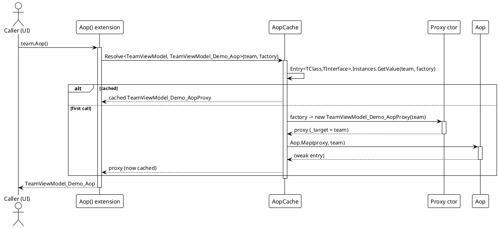
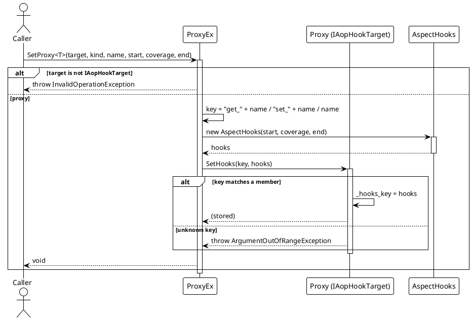
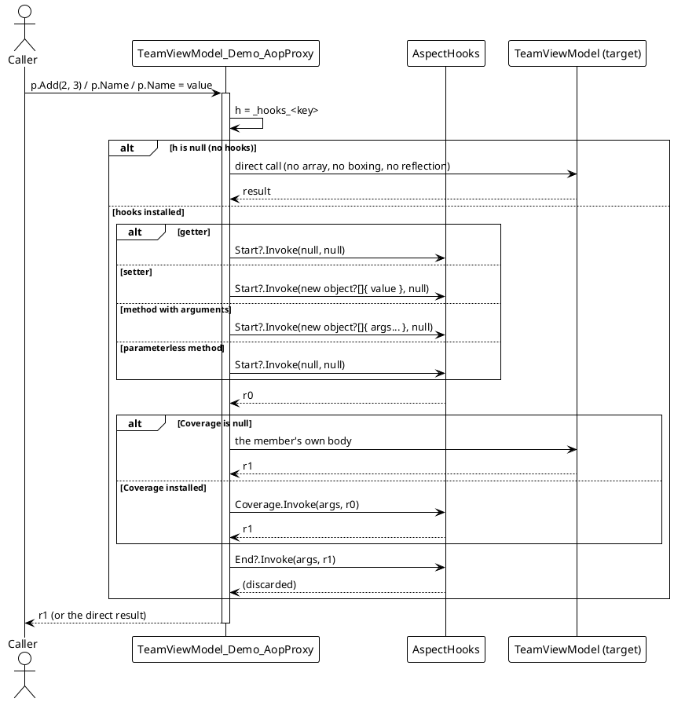

# 数据流 — AOP

三条流程：**取得代理**、**安装钩子**、**被拦截的调用**。示例取自 `Examples/AOP/WPF/Demo`，其生成的代理是 `TeamViewModel_Demo_AopProxy`。

## 1. 取得代理 —— `Aop()`

生成的扩展是唯一入口。`AopCache` 对每个目标只执行一次工厂；后续调用返回缓存代理。



代理用 `new` 构造，而不是经由某个工厂 API。生成的扩展是：

```csharp
var p = new global::VeloxDev.AopInterfaces.AopFixture_VeloxDev_Core_Test_AspectOriented_AopProxy(x);
global::VeloxDev.AspectOriented.Aop.Map(p, x);
return p;
```

（由 `AopWriter.WriteExtension` 发射；这里以 `AopFixture` 展示，每个目标的形态相同。）

## 2. 安装钩子 —— `SetProxy`



`SetHooks` 是生成代理上的显式接口实现；其 `switch` 为每个可拦截访问器准备一个分支。再次安装会替换字段 —— 旧的 `AspectHooks` 被丢弃，不会组合。

## 3. 被拦截的调用

每个生成成员都是同一套两分支形态：**无钩子**直接调用目标；**有钩子**运行链。



对应 `MainWindow.xaml.cs` 中的 Demo 注册：

| 调用 | 注册的阶段 | 发生什么 |
|---|---|---|
| `p.Name` | getter `start` | 记录读取；方法体仍运行并返回值 |
| `p.Name = "..."` | setter `end` | 方法体写入；`end` 读取 `args[0]` |
| `p.Reset()` | method `coverage` | 方法体不运行；返回 `coverage` 的 `null` 结果 |
| `p.Members.Add(...)` | `AOP_OnMemberAdded` 的 `end` | 集合事件重新进入 `this.Aop()`；方法体运行后由 `end` 报告新成员 |

### 事件驱动的重入

`TeamViewModel` 在构造函数中订阅自己的集合，并经由代理转发（`Examples/AOP/WPF/Demo/TeamViewModel.cs`）：

```csharp
private void OnMemberAdded(object? sender, NotifyCollectionChangedEventArgs e)
{
    this.Aop().AOP_OnMemberAdded(sender, e);
}
```

`this.Aop()` 是同一个缓存代理，因此通知路径与直接调用一样被拦截。方法体仍会运行（未注册 `coverage`），Demo 的 `end` 钩子随后检查 `parameters[1]` —— 即 `NotifyCollectionChangedEventArgs`。

## 4. 错误与边界路径

| 路径 | 触发条件 | 结果 |
|---|---|---|
| 不是代理 | 在手写的 `IAspectOriented` 上调用 `SetProxy` | 在任何状态改变之前抛 `InvalidOperationException` |
| 未知成员 | `SetProxy(..., "NoSuchMember", ...)` | `SetHooks` 抛 `ArgumentOutOfRangeException` |
| 钩子抛异常 | 任一非空阶段 | 原样传播；后续阶段被跳过 |
| `coverage` 对值类型返回 `null` | 如 `int` 成员 | 生成的拆箱处抛 `NullReferenceException` |
| `coverage` 返回错误类型 | 任意成员 | 生成的转换处抛 `InvalidCastException` |
| 目标成员抛异常 | 方法体或直接调用 | 原样传播 —— 不包成 `TargetInvocationException` |
| 无钩子 | 任意成员 | 直接调用；自身没有额外异常面 |

没有反射包装是相对旧 `MethodInfo.Invoke` 设计的实际行为改进：调用方捕获到的就是目标抛出的异常类型。

> 源码：`Src/Core/VeloxDev.Core/AspectOriented/{Aop,AopCache,ProxyEx,AspectHooks}.cs`、`Src/Generators/VeloxDev.Core.Generator/{AopSurface,AopProxy}.cs`、`Writers/AopWriter.cs`、`Src/Core/VeloxDev.Core.Test/AspectOriented/AopProxyTests.cs`、`Examples/AOP/WPF/Demo/{TeamViewModel.cs,MainWindow.xaml.cs}`。
