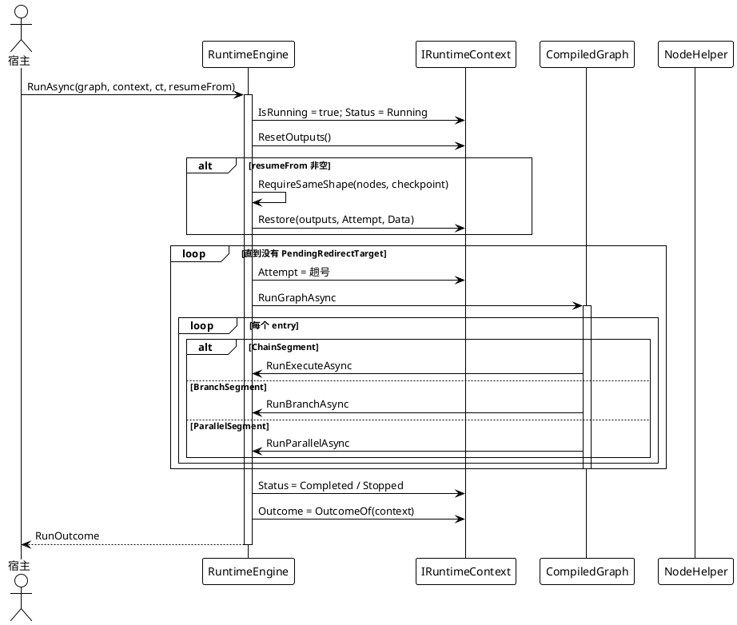

# 执行循环

`RunAsync` 先准备会话，然后反复对整张图跑一趟，直到没有任何一趟请求重定向。每趟把每个入口分派给链、分支或并行驱动器。

## 正常流程



趟循环刻意保持统一：重定向实现为“从目标 Order 重跑整张图”，而不是嵌套续体。

```csharp
while (true)
{
    context.Attempt = resumeFrom is null ? redirects + 1 : resumeFrom.Attempt + redirects;
    if (redirects == 0)
        await ObserveAsync(session, context, ExecutionObservationKind.RunStarted, null, null, TimeSpan.Zero, ct);
    context.PendingRedirectTarget = null;
    if (redirects > 0) context.Data = passSeed;
    context.ActiveRedirectTarget = redirectTarget;
    var terminated = await RunGraphAsync(graph, context, bindings, ct, redirectTarget, redirects == 0 ? done : null);
    if (!terminated && context.PendingRedirectTarget is { } next)
    {
        redirects++;
        if (redirects > MaxRedirects) { /* 以错误结束运行 */ }
        redirectTarget = next;
        continue;
    }
    break;
}
```

> 来源：`Src/Core/VeloxDev.Core/WorkflowSystem/CompilerEx/Runtime/RuntimeEngine.cs` 第 94-124 行。

## 驱动一个节点

`DriveAsync` 是唯一调用 `ReceiveAsync` 的地方。它应用暂停门、记录编译序、注入汇合输入、登记产物，并把值交给下一节点。

```csharp
var result = await node.GetHelper().ReceiveAsync(context, ct);

if (ReportedLevel(context, session) == ExecutionReportLevel.Error) result = null;

context.RegisterOutput(node, result);
context.Data = result;
await ObserveAsync(session, context, ExecutionObservationKind.NodeSucceeded, node, null, ElapsedSince(startedAt), ct);
await SaveCheckpointAsync(session, context, ct);
return;
```

> 来源：`Src/Core/VeloxDev.Core/WorkflowSystem/CompilerEx/Runtime/RuntimeEngine.cs` 第 574-583 行。

汇合点收到的是 `GroupData` 而不是链式值。编译器把输入节点记在 `NodeCompileInfo.InputNodes`，引擎用本趟登记的产物构建字典。

```csharp
if (info?.InputNodes is { Count: > 1 } inputs)
    context.Data = new GroupData(context.CollectGroupedInputs(inputs));
```

> 来源：`Src/Core/VeloxDev.Core/WorkflowSystem/CompilerEx/Runtime/RuntimeEngine.cs` 第 568-572 行。

## 分支与并行分派

- **分支**：驱动 router（除非它在重定向目标之前），静态分支使用 `CompileKey`，动态分支调用 `ResolveRouteKey(context)`，再走匹配选项的子图。选项缺失或为终端时，运行作为正常完成结束。
- **并行**：源载荷复制给每条分支；每条分支在自己的 `BranchRuntimeContext` 上运行，因此载荷、重定向请求与报告级别都是分支私有的。分支以异步操作并发启动，用 `Task.WhenAll` 汇合；可选的 `MaxParallelBranches` 用信号量限制一组内的并发。
- **终端分支**：分支驱动器返回 `true` 会结束整次运行。

> 来源：`Src/Core/VeloxDev.Core/WorkflowSystem/CompilerEx/Runtime/RuntimeEngine.cs` 第 328-384、413-491 行。

## 重定向与失败

报 `Error`（或抛异常）的节点要么实现 `IRedirectable`，要么由宿主的 `HostRedirect` 回答。答案必须是失败节点的上游节点，用 `SearchReverseNodes` 证明而不是比较 Order；其 Order 成为 `PendingRedirectTarget`。没有有效答案时运行以 `EndedWithError = true`、状态 `-1` 结束。

```csharp
var targetOrder = NodeOrder(bindings, target);
if (targetOrder < 0 || targetOrder >= order || !IsUpstreamOf(node, target))
{
    context.Log($"Redirect target '{target.GetType().Name}' (Order {targetOrder}) is not an upstream compiled node; ignored.");
    continue;
}

context.PendingRedirectTarget = targetOrder;
break;
```

> 来源：`Src/Core/VeloxDev.Core/WorkflowSystem/CompilerEx/Runtime/RuntimeEngine.cs` 第 306-318 行。

- **取消**不是失败：`RunAsync` 捕获 `OperationCanceledException`，置 `Stopped`，只报告给错误汇。
- **重定向上限**：超过 50 次会置 `Stopped`、`EndedWithError = true`、上报失败并抛 `InvalidOperationException`。
- **router/重定向契约抛异常**：视为重定向阶段失败；运行结束而不是随便挑一条分支。
- **检查点形状不符**：`RequireSameShape` 在设置 `IsRunning` 之前抛出，会话不被触碰。

> 来源：`Src/Core/VeloxDev.Core/WorkflowSystem/CompilerEx/Runtime/RuntimeEngine.cs` 第 106-141、253-301、725-740 行。

## 结局

`RunOutcome` 是推导出来的，不是每条路径各自存储：`Completed` 来自状态 `Completed`，`Failed` 与 `Cancelled` 都来自 `Stopped`，由 `EndedWithError` 区分。

> 来源：`Src/Core/VeloxDev.Core/WorkflowSystem/CompilerEx/Runtime/Contracts/RunOutcome.cs` 第 24-37 行；`RuntimeEngine.cs` 第 714-722 行。
