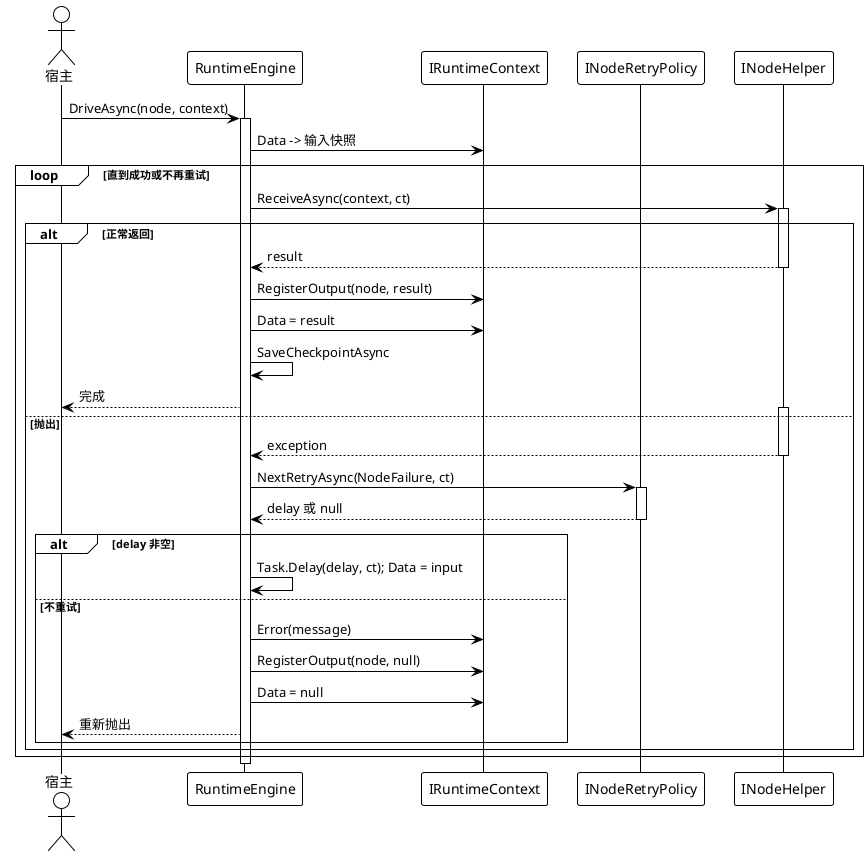

# 韧性与检查点

普通执行之外的每项能力都是可选的，并从具体 `RuntimeContext` 上读取。什么都不配置时，运行与这些能力出现之前完全一致：同样的日志行、同样的驱动次数。

## 可选能力

```csharp
public IExecutionGate? ExecutionGate { get; set; }
public IExecutionObserver? Observer { get; set; }
public INodeRetryPolicy? RetryPolicy { get; set; }
public IExecutionErrorSink? ErrorSink { get; set; }
public Func<IRuntimeContext, INodeComponent, INodeComponent?>? HostRedirect { get; set; }
public IExecutionCompensation? Compensation { get; set; }
public IExecutionCheckpointStore? CheckpointStore { get; set; }
public ILogWriter? LogWriter { get; set; }
```

> 来源：`Src/Core/VeloxDev.Core/WorkflowSystem/CompilerEx/Runtime/Model/RuntimeContext.cs` 第 148-199 行。

它们放在具体类而不是 `IRuntimeContext` 上，因为给那个契约加成员会破坏每个外部实现。引擎靠转型取得它们；宿主自带上下文只保留基线行为。

> 来源：`Src/Core/VeloxDev.Core/WorkflowSystem/CompilerEx/Runtime/RuntimeEngine.cs` 第 784-790 行。

## 暂停门

每个节点驱动前询问一次门，且在节点体内绝不打断。已经打开的门同步完成，不会让会话每过一个节点闪一次 `Paused`；关闭的门让驱动停下并置 `Status = "Paused"`，直到重新打开。

```csharp
if (session?.ExecutionGate is { } gate)
{
    var wait = gate.WaitAsync(ct);
    if (wait.IsCompleted)
    {
        await wait;
    }
    else
    {
        context.Status = "Paused";
        try { await wait; }
        finally { context.Status = "Running"; }
    }
}
```

> 来源：`Src/Core/VeloxDev.Core/WorkflowSystem/CompilerEx/Runtime/RuntimeEngine.cs` 第 516-529 行。

## 重试

只有抛出的异常会交给重试策略。通过 `Error()` 请求重定向的节点是在选择控制流，不是失败，因此不重试。首次尝试前会快照输入，每次重试前恢复。



```csharp
var delay = await NextRetryAsync(session, context, node, ex, failures, elapsed, ct);
if (delay is { } wait)
{
    context.Log($"[Retry {failures}] {node.GetType().Name}: {ex.Message}");
    await ObserveAsync(session, context, ExecutionObservationKind.NodeRetried, node, failures.ToString(), TimeSpan.Zero, ct);
    await Task.Delay(wait, ct);
    context.Data = input;
    continue;
}
```

> 来源：`Src/Core/VeloxDev.Core/WorkflowSystem/CompilerEx/Runtime/RuntimeEngine.cs` 第 595-604 行。

策略自己抛异常按“不再重试”处理；宿主的 bug 不应顶替节点原本的失败。

> 来源：`Src/Core/VeloxDev.Core/WorkflowSystem/CompilerEx/Runtime/RuntimeEngine.cs` 第 617-637 行。

## 观察者与错误汇

- 观察者接收运行、节点与分支观察。它不能改变运行：观察者抛异常只记日志并丢弃。
- 错误汇接收节点失败、router 失败、重定向失败与取消的结构化 `ExecutionError` 记录。汇抛异常只记日志并丢弃；报告失败不能反过来失败运行。
- 节点也可通过 `IRuntimeContext.ErrorAsync` / `WarnAsync` 主动上报；它们写日志并把记录交给汇。`Warn` 是提醒，`Error` 是停止。

> 来源：`Src/Core/VeloxDev.Core/WorkflowSystem/CompilerEx/Runtime/RuntimeEngine.cs` 第 640-711 行；`RuntimeContext.cs` 第 320-378 行。

## 补偿与检查点

补偿只在结局为 `Failed` 或 `Cancelled` 时运行，覆盖本次运行实际驱动过的节点，从最近到最早。撤不回来的节点只记日志并跳过，不掩盖最初的失败。

```csharp
if (session?.Compensation is not { } compensation) return;
if (outcome is not (RunOutcome.Failed or RunOutcome.Cancelled)) return;

var completed = session.CompletedThisRun;
for (var i = completed.Count - 1; i >= 0; i--)
{
    var (node, output) = completed[i];
    try
    {
        await compensation.CompensateAsync(new NodeCompensation(node, output, NodeOrder(bindings, node)), CancellationToken.None);
    }
    catch (Exception ex)
    {
        context.Log($"[Compensation] {node.GetType().Name} was not compensated: {ex.Message}");
    }
}
```

> 来源：`Src/Core/VeloxDev.Core/WorkflowSystem/CompilerEx/Runtime/RuntimeEngine.cs` 第 671-693 行。

每次成功驱动后写检查点。恢复时先校验节点键形状，再铺回 `Attempt`、`ActiveRedirectTarget`、`Data` 与已登记产物。已记录为完成的节点不再驱动；过滤按节点引用而不是 Order，因为扇出分支的 Order 是交错的。

- **形状不符**：在触碰会话之前抛出。
- **存储抛异常**：记为 `[Checkpoint]`，运行继续。
- **恢复的那一趟**：沿用检查点的 `Attempt`，之后的重定向从它递增。

> 来源：`Src/Core/VeloxDev.Core/WorkflowSystem/CompilerEx/Runtime/RuntimeEngine.cs` 第 69-83、207-213、725-775 行；`RuntimeContext.cs` 第 219-243、407-411 行。

## 日志写入器

`AppendLog` 在保留上限检查之前把行交给 `LogWriter`。写入器抛异常会触发 `LogWriteFailed` 并被丢弃，因为 `AppendLog` 运行在节点帧里，逸出的异常会被读成节点失败。

> 来源：`Src/Core/VeloxDev.Core/WorkflowSystem/CompilerEx/Runtime/Model/RuntimeContext.cs` 第 295-315 行。
