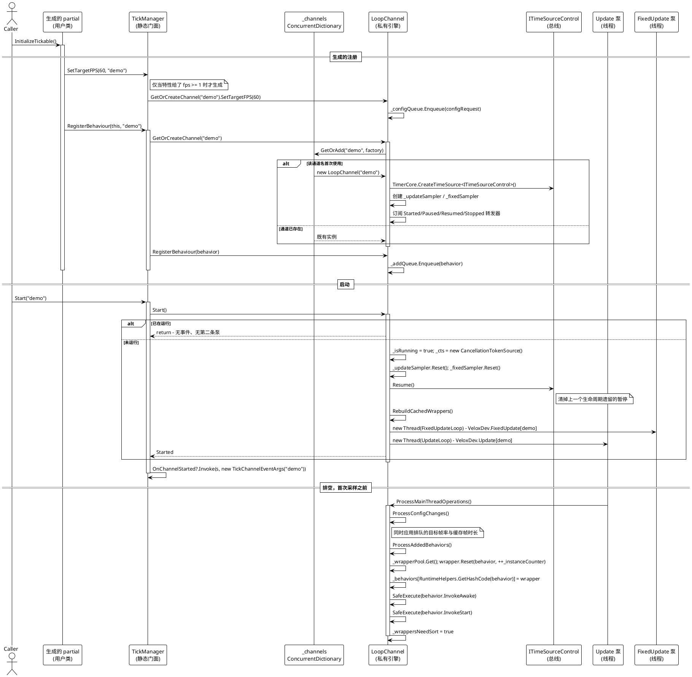

# 启动与注册

把类上的 `[Tickable]` 变成「该对象的 `Awake` 在第一帧之前运行」的流程。有两点不显然：注册是**入队**而非立即应用；排空发生在帧采样**之前**。



> 源码：`Src/Core/VeloxDev.Core/TimeLine/TickManager.cs` 第 276-330 行（Start）、432-435（RegisterBehaviour）、755-803（排空）、1019-1032（GetOrCreateChannel）、1068-1069（静态转发）；`Src/Generators/VeloxDev.Core.Generator/Writers/TickWriter.cs` 第 81-94 行。

## 顺序断言，精确表述

不变量是：**`Awake` 与 `Start` 在该通道的第一帧之前运行。**

机制不是「先注册再启动」，而是 `ProcessMainThreadOperations` —— 其中包含 `ProcessAddedBehaviors` —— 在 update 循环体顶部、`_updateSampler.Sample()` **之前**被调用：

```csharp
// Src/Core/VeloxDev.Core/TimeLine/TickManager.cs（第 530-541 行）
var frameStartTime = GetTimestamp();
ProcessMainThreadOperations();

// 无偿采样：总线没前进就没有帧可推。
var sample = _updateSampler.Sample();
if (sample.Delta == TimeSpan.Zero)
{
    Sleep(TimeSpan.FromMilliseconds(MIN_SLEEP_MS), token);
    continue;
}

var frameArgs = CreateFrameEventArgs(sample.Delta, sample.Total);
```

所以两种顺序都成立：

| 调用方顺序 | 发生什么 |
|---|---|
| 先 `InitializeTickable()` 再 `Start(name)` | 队列在第一次迭代、首次采样之前排空。`Awake` → `Start` → 首个 `Update` |
| 先 `Start(name)` 再 `InitializeTickable()` | 队列在下一次迭代、该帧采样之前排空。仍然是 `Awake` → `Start` → `Update` |

WPF 示例依赖并测量这一点：`MainWindow.xaml.cs` 先注册、再设帧率、最后启动（第 45-52 行），`SimState.AwakeAtUpdateCount` 记录 `Awake` 运行时的 `Update` 计数器 —— 它是零，这是证据而不是断言。

## `Awake` / `Start` 与停止、重启

这张表常让人踩坑，附上每行背后的机制：

| 操作 | 重跑生命周期？ | 为什么 |
|---|---|---|
| `StopAsync` + `Start` | 否 | `StopAsync` 清的是*队列*（`ClearQueues`，第 956 行）并重置统计；行为字典存活，所以存活的注册在 `Start` 后继续被驱动，但不重跑 `Awake` / `Start`。只有停止时仍在队列里的注册会丢失 |
| `RestartAsync` | 否 | 同上 —— 它就是 `StopAsync` + 等待 + `Start` |
| `CloseTickable()` + `InitializeTickable()` | **是** | 从 `_wrapperPool` 取出新 wrapper，并在它上面运行 `InvokeAwake` / `InvokeStart` |

注意这种不对称：停止通道不会通知行为（`ITickable` 上没有「关闭」钩子），也不会移除已应用的注册；对仍在注册的实例再次注册会替换 wrapper 并重跑两个钩子。`MainWindow.xaml.cs` 第 105-119 行把两组按钮都暴露出来，让区别可见而不是靠断言。

## 失败与边界路径

- **`null` 行为。** `RegisterBehaviour` 会过滤它（`if (behavior != null)`，第 434 行），队列永远见不到。万一到达，排空也会再次跳过（`if (behavior == null) continue;`，第 792 行）。
- **重复注册。** `_behaviors` 以 `RuntimeHelpers.GetHashCode(behavior)` 为键，第二次注册覆盖第一个 wrapper。`Awake` 与 `Start` 仍会在新 wrapper 上再跑一遍。
- **对运行中的通道调用 `Start`。** 在第 278 行返回：没有新线程，没有第二个 `OnChannelStarted`。
- **在从未启动的通道上注册。** 条目留在 `_addQueue` 里直到有人调用 `Start`。它不会丢失，也不会自行开始。
- **`Awake` / `Start` 抛异常。** `SafeExecute` 捕获并写入 `Debug.WriteLine`；`InvokeStart` 仍会运行，排空仍会置 `_wrappersNeedSort`。
- **在 `StopAsync` 期间注册。** 队列在 `finally` 块中清空，所以停止完成时仍在队列里的注册会丢失。请在停止完成后重新注册；停止前已应用的注册仍然存在。
