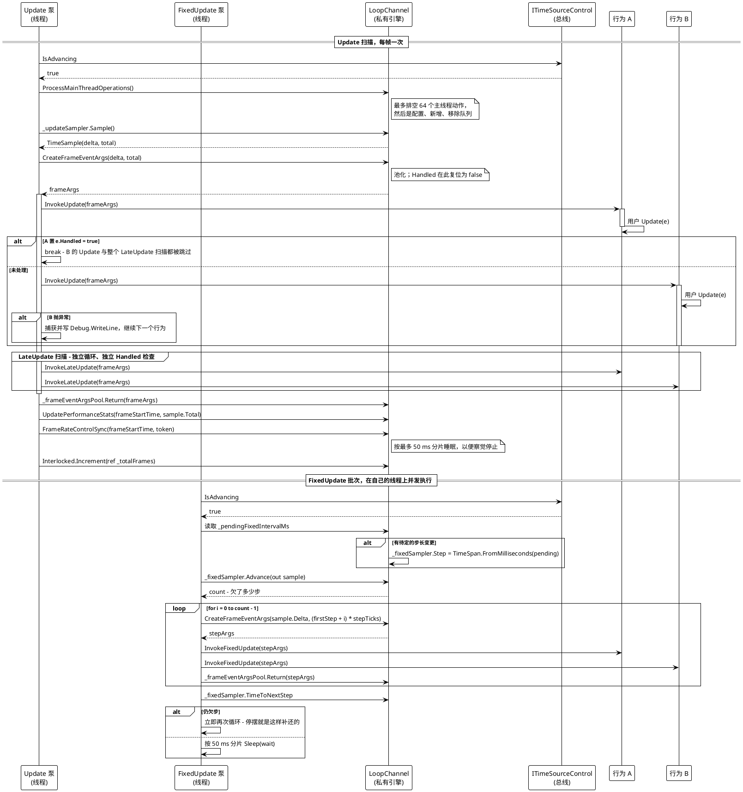

# 帧交付

稳态。update 线程上先一次 `Update` 扫描、再一次 `LateUpdate` 扫描；fixed-update 线程上独立的固定步批次。两者并发，异常路径按行为隔离。



> 源码：`Src/Core/VeloxDev.Core/TimeLine/TickManager.cs` 第 511-556 行（UpdateLoop）、448-509（FixedUpdateLoop）、691-736（三个派发循环）、826-835（CreateFrameEventArgs）、838-872（节拍与 Sleep）、916-928（统计）。

## 三个派发循环

三者形状相同：读取缓存数组、按索引遍历、在每个行为之前检查 `Handled` 与令牌、按行为隔离异常。

```csharp
// Src/Core/VeloxDev.Core/TimeLine/TickManager.cs（第 707-720 行）
private void ExecuteBehaviorsLateUpdateSync(FrameEventArgs frameArgs, CancellationToken token)
{
    var wrappers = GetCachedWrappers();
    for (int i = 0; i < wrappers.Length; i++)
    {
        if (frameArgs.Handled || token.IsCancellationRequested) break;
        var w = wrappers[i];
        if (w is { IsActive: true, Behavior: not null })
        {
            try { w.Behavior.InvokeLateUpdate(frameArgs); }
            catch (Exception ex) { Debug.WriteLine($"[{Name}] LateUpdate error: {ex.Message}"); }
        }
    }
}
```

| 循环 | 顺序 | 与谁共享 `frameArgs` | 中断条件 |
|---|---|---|---|
| `ExecuteBehaviorsUpdateSync` | 注册顺序 | `LateUpdate` | `Handled` \|\| 已取消 |
| `ExecuteBehaviorsLateUpdateSync` | 注册顺序 | `Update`（同一对象） | `Handled` \|\| 已取消 |
| `ExecuteBehaviorsFixedUpdateSync` | 注册顺序 | 无 —— 每步一个对象 | `Handled` \|\| 已取消 |

值得直说的后果：**`Handled` 在 `Update` 与 `LateUpdate` 之间共享，不与 `FixedUpdate` 共享。** `Update` 与 `LateUpdate` 收到同一个池化 `FrameEventArgs` 对象，所以 `Update` 里置起的标志在微秒后对 `LateUpdate` 循环可见。`FixedUpdate` 步在 fixed 循环内部构建自己的参数，永远看不到该标志。WPF 示例同时展示两半：球在每个固定步下继续走，而由 `LateUpdate` 定位的跟随环冻住（`MainWindow.xaml.cs` 第 199-214 行）。

## 两条泵的停摆路径

每个循环在做任何事之前先检查 bus：

```csharp
// Src/Core/VeloxDev.Core/TimeLine/TickManager.cs（第 470-474 行，fixed 泵；522-526 形状相同）
if (!_bus.IsAdvancing)
{
    _bus.WaitWhileStalledAsync(token).GetAwaiter().GetResult();
    continue;
}
```

线程版泵不能 `await`，所以同步阻塞在可等待对象上。代价是每个通道每条泵占用一个阻塞线程；收益是停摆期间零唤醒。异步泵（`UpdateLoopAsync` / `FixedUpdateLoopAsync`，第 624-684 / 559-622 行）用 `await` 做同样的事，所以 park 时完全不占线程 —— 这正是那条路径存在的全部理由。

`Thread.Sleep` 从不睡满整个间隔。`Sleep` 把等待切成 `MAX_SLEEP_CHUNK_MS`（50）并逐片重查令牌（第 864-872 行），所以即使目标帧率为 2 fps、帧预算半秒，停止也会在 50 ms 内被察觉。

## 补偿的差异

这是示例存在的意义所在。

| 泵 | 采样器 | 契约 |
|---|---|---|
| Update | `IUncompensatedTimeSampler` | 报告过去了多少。不欠账。钩子睡 300 ms 不会被补还 —— 采样早已完成，睡眠会以一次巨大的 `DeltaTime` 落在**下一帧** |
| FixedUpdate | `ICompensatingTimeSampler` | `Advance` 返回欠了多少整步（包括停摆期间错过的），有欠账时 `TimeToNextStep` 为零 —— 所以循环立即重跑并交付一批 |

示例为每条泵各配一个卡顿按钮和各自的观测量。`MainWindow.xaml.cs` 第 88-92 行与 `MainWindow.Hooks.cs` 第 72-83、141-153 行实现了它们；读数用 `HookNote.Slept`（本次调用睡了）与 `HookNote.AfterSleep`（本次调用承担后果）区分两种情况。

## 一次 `FixedUpdate` 唤醒实际交付什么

`FixedUpdateLoop` 的一次迭代可以交付多步，每步拿到自己步序号的总时间，而不是重复最后一次读数：

```csharp
// Src/Core/VeloxDev.Core/TimeLine/TickManager.cs（第 478-496 行）
var count = _fixedSampler.Advance(out var sample);
if (count > 0)
{
    // 每一步的 Total 是自己的步序号乘步长，而不是把最后一次的读数重复 N 遍。
    var stepTicks = _fixedSampler.Step.Ticks;
    var firstStep = sample.Step - count + 1;

    for (var i = 0; i < count; i++)
    {
        var fixedFrameArgs = CreateFrameEventArgs(
            sample.Delta,
            TimeSpan.FromTicks((firstStep + i) * stepTicks));
        ExecuteBehaviorsFixedUpdateSync(fixedFrameArgs, token);

        _frameEventArgsPool.Return(fixedFrameArgs);
    }
}
```

`TickableBusTests.FixedUpdatePushesTrackTheVirtualClockNotTheWakeCadence` 是这一性质的可执行陈述：4 倍速率下推送必须跟随虚拟时钟（`rate * elapsed / step`），而不是唤醒节奏。
