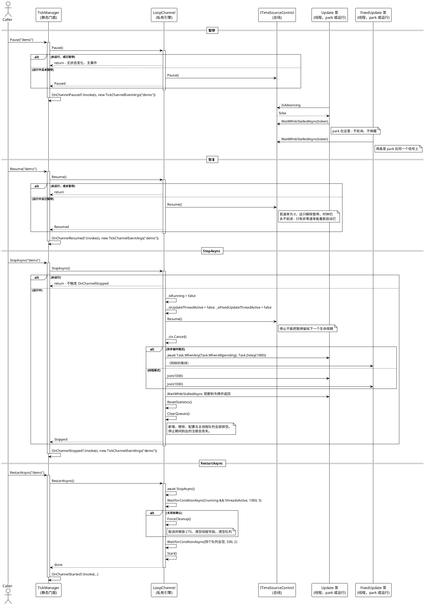

# 暂停、恢复与停止

这些迁移在不拆除通道的前提下停止并重新开始交付。流程不长，但状态很多：暂停活在共享时钟上，停止必须触达 park 住的泵，重启必须重新锚定时钟。

> 源码：`Src/Core/VeloxDev.Core/TimeLine/TickManager.cs` 第 331-377 行（StopAsync）、386-404（Pause/Resume）、406-432（RestartAsync）、444（TogglePause）、956-995（ClearQueues、ForceCleanup、WaitForConditionAsync）、1053-1066（静态转发）。

## 为什么 park 住的泵仍能被停止

这是设计必须解决的失败模式，固定它的测试是 `TickableBusTests.StoppingWhilePausedEndsTheChannel`：

> 停摆中的循环 park 在一个对令牌一无所知的等待上。不在这个等待里观察令牌的话，`StopAsync` 会一直等下去，然后 `ForceCleanup` 释放掉那个令牌源，异常从线程体里逃出去。

防止这种情况的契约在 `WaitWhileStalledAsync` 上 —— 它接受令牌，所以取消会传播*进* park。测试断言任务对 5 秒超时获胜。

## 每个迁移重置什么，不重置什么

| | `Pause` | `Resume` | `StopAsync` | `RestartAsync` |
|---|---|---|---|---|
| `_isRunning` | 不变 | 不变 | `false` | 先 `false` 后 `true` |
| bus 暂停标志 | `true` | `false` | `false`（清除） | 清除后不变 |
| bus 速率 | 不变 | 不变 | **不**清除 | **不**清除 |
| `TotalFrames` / `TotalTime` / `CurrentFPS` | 不变 | 不变 | 归零 | 重置后重新累计 |
| 行为注册 | 不变 | 不变 | **已应用的存活**；排队的丢弃 | **已应用的存活**；排队的丢弃 |
| 重跑 `Awake` / `Start` | 否 | 否 | 否 | **否** |
| 采样器 | 不变 | 不变 | 不变 | **重新锚定** |
| 触发事件 | `OnChannelPaused` | `OnChannelResumed` | `OnChannelStopped` | `OnChannelStopped` + `OnChannelStarted` |

表中有三条一旦忽略就会出问题：

- **速率 `0` 不是 bus 的暂停标志，`Resume` 与 `StopAsync` 都不清除它。** `SetTimeScale(0)` 冻结时钟；`StopAsync` 的 `_bus.Resume()` 只解除*暂停*。速率 0 下停止的通道会重启并立刻再次 park。示例把 `IsAdvancing` 打印在 `SystemStatus` 旁边，就是为了让两种状态在屏幕上可区分（`MainWindow.xaml.cs` 第 276-285 行）。
- **`StopAsync` 排空注册队列，但不清空已应用的注册。** `ClearQueues` 丢弃仍在 `_addQueue` 或 `_removeQueue` 中的行为；`_behaviors` 字典原封不动，所以已经排空过的行为在下次 `Start` 后继续被驱动 —— 且不重跑 `Awake` / `Start`。期望停止后行为脱离的宿主必须调用 `CloseTickable()` *并让移除操作在停止前排空*（或在重启后重新注册）。
- **`RestartAsync` 也不重跑 `Awake` / `Start`。** 唯一会重跑的路径是 `CloseTickable()` + `InitializeTickable()`。

## 保护的位置让事件诚实

每个处理器都写在保护*之后*，从不在之前。所以事件意味着「状态确实变了」，而保护定义了哪些迁移是静默的：

| 调用 | 何时被抑制 | 触发 |
|---|---|---|
| `Pause` | 未运行，或已暂停 | `OnChannelPaused` |
| `Resume` | 未运行，或未暂停 | `OnChannelResumed` |
| `TogglePause` | 未运行 | 上面两者之一，恰好一个 |
| `StopAsync` | 未运行 | `OnChannelStopped` |
| `Start` | 已在运行 | `OnChannelStarted` |

`TogglePause` 不可能两者都触发，因为它就是 `if (_bus.IsPaused) Resume(); else Pause();`（第 444 行），而这两个方法是唯一的触发者。

## 失败与边界路径

- **暂停中停止。** 见上，正常完成。
- **fixed 泵正在批次中间时停止。** 派发循环在每个行为顶部检查令牌（中断条件里的 `token.IsCancellationRequested`），所以长批次会在一个行为之内中止。
- **队列非空时停止。** `ClearQueues` 在 `finally` 块中排空四个队列，所以从未应用的注册与注销会被丢弃，而不是泄漏进下一个生命周期。
- **关闭未确认后重启。** `ForceCleanup` 是回退：取消并释放令牌源、清空线程与任务字段、清空队列。这是唯一可能在下次 `Start` 创建新泵时旧泵仍在运行的路径，所以它会向 `Debug.WriteLine` 写警告。
- **`RestartAsync` 的排空等待是尽力而为。** 它的 `WaitForConditionAsync` 结果被忽略；若 500 ms 后队列仍非空，`Start` 照常进行（`TickManager.cs` 第 422-427 行）。
- **`StopAsync` 永不 fault。** 泵的 join 包在 `try { … } catch (Exception) { }` 中，清理在 `finally`，所以即使泵失常，返回的任务也成功完成。
