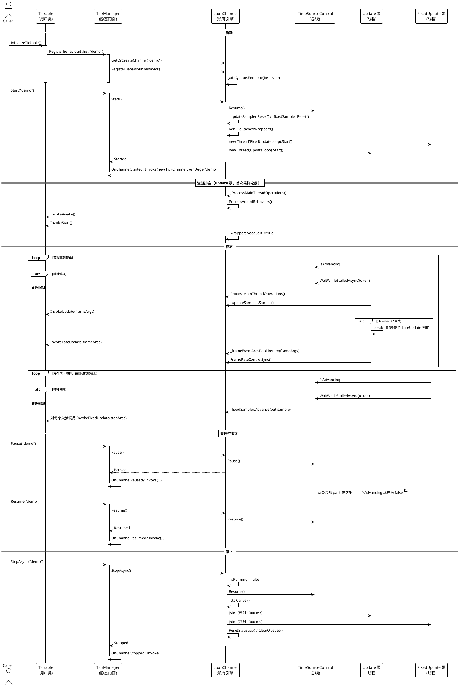

# 数据流 — Tickable

tickable 特性有一条包含三个阶段的调用链；按顺序阅读，因为每一阶段都改变下一阶段依赖的状态：

1. **启动与注册** —— 调用方启动通道并把行为入队；update 泵在采样之前排空队列，所以 `Awake` 与 `Start` 落在第一个 `Update` 之前。
2. **帧交付** —— 稳态：一次 `Update` 扫描、一次 `LateUpdate` 扫描，以及另一线程上独立的 `FixedUpdate` 批次。
3. **暂停、恢复与停止** —— 不拆除通道就停止并重新开始交付的迁移。

## 整个生命周期一张图

> 源码：`Src/Core/VeloxDev.Core/TimeLine/TickManager.cs` 第 276-330 行（Start）、331-377（StopAsync）、386-404（Pause/Resume）、432-440（注册）、511-556（UpdateLoop）、448-509（FixedUpdateLoop）、755-803（排空）、1019-1032（GetOrCreateChannel）、1050-1072（静态转发）。

## 按阶段划分的流程

| 子页 | 流程 | 图 |
|---|---|---|
| [启动与注册](00_启动与注册/index.md) | `InitializeTickable()` → `RegisterBehaviour` → `GetOrCreateChannel` → `Start` → 排空 → `InvokeAwake`/`InvokeStart` | PlantUML |
| [帧交付](01_帧交付/index.md) | 每帧 `InvokeUpdate` → `InvokeLateUpdate`、`Handled` 短路、并发的 `InvokeFixedUpdate` 批次，以及异常路径 | PlantUML |
| [暂停恢复与停止](02_暂停恢复与停止/index.md) | `Pause` / `Resume` / `TogglePause` / `StopAsync` / `RestartAsync`，包括 park 泵与暂停中停止的路径 | PlantUML |

## 什么跨过哪条边界

上面的流程只有在线程边界明确时才有意义。图中每个箭头都跨过四种边界之一：

| 从 → 到 | 机制 | 后果 |
|---|---|---|
| 调用方 → `LoopChannel` | `ConcurrentQueue<T>`（新增、移除、配置）或 `volatile` 字段 | 无锁；稍后应用，不在调用时 |
| Update 泵 → 行为 | 直接方法调用 | 同步；慢钩子会推迟该帧 |
| FixedUpdate 泵 → 行为 | 在自己的线程上直接方法调用 | 与 Update 并发；共享状态需自行加锁 |
| 泵 → bus | `ITimeSourceControl` | 暂停与速率被两条泵、以及同一时钟上的动画共同观察 |

这条链中**没有**的是任何向 UI 线程的封送。`ExecuteOnMainThread` 的目标是 update 泵，而在钩子里阻塞等待 `Dispatcher.Invoke` 会被按钩子的异常保护捕获。
