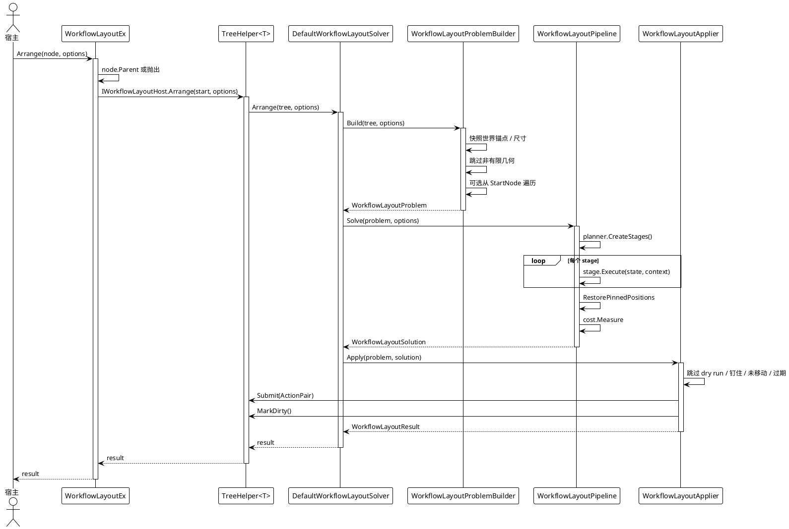

# 工作流自动布局

`WorkflowLayoutEx.Arrange` 是一个调用入口。它先对树做快照，再从不可变快照求解位置，最后把结果作为一个可撤销动作写回。求解器从不读取模型，管线从不写入模型。

## 正常流程



求解器是组合点：快照、管线、应用，一次完成。

```csharp
public WorkflowLayoutResult Arrange(ITreeComponent tree, WorkflowLayoutOptions options)
{
    if (tree is null) throw new ArgumentNullException(nameof(tree));
    options ??= new WorkflowLayoutOptions();

    var problem = WorkflowLayoutProblemBuilder.Build(tree, options);
    var pipeline = new WorkflowLayoutPipeline(_planner, _cost);
    var solution = pipeline.Solve(problem, options);
    return new WorkflowLayoutApplier(tree).Apply(problem, solution);
}
```

> 来源：`Src/Core/VeloxDev.Core/WorkflowSystem/Layout/DefaultWorkflowLayoutSolver.cs` 第 25-34 行。

## 快照

builder 是布局中唯一读取模型的组件。它把折叠锚点还原成世界坐标，丢弃 `NaN` 或无限几何的节点及其边，并记录哪些节点被钉住。

```csharp
var anchor = node.GetWorldAnchor();
var size = node.GetWorldSize();
var x = anchor.Horizontal;
var y = anchor.Vertical;
var width = size.Width;
var height = size.Height;

if (!IsFinite(x) || !IsFinite(y) || !IsFinite(width) || !IsFinite(height))
{
    skipped.Add(sourceIndex);
    continue;
}
```

> 来源：`Src/Core/VeloxDev.Core/WorkflowSystem/Layout/WorkflowLayoutProblemBuilder.cs` 第 47-59 行。

起点节点把可动集合缩到其可达子图。集合外的节点仍留在问题里作为固定障碍，因此选中的簇不会被推穿它们。

> 来源：`Src/Core/VeloxDev.Core/WorkflowSystem/Layout/WorkflowLayoutProblemBuilder.cs` 第 87-121 行。

## 求解

管线不持有模型状态。它对快照运行 planner 的 stage，在最后一个 stage 之后恢复钉住位置（行为异常的 stage 无法移动它们），并测量代价。

```csharp
var state = new WorkflowLayoutState(problem, options);
var stages = _planner.CreateStages(problem, options);

foreach (var stage in stages)
{
    context.CancellationToken.ThrowIfCancellationRequested();
    stage.Execute(state, context);
}

RestorePinnedPositions(state);

var cost = _cost.Measure(problem, state, context);
```

> 来源：`Src/Core/VeloxDev.Core/WorkflowSystem/Layout/WorkflowLayoutPipeline.cs` 第 43-54 行。

## 应用

应用是独立的、调用线程上的步骤。钉住与未移动的节点跳过；实时锚点、图层或父级已不再匹配快照的节点会被跳过而不是覆盖；其余移动包进一个 `ActionPair`。

```csharp
helper.Submit(new ActionPair(
    () =>
    {
        foreach (var move in moves) move.Node.StandardSetAnchor(move.To);
    },
    () =>
    {
        foreach (var move in moves) move.Node.StandardSetAnchor(move.From);
    }));
helper.MarkDirty();
```

> 来源：`Src/Core/VeloxDev.Core/WorkflowSystem/Layout/WorkflowLayoutApplier.cs` 第 70-80 行。

## 错误与边界路径

- **节点未挂载**：`Parent` 为空时 `Arrange(node, ...)` 抛 `ArgumentException`。
- **起点非有限或不在树中**：builder 抛 `ArgumentException`。
- **dry run**：管线仍求解；applier 返回 `Applied = false`、`DryRun = true`。
- **没有节点**：applier 直接返回，不提交。
- **并发编辑**：快照与应用之间锚点/图层/父级变化的节点计入 `SkippedCount`，不被覆盖。
- **解不匹配**：解由另一个问题产生时 applier 抛 `ArgumentException`。
- **取消**：管线在每个 stage 前检查令牌。
- **节点移动钩子**：应用走 `StandardSetAnchor`，宿主的 `Moving`/`Moved` 事件仍然可见。

> 来源：`Src/Core/VeloxDev.Core/WorkflowSystem/Layout/WorkflowLayoutEx.cs` 第 38-51 行；`WorkflowLayoutProblemBuilder.cs` 第 92-97 行；`WorkflowLayoutApplier.cs` 第 28-97 行；`WorkflowLayoutPipeline.cs` 第 46-50 行。
