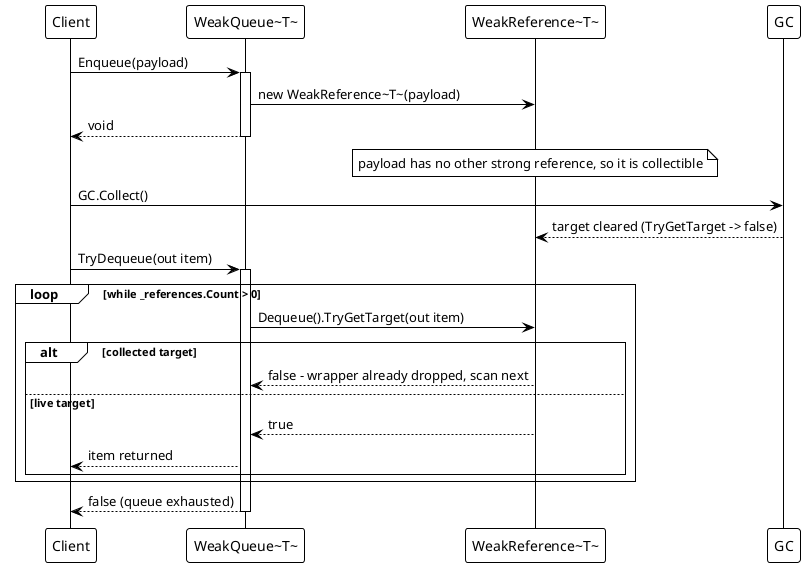
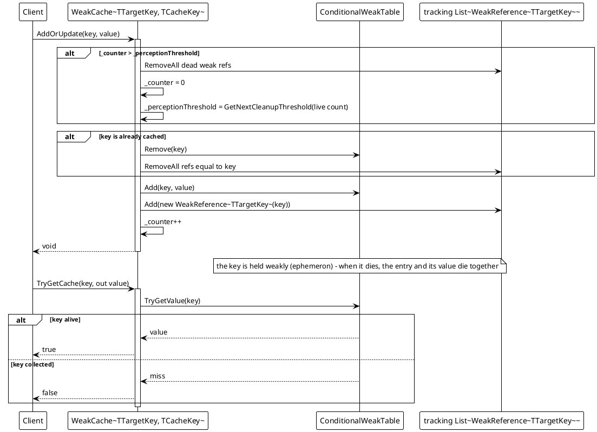
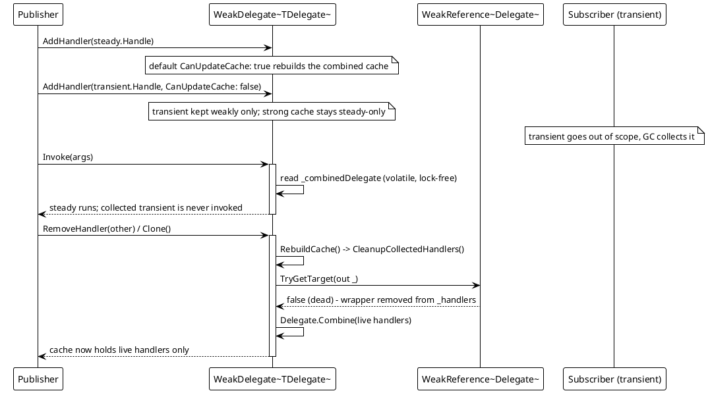

# 数据流 — 弱引用类型

四个类型都由每实例 `lock` 保护，死引用在访问时被跳过或剪除。三张图追踪代表性流程：弱队列、ephemeron 缓存清扫，以及弱多播。泛型约束让载荷成为引用类型：`WeakQueue<T>` / `WeakStack<T>` 是 `where T : class`，因此 `TryDequeue` / `TryPop` / `TryPeek` 返回 `T?`，其 null 与 `false` 都表示“没有存活条目”。

## 1. 弱队列——入队、回收、出队跳过死引用

`Enqueue` 只包装条目（`WeakQueue.cs`，第 39-47 行）。`TryDequeue` 弹出队首并调用 `TryGetTarget`；载荷已回收意味着包装被丢弃、循环继续（第 72-87 行）。`TryPeek` 行为相同，但保留存活的队首、只丢弃死条目（第 91-107 行）。`Count` 与 `GetEnumerator` 先对整个底层队列运行 `Prune()`（第 12-24、120-133、137-148 行），因此报告的计数与产出的条目始终存活；死载荷绝不会被返回。

## 2. 弱缓存——AddOrUpdate、周期清扫、ephemeron 驱逐

表（`_caches`）是查找的事实源。`AddOrUpdate` 先检查清扫计数器，然后因为键已存在时 `ConditionalWeakTable.Add` 会抛异常，显式 `Remove` 先前条目再添加新条目；它还会刷新记账列表，使 `_targets` 中每个添加过的键对应一个弱引用（死引用稍后清扫）（第 68-87 行）。`TryGetCache` 是普通表读取（第 54-66 行）：键被回收后 ephemeron 条目已不存在，因此值——只在键存活期间通过表被引用——也随之消失，无需手动驱逐。`ForeachCache`（第 36-52 行）先剪除死记账引用，再让存活的键逐个查表。注意清扫阈值按存活数几何增长（`GetNextCleanupThreshold`，第 100-104 行），这使周期清理保持每次插入摊销 O(1)。

## 3. 弱委托——弱多播与重建时剪除

`AddHandler` 追加 `WeakReference<Delegate>`，并在 `CanUpdateCache` 为 true 时立即重建组合委托（第 29-37 行）；`RemoveHandler` 从尾部扫描并移除匹配条目（第 42-55 行）。调用在热路径上从不遍历弱列表：`GetInvocationList` 通过无锁 `volatile` 读取返回缓存的 `_combinedDelegate`，仅在缓存为 null 时加锁重建（第 62-73 行）。`Invoke(object?[] objects)` 对该缓存委托执行 DynamicInvoke（第 80-83 行）——已知签名的调用方改用类型化调用，`TransitionEffectCore` 每帧正是如此（`TransitionEffect.cs`，第 136-139 行）。缓存委托是强引用，因此剪除只移除已回收处理器的包装条目：`RebuildCache` 调用 `CleanupCollectedHandlers`（第 85-99、101-110 行），`Clone` 只把存活处理器复制进新实例（第 113-128 行）。因此唯一“像泄漏”的角落，是用默认缓存更新添加、却从未退订的处理器——它会被强缓存 root，直到之后的某次 add/remove/clone 绕开它重建。

源码：`Src/Core/VeloxDev.Core/WeakTypes/{WeakQueue,WeakStack,WeakDelegate,WeakCache}.cs`；用法见 `Src/Core/VeloxDev.Core/TransitionSystem/Effects/TransitionEffect.cs`；行为由 `Src/Core/VeloxDev.Core.Test/WeakTypes/*.cs` 覆盖（FIFO/LIFO 顺序、peek、范围操作、缓存覆盖/移除/清理）。
