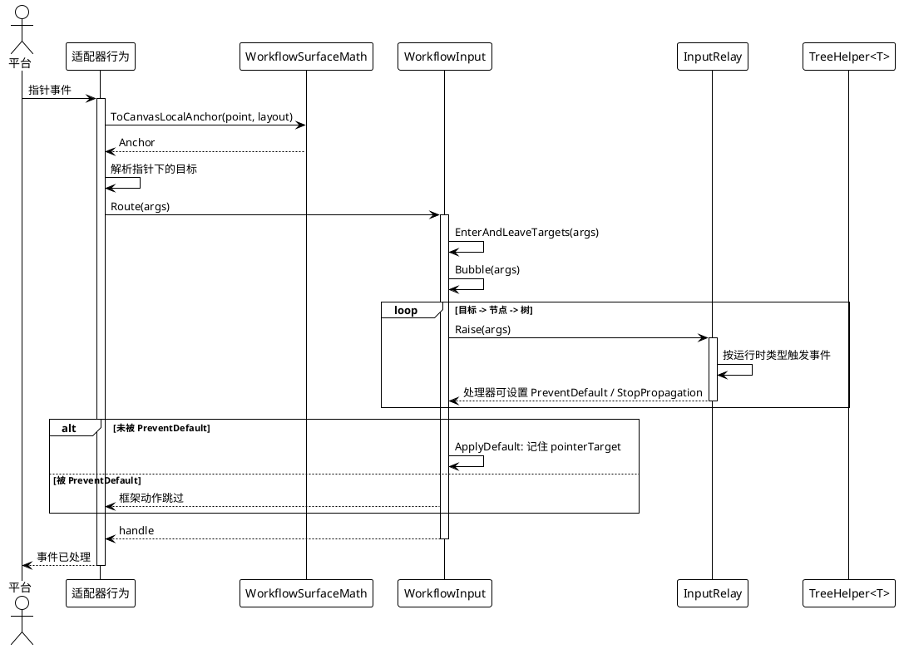

# 输入路由

适配器决定命中了*什么*，并把它作为 `PointerEventArgs.Target` 传入。`WorkflowInput` 决定*谁听到*：目标先听，然后逐级祖先，最后是树；所有接收者共享同一个参数实例与同一个句柄。

## 正常流程



`Route` 分三步：目标变化时合成 enter/exit，冒泡事件，然后（除非订阅者阻止）执行框架自己的反应。

```csharp
public void Route(PointerEventArgs e)
{
    if (e is null) throw new ArgumentNullException(nameof(e));

    EnterAndLeaveTargets(e);

    if (Bubble(e)) return;

    ApplyDefault(e);
}
```

> 来源：`Src/Core/VeloxDev.Core/WorkflowSystem/GUI/Events/WorkflowInput.cs` 第 267-276 行。

链是目标 → 所属节点（插槽）→ 适配器传入的那棵树。树从不从 `Parent` 链推导，因为拖拽预览插槽或未挂载节点的父链并不可靠。

```csharp
private IEnumerable<IWorkflowHelper> Chain(IWorkflowComponent? target)
{
    switch (target)
    {
        case ISlotComponent slot:
            yield return slot.GetHelper();
            if (slot.Parent is { } owner) yield return owner.GetHelper();
            break;

        case INodeComponent node:
            yield return node.GetHelper();
            break;

        case ILinkComponent link:
            yield return link.GetHelper();
            break;
    }

    yield return tree.GetHelper();
}
```

> 来源：`Src/Core/VeloxDev.Core/WorkflowSystem/GUI/Events/WorkflowInput.cs` 第 358-378 行。

## 句柄语义

一个 `WorkflowEventHandle` 随一个逻辑动作传递。两个标志相互独立，且按动作种类落地不同：

| 动作种类 | `PreventDefault` | `StopPropagation` |
|---|---|---|
| 路由输入 | 框架自己的动作让开 | 祖先不再听到 |
| `…ing` 模型动作 | 动作被拒绝 | （报告侧） |
| `…ed` 报告 | 无效果 | 后续订阅者不听到 |

> 来源：`Src/Core/VeloxDev.Core/WorkflowSystem/GUI/Events/WorkflowEventHandle.cs` 第 22-55 行。

## 适配器边界

WPF 表面行为是一个具体翻译。它把指针位置转换成画布局部锚点、解析目标、路由事件并返回句柄。

```csharp
private static WorkflowEventHandle RoutePointer(
    SurfaceState state, ITreeComponent tree, Point point, FrameworkElement source, DependencyObject? hit,
    Func<Anchor, IWorkflowComponent?, WorkflowEventHandle, Wf.PointerEventArgs> args)
{
    var anchor = WorkflowSurfaceMath.ToCanvasLocalAnchor(point.X, point.Y, Panel.GetZIndex(source), tree.Layout);
    var input = WorkflowInput.For(tree);
    var target = ResolveTarget(hit, tree, anchor.Horizontal, anchor.Vertical, input.HitRadius);

    var handle = new WorkflowEventHandle();
    input.Route(args(anchor, target, handle));
    FocusHoveredLink(input, state);
    return handle;
}
```

> 来源：`Src/Adapters/VeloxDev.WPF/WorkflowSystem/AttachedBehaviors/WorkflowSurfaceBehavior.cs` 第 976-988 行。

连线拖拽期间适配器不路由普通指针移动；它报告候选插槽，让连线预览独占状态。

```csharp
if (viewModel.VirtualLink.IsVisible)
{
    viewModel.StandardSetPreviewReceiver(
        SlotHitTestEx.HitTest(viewModel, pointer.Horizontal, pointer.Vertical));
    return;
}
```

> 来源：`Src/Adapters/VeloxDev.WPF/WorkflowSystem/AttachedBehaviors/WorkflowSurfaceBehavior.cs` 第 727-731 行。

## 滚轮归属

普通滚轮归适配器所有：平台滚动容器一次都不许滚，由路由裁决，默认滚动之后通过 `IWorkflowSurfaceScroller` 补上。因此 `PreventDefault` 表示“这一笔不滚”，订阅者改走已注册的滚动器。

```csharp
var handle = RoutePointer(state, viewModel, e.GetPosition(state.Canvas), host, e.OriginalSource as DependencyObject,
    (anchor, target, h) => new Wf.PointerWheelEventArgs(
        anchor, Modifiers(), host, target, 0d, e.Delta, h));

e.Handled = true;
if (!handle.PreventDefault)
{
    state.Scroller?.ScrollBy(0d, e.Delta);
}
```

> 来源：`Src/Adapters/VeloxDev.WPF/WorkflowSystem/AttachedBehaviors/WorkflowSurfaceBehavior.cs` 第 879-888 行。

## 错误与边界路径

- **空事件**：`Route` 抛 `ArgumentNullException`。
- **目标变化**：为旧目标合成 exit、为新目标合成 enter，各自带独立句柄；这两条的返回值被刻意忽略。
- **指针目标**：`ApplyDefault` 对任何带目标的指针事件写 `pointerTarget`，所以滚过一格再按键盘仍指向最后已知元素。宿主弹窗打开时 `IsSuspended` 停止该更新。
- **键盘**：键没有框架默认动作；Core 只路由，宿主决定（例如 Delete 执行 `link.DeleteCommand`）。
- **未声明 helper**：不实现 `IInputEvents` 的 helper 被跳过，路由继续上溯。

> 来源：`Src/Core/VeloxDev.Core/WorkflowSystem/GUI/Events/WorkflowInput.cs` 第 278-388 行；`Src/Core/VeloxDev.Core/WorkflowSystem/GUI/Events/Input/IInputEvents.cs` 第 19-23 行。
