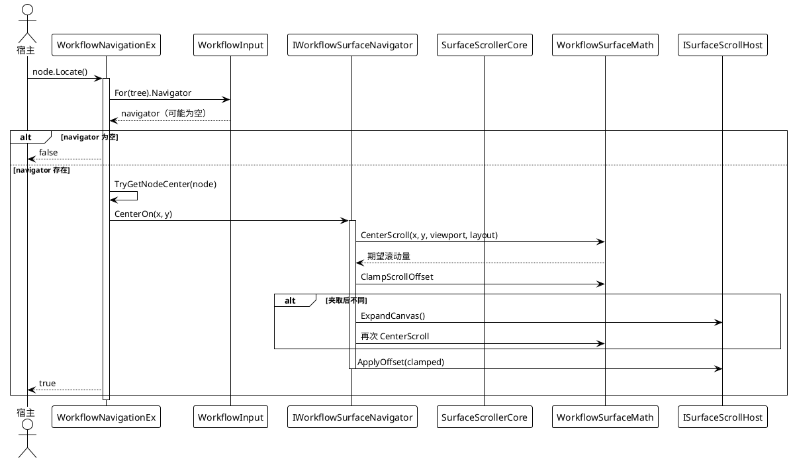

# 表面导航

导航只做平移：把模型点放到视口中心，并保留缩放。它在视图存在之前就能工作，因为每个目标都来自模型数据，而不是已绘制曲线或已测量插槽锚点。

## Locate



`Locate` 有三个重载。节点按自身矩形居中，插槽按父节点矩形居中，连线按两个端点节点中心的中点居中。

```csharp
private static bool TryGetNodeCenter(INodeComponent node, out double x, out double y)
{
    var anchor = node.Anchor;
    var size = node.Size;
    x = anchor.Horizontal + size.Width / 2d;
    y = anchor.Vertical + size.Height / 2d;
    return IsFinite(x) && IsFinite(y);
}
```

> 来源：`Src/Core/VeloxDev.Core/WorkflowSystem/StandardEx/WorkflowNavigationEx.cs` 第 93-100 行。

目标通过 `WorkflowInput.Navigator` 传递，由适配器在表面挂载时注册。没有 navigator 的树返回 `false` 且什么都不改。

> 来源：`Src/Core/VeloxDev.Core/WorkflowSystem/StandardEx/WorkflowNavigationEx.cs` 第 24-104 行。

## 滚轮滚动

`SurfaceScrollerCore.ScrollBy` 把滚轮增量转换成平台步长，只写发生移动的轴，并在请求越过当前范围时通过 `ClampScrollOffset` 撑大画布。

```csharp
var dx = wheelDeltaX != 0d ? (wheelDeltaX / notch) * stepX : 0d;
var dy = wheelDeltaY != 0d ? -(wheelDeltaY / notch) * stepY : 0d;

var offsetX = host.HorizontalOffset;
var offsetY = host.VerticalOffset;
var desiredX = dx != 0d ? offsetX + dx : offsetX;
var desiredY = dy != 0d ? offsetY + dy : offsetY;
```

> 来源：`Src/Core/VeloxDev.Core/WorkflowSystem/GUI/Surface/SurfaceScrollerCore.cs` 第 70-76 行。

两轴不共享符号约定：正的 `wheelDeltaX` 向右侧内容移动，正的 `wheelDeltaY` 向上方内容移动，因此 `dy` 取负。

> 来源：`Src/Core/VeloxDev.Core/WorkflowSystem/GUI/Surface/SurfaceScrollerCore.cs` 第 60-71 行。

## 命中测试

插槽按已测量锚点查找；连线按视图发布的曲线查找。

```csharp
public static ISlotComponent? HitTest(
    ITreeComponent tree, double x, double y, double radius = DefaultHitRadius)
{
    // ...
    foreach (var node in tree.Nodes)
    {
        foreach (var slot in node.Slots)
        {
            var anchor = slot.Anchor;
            if (double.IsNaN(anchor.Horizontal) || double.IsNaN(anchor.Vertical)) continue;
            // 半径内最近的锚点胜出
        }
    }
    return best;
}
```

> 来源：`Src/Core/VeloxDev.Core/WorkflowSystem/GUI/Interaction/SlotHitTestEx.cs` 第 29-56 行。

连线方面，遍历从 `VisibleItems` 末尾往前，跳过拖拽预览，并拒绝被节点卡片遮住的连线，除非指针靠近它自己的端口。

```csharp
var items = tree.GetHelper()?.VisibleItems;
if (items is null) return null;

var dragPreview = tree.VirtualLink;
for (var i = items.Count - 1; i >= 0; i--)
{
    if (items[i] is not ILinkComponent link) continue;
    if (ReferenceEquals(link, dragPreview)) continue;
    if (!link.HitTest(x, y, radius)) continue;
    if (IsCoveredByANode(items, link, x, y, radius)) continue;
    return link;
}
```

> 来源：`Src/Core/VeloxDev.Core/WorkflowSystem/GUI/Interaction/LinkHitTestEx.cs` 第 79-92 行。

## 错误与边界路径

- **没有 navigator**：`Locate` 返回 `false`，不触碰模型。
- **位置非有限**：`NaN`/无限锚点返回 `false`。
- **没有 layout**：`ScrollBy` 与 `CenterOn` 直接返回，不写偏移；它们不知道画布几何。
- **零增量**：某一轴增量为零时该轴不动；两轴都为零是空操作。
- **越界滚动**：画布被撑大，重新读取最大值，再按新上限夹取。
- **未测量插槽**：锚点仍为 `NaN` 的插槽被跳过；剩余最近者胜出。
- **连线可见性**：没有发布曲线或 `IsVisible = false` 的连线永不命中。
- **命中半径**：`LinkHitTestEx.DefaultHitRadius` 为 6 个画布单位，`SlotHitTestEx.DefaultHitRadius` 为 12。

> 来源：`Src/Core/VeloxDev.Core/WorkflowSystem/GUI/Surface/SurfaceScrollerCore.cs` 第 49-116、124-156 行；`Src/Core/VeloxDev.Core/WorkflowSystem/GUI/Interaction/LinkHitTestEx.cs` 第 18、54-58、104-140 行；`SlotHitTestEx.cs` 第 20 行。
