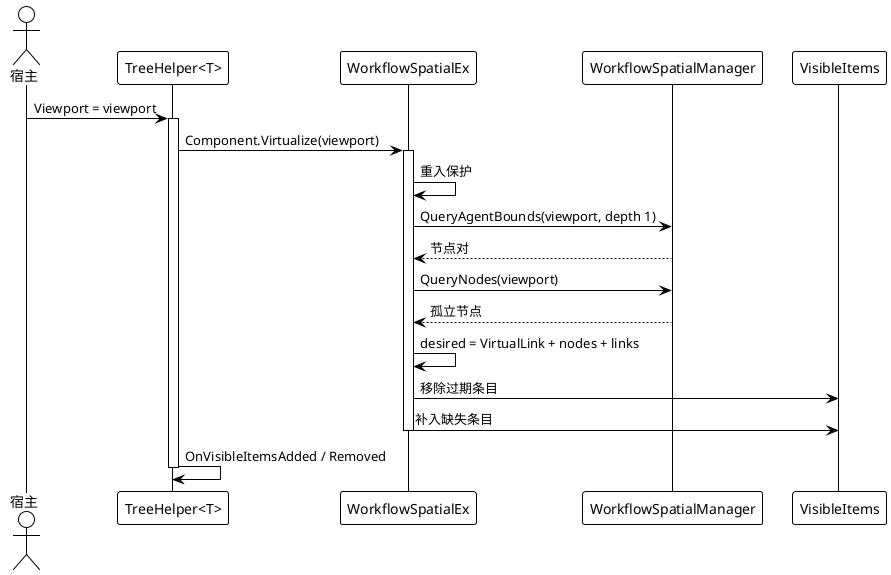
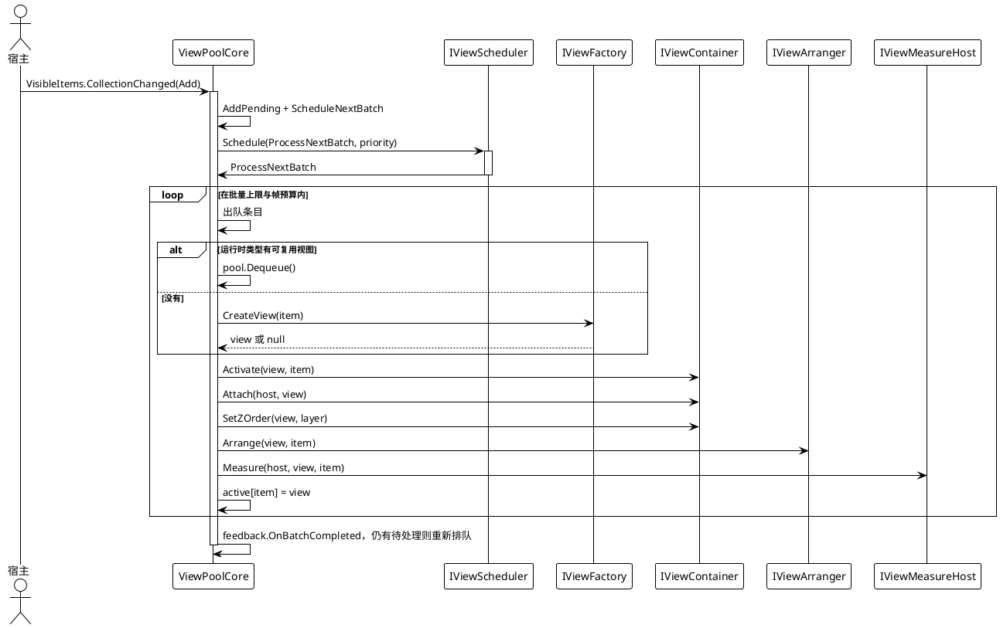

# 视图托管与虚拟化

两层协作。`TreeHelper` 决定某个视口下哪些模型条目可见；`ViewPool` 把可见集合映射到平台视图，每个条目至多创建一次，并按运行时类型回收。

## 虚拟化流程



`EnableMap` 创建空间管理器并订阅树的增删事件。视口宽高为零时 `Virtualize` 是空操作；更新 `VisibleItems` 本身可能改变视口，因此有重入保护。

```csharp
if (viewport.Width <= 0 || viewport.Height <= 0)
    return;

if (!Virtualizing.TryAdd(tree, 0))
    return;
try
{
    VirtualizeCore(tree, viewport);
}
finally
{
    Virtualizing.TryRemove(tree, out _);
}
```

> 来源：`Src/Core/VeloxDev.Core/WorkflowSystem/GUI/Virtualization/WorkflowSpatialEx.cs` 第 95-113 行。

目标集合一趟构建，然后移除过期项、补入缺失项。连线由节点对索引解析，因此一条横穿视口的长连线会把两个端点节点一起带进集合。

```csharp
List<IWorkflowComponent> desiredItems = [tree.VirtualLink];
var desiredSet = new HashSet<IWorkflowComponent>(
    WorkflowReferenceEqualityComparer<IWorkflowComponent>.Instance)
{
    tree.VirtualLink
};

foreach (var node in visibleNodes)
    AddDesiredItem(desiredItems, desiredSet, node);

foreach (var link in manager.ResolveLinksFromPairs(agentBounds))
    AddDesiredItem(desiredItems, desiredSet, link);
```

> 来源：`Src/Core/VeloxDev.Core/WorkflowSystem/GUI/Virtualization/WorkflowSpatialEx.cs` 第 164-176 行。

> 来源：`Src/Core/VeloxDev.Core/WorkflowSystem/GUI/Virtualization/WorkflowSpatialEx.cs` 第 47-67、145-188 行；`WorkflowSpatialManager.cs` 第 41-67、80-125 行。

## 视图物化



池是物化的平台中立半部。它持有回收队列、活动映射与待处理队列；每个平台相关步骤都委托出去。

```csharp
if (pools.TryGetValue(itemType, out var pool) && pool.Count > 0)
{
    view = pool.Dequeue();
    reusedViewCount++;
}

if (view is null)
{
    view = host.Factory.CreateView(typedItem);
    if (view is null)
    {
        unsupportedTypes.Add(itemType);
        return;
    }
    createdViewCount++;
}

stage = ViewStage.Activate;
host.Container.Activate(view, typedItem);
stage = ViewStage.Attach;
host.Container.Attach(hostElement, view);
```

> 来源：`Src/Core/VeloxDev.Core/WorkflowSystem/ViewHosting/ViewPool.cs` 第 338-359 行。

## tick 驱动的遍历

helper 生成的 `Update` 钩子以 10 FPS 运行。只在树变脏时做事，并且同一时间只排队一趟 UI 遍历；捕获到 UI `SynchronizationContext` 时，遍历被投递到那里而不是在计时器线程上运行。

```csharp
partial void Update(FrameEventArgs e)
{
    if (!useVirtualization || Volatile.Read(ref isDirty) == 0) return;

    var context = hostContext;
    if (context is null || ReferenceEquals(context, SynchronizationContext.Current))
    {
        RunVirtualizationPass();
        return;
    }

    if (Interlocked.Exchange(ref uiPassQueued, 1) != 0) return;
    // ...
}
```

> 来源：`Src/Core/VeloxDev.Core/WorkflowSystem/Templates/Helpers/TreeHelper.cs` 第 75-87 行。

> 来源：`Src/Core/VeloxDev.Core/WorkflowSystem/Templates/Helpers/TreeHelper.cs` 第 33、54-58 行。

## 错误与边界路径

- **未启用虚拟化**：空间索引缺失时 `VirtualizeCore` 抛 `ArgumentNullException`；`TreeHelper` 只在开启虚拟化时调用它。
- **空视口**：宽或高非正时是空操作。
- **嵌套虚拟化**：重入保护丢弃嵌套调用；外层调用已经到达最终状态。
- **待定连线**：端点节点尚未注册的连线被暂存，并在下一次 `NodeAdded` 重试，而不是永久消失。
- **工厂拒绝**：视图为 null 时把运行时类型记为不支持，池不会每批重试。
- **物化抛异常**：视图被停用、摘除并放回池，失败报告给 `IViewDiagnostics`。
- **回收上限**：`MaxRecycledViewsPerType` 限制池大小；超过上限的视图由 `IViewContainer` 销毁。

> 来源：`Src/Core/VeloxDev.Core/WorkflowSystem/GUI/Virtualization/WorkflowSpatialEx.cs` 第 115-126 行；`WorkflowSpatialManager.cs` 第 151-185、254-264 行；`ViewPool.cs` 第 319-415 行；`ViewHostCore.cs` 第 90-100 行。
