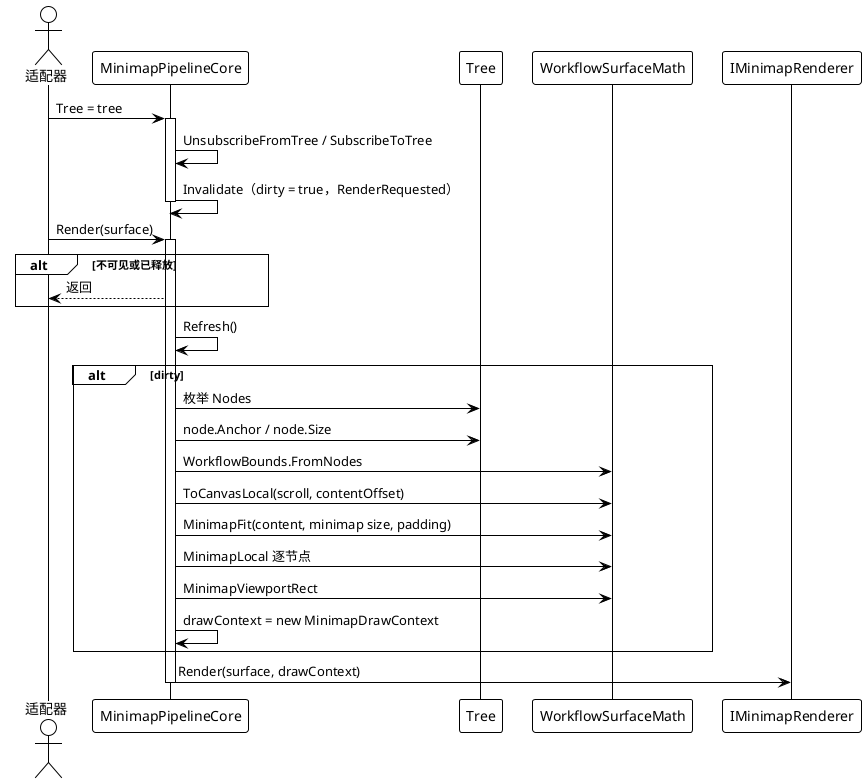
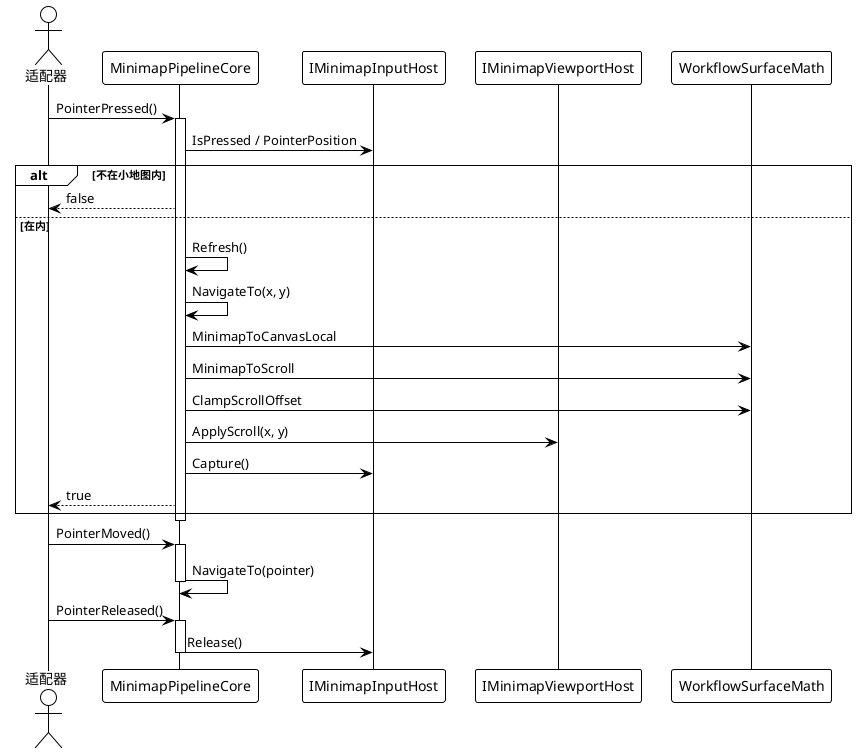

# 小地图

`MinimapPipelineCore` 是平台中立的小地图状态机。节点、连线与视口变化只设置脏标记并触发 `RenderRequested`；映射与布局工作在下一次渲染或刷新时做一次。

## 正常流程：映射与绘制



```csharp
public void Render(TSurface surface)
{
    if (disposed || !IsVisible)
    {
        return;
    }

    Refresh();
    if (drawContext is null)
    {
        return;
    }

    Renderer.Render(surface, drawContext);
}
```

> 来源：`Src/Core/VeloxDev.Core/WorkflowSystem/Minimap/MinimapPipelineCore.cs` 第 188-202 行。

`BuildDrawContext` 把节点矩形与视口矩形转换成画布局部边界，把内容适配进小地图，并按最小缩略尺寸映射每个节点。

```csharp
var (ox, oy, sc) = WorkflowSurfaceMath.MinimapFit(
    ContentBounds.Width, ContentBounds.Height, mmW - pad * 2, mmH - pad * 2, pad);

// ...
var (l, t) = WorkflowSurfaceMath.MinimapLocal(
    nx, ny, ContentBounds.Left, ContentBounds.Top, ox, oy, sc);
mapped.Add(WorkflowBounds.FromNode(
    l, t,
    WorkflowSurfaceMath.MinThumbSize(nw, sc, minThumb),
    WorkflowSurfaceMath.MinThumbSize(nh, sc, minThumb)));
```

> 来源：`Src/Core/VeloxDev.Core/WorkflowSystem/Minimap/MinimapPipelineCore.cs` 第 328-342 行。

## 拖拽滚动

在小地图内按下会刷新映射、把视口中心移到按下点、捕获指针并开始拖拽。每次移动重新居中；松手结束。



```csharp
public bool PointerPressed()
{
    if (disposed || dragging || !Input.IsPressed)
    {
        return false;
    }

    var (x, y) = Input.PointerPosition;
    if (!HitTest(x, y))
    {
        return false;
    }

    Refresh();
    NavigateTo(x, y);
    dragging = true;
    Input.Capture();
    return true;
}
```

> 来源：`Src/Core/VeloxDev.Core/WorkflowSystem/Minimap/MinimapPipelineCore.cs` 第 215-233 行。

## 失效

管线订阅节点与连线集合变化，以及 `Anchor`/`Size` 属性变化。每次变化调用 `Invalidate`，设置 `dirty` 并触发 `RenderRequested`；一串变化因此只花一次映射。

```csharp
public void Invalidate()
{
    if (disposed)
    {
        return;
    }

    dirty = true;
    RenderRequested?.Invoke(this, EventArgs.Empty);
}
```

> 来源：`Src/Core/VeloxDev.Core/WorkflowSystem/Minimap/MinimapPipelineCore.cs` 第 163-172 行。

> 来源：`Src/Core/VeloxDev.Core/WorkflowSystem/Minimap/MinimapPipelineCore.cs` 第 413-631 行。

## 错误与边界路径

- **没有树**：`BuildDrawContext` 返回 null 并清空缓存边界。
- **没有节点**：内容边界为空时不产生绘制上下文，不绘制。
- **比例非法**：`Scale <= 0` 时 `NavigateTo` 返回。
- **不可见**：`Render` 在刷新前返回，但命中测试与拖拽算术仍然可用。
- **指针在外**：`PointerPressed` 返回 false 且不捕获。
- **捕获丢失**：`PointerCaptureLost` 结束拖拽且不再请求捕获。
- **线程亲和**：树通知可能来自任意线程；适配器必须把 `Invalidate` 与渲染调用编组到宿主线程。

> 来源：`Src/Core/VeloxDev.Core/WorkflowSystem/Minimap/MinimapPipelineCore.cs` 第 50-59、141-145、188-202、259-269、294-322、378-392 行。
