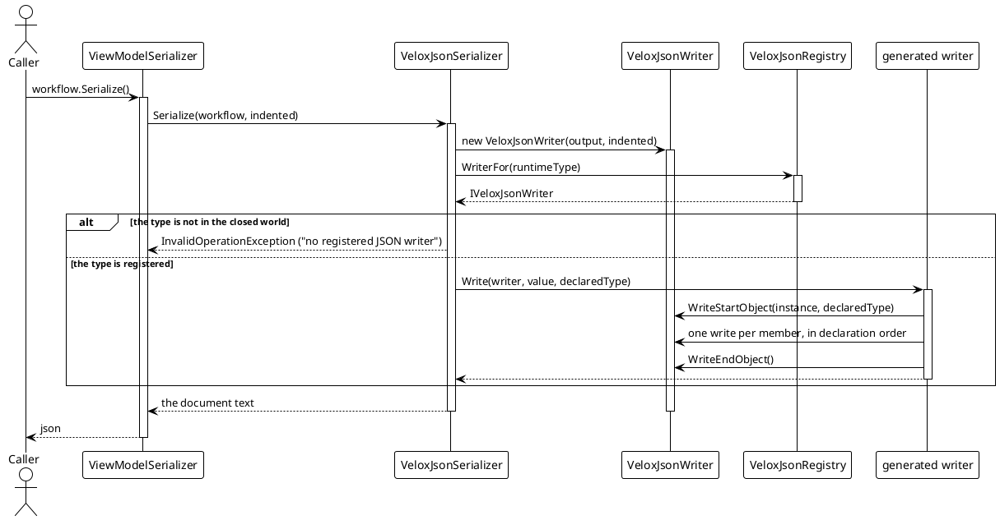
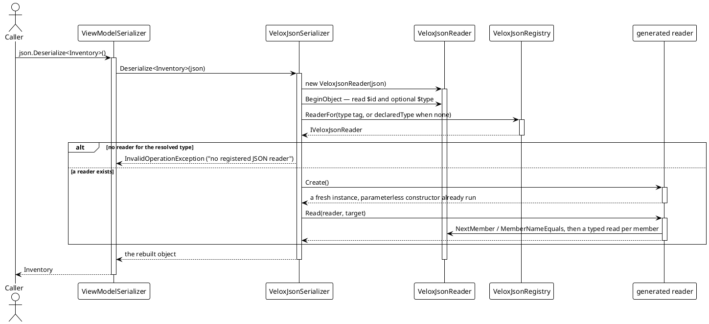

# 数据流 — 序列化

归档路径分三段：**解析类型**、**选写者或读者**、**遍历成员**。运行期不发现任何东西 —— 注册表在程序集加载时由 `[ModuleInitializer]` 填好。

## 1. 写出文档

`WriteStartObject` 是格式身份所在：一个实例第一次出现时写出它的 id，并且**仅当运行期类型与声明类型不同时**写类型标签；第二次出现则写引用而不是对象（`Src/Core/VeloxDev.Core/Serialization/VeloxJsonWriter.cs:122-142`）。正是这一条分支让带 `Parent` 反向引用的图不会膨胀，也是为什么不存在 `PreserveReferencesHandling` 之类的设置。

## 2. 读取文档

读侧有三条性质：

- **文档的成员顺序无关紧要。** `NextMember()` 前进，`MemberNameEquals(name)` 就地比较；读者只索取自己认识的成员，其余跳过。这也解释了为什么文档里没有的成员会保持构造函数留下的值 —— 不存在「恢复默认值」这一遍。
- **构造函数先运行，成员随后写到实例上。** 构造函数设置过、而文档没有提到的内容会活过加载。
- **类型标签走同一张注册表。** `TypeOf(name) ?? declaredType` —— 退回声明类型时，具体类会静默丢失多态，接口或抽象类型则抛出由 `MissingReader` 构造的 `InvalidOperationException`（`VeloxJsonSerializer.cs:453-463`）。

## 3. 两条链路在哪里分叉

读与写各自存在**两份** —— 一条同步链路、一条异步链路 —— 而且它们是两条手写路径，不是一条路径加 `await`。原因是内存内路径从不做 I/O，在那里为异步状态机付费纯属浪费。

代价是两者必须一致，而结构上没有任何东西强制它们一致：`ShapeRoundTripTests.TheTwoChains_SpellEveryScalarTheSameWay` 与 `ElementScalarRoundTripTests` 把标量拼写和运行期类型元素钉在一起。生成器为每个类型同时产出两半（`IVeloxJsonWriter` / `IVeloxJsonReader` 各声明同步与异步方法），所以类型不会只被支持一半。
