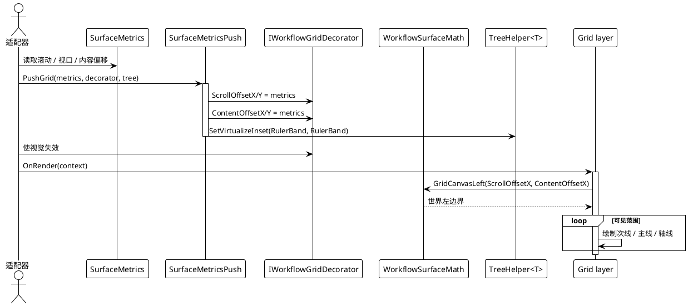

# 网格装饰器与标尺

网格装饰器是数据接收方：表面行为在每次渲染前把滚动与内容偏移推给它，装饰器用这些数字绘制世界对齐的网格线与浮动标尺。Core 拥有契约与共享算术，各适配器拥有绘制。

## 正常流程：推偏移、渲染



`PushGrid` 就是整条写入路径。它还把标尺带厚度转发给虚拟化，避免标尺下方的节点提前一个带宽被剔除。

```csharp
public static void PushGrid(
    SurfaceMetrics metrics, IWorkflowGridDecorator decorator, ITreeComponent? tree)
{
    if (decorator is null) throw new ArgumentNullException(nameof(decorator));

    decorator.ScrollOffsetX = metrics.ScrollOffsetX;
    decorator.ScrollOffsetY = metrics.ScrollOffsetY;
    decorator.ContentOffsetX = metrics.ContentOffsetX;
    decorator.ContentOffsetY = metrics.ContentOffsetY;

    tree?.SetVirtualizeInset(left: decorator.RulerBand, top: decorator.RulerBand);
}
```

> 来源：`Src/Core/VeloxDev.Core/WorkflowSystem/GUI/Surface/SurfaceMetricsPush.cs` 第 25-37 行。

## 契约

契约存在的目的是让七家 GUI 适配器共享同一份定义，而不是各自带一份完全相同的本地副本。

```csharp
public interface IWorkflowGridDecorator
{
    double ScrollOffsetX { get; set; }
    double ScrollOffsetY { get; set; }
    double ContentOffsetX { get; set; }
    double ContentOffsetY { get; set; }
    double RulerBand { get; }
}
```

> 来源：`Src/Core/VeloxDev.Core/Interfaces/WorkflowSystem/Surface/IWorkflowGridDecorator.cs` 第 12-33 行。

小地图契约从它派生，因为小地图需要相同的滚动/内容偏移，外加视口尺寸与树。

> 来源：`Src/Core/VeloxDev.Core/Interfaces/WorkflowSystem/Surface/IWorkflowMinimapOverlay.cs` 第 15-46 行。

## 绘制

具体装饰器用滚动偏移减内容偏移得到世界边界，再按网格间距的倍数绘制。

```csharp
protected override void OnRender(DrawingContext context)
{
    var bounds = new Rect(RenderSize);
    DrawGrid(context, bounds);
}

private void DrawGrid(DrawingContext context, Rect bounds)
{
    var spacing = Math.Max(0.1, owner.GridSpacing);
    var majorStep = spacing * Math.Max(1, owner.MajorLineEvery);
    var worldLeft = WorkflowSurfaceMath.GridCanvasLeft(owner.ScrollOffsetX, owner.ContentOffsetX);
    // 在 worldLeft + k * spacing 处绘制竖线
    // IsMajorLine(value, majorStep) 为真时用主线
}
```

> 来源：`Src/Templates/VeloxDev.WPF.Templates/working/content/workflow-grid-decorator/TemplateClass.cs` 第 148-182 行。

主线判定、轴线强调与近零判定都是本地辅助：值与 `majorStep` 的余数在 `0.001` 内即为主线，值近零时使用轴线画笔。

> 来源：`Src/Templates/VeloxDev.WPF.Templates/working/content/workflow-grid-decorator/TemplateClass.cs` 第 290-304 行。

## 视口持久化

同一次指标推送还会写树的视口并持久化其画布局部位置，使重新加载可以恢复滚动。

```csharp
var localX = WorkflowSurfaceMath.ToCanvasLocal(metrics.ScrollOffsetX, metrics.ContentOffsetX);
var localY = WorkflowSurfaceMath.ToCanvasLocal(metrics.ScrollOffsetY, metrics.ContentOffsetY);

tree.GetHelper().Viewport = new Viewport(
    localX, localY, metrics.ViewportWidth, metrics.ViewportHeight);

tree.Layout.ViewportOffset = new Offset(localX, localY);
```

> 来源：`Src/Core/VeloxDev.Core/WorkflowSystem/GUI/Surface/SurfaceMetricsPush.cs` 第 71-77 行。

## 错误与边界路径

- **缺少装饰器**：`PushGrid` 抛 `ArgumentNullException`；没有装饰器的表面应跳过调用，而不是传 null。
- **缺少树**：装饰器仍收到偏移；只跳过虚拟化内缩。
- **没有滚动范围**：装饰器只使用收到的快照，不查询平台。
- **标尺带**：装饰器不绘制浮动带时 `RulerBand` 为 0，因此不应用虚拟化内缩。
- **偏移权威**：滚动偏移属于平台滚动空间；内容偏移是 `CanvasLayout.ActualOffset`。混用它们正是 `WorkflowSurfaceMath.ToCanvasLocal` 要防止的。

> 来源：`Src/Core/VeloxDev.Core/WorkflowSystem/GUI/Surface/SurfaceMetricsPush.cs` 第 18-37 行；`Src/Core/VeloxDev.Core/Interfaces/WorkflowSystem/Surface/IWorkflowGridDecorator.cs` 第 14-32 行。
