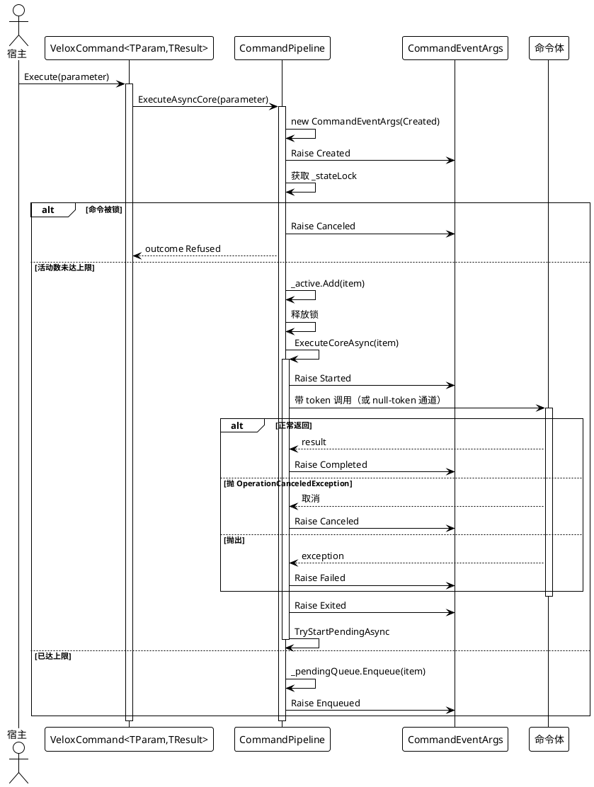

# MVVM 视图模型生成

生成器为 `[VeloxProperty]` 成员发出 `On{Name}Changing/Changed` partial，为每个 `[VeloxCommand]` 方法发出 `{Name}Command`。运行时该命令是一个 `VeloxCommand`，所有执行都汇入 `CommandPipeline` 的队列、一个并发上限与八个生命周期事件。

## 生成形状

`[VeloxProperty]` 的 setter 在字段写入前后触发两个通知钩子；具体方法按类生成，不靠反射。`[VeloxCommand]` 方法变成以该方法为体的类型化命令属性。

> 来源：`Src/Generators/VeloxDev.Core.Generator/Writers/MVVMWriter.cs` 第 147-148、188-189 行；`Src/Core/VeloxDev.Core/MVVM/VeloxPropertyAttribute.cs`；`Src/Core/VeloxDev.Core/MVVM/VeloxCommandAttribute.cs`。

`object?` 命令与类型化命令的运行时入口相同：

```csharp
public void Execute(TParam parameter) => _ = ExecuteAsyncCore(parameter);
public Task ExecuteAsync(TParam parameter) => ExecuteAsyncCore(parameter);
```

> 来源：`Src/Core/VeloxDev.Core/MVVM/VeloxCommand{TParam,TResult}.cs` 第 96-100 行。

## 正常流程



决策与入队在同一把状态锁内完成；命令体与所有事件在锁释放后启动，因此处理器可重入命令而不会死锁。

```csharp
await _stateLock.WaitAsync().ConfigureAwait(false);
try
{
    forceLocked = _isForceLocked;
    if (!forceLocked)
    {
        if (_active.Count < _maxConcurrency)
        {
            _active.Add(item);
            startNow = true;
        }
        else
        {
            _pendingQueue.Enqueue(item);
            enqueued = true;
        }
    }
}
finally
{
    _stateLock.Release();
}
```

> 来源：`Src/Core/VeloxDev.Core/MVVM/CommandPipeline{TParam,TResult}.cs` 第 589-610 行。

命令体只在一处被调用，返回值也只在那里读一次，因此它属于该次执行，从不存到命令上。

```csharp
if (_resultCommand is not null)
{
    result = _isCtsNeeded
        ? await _resultCommand(item.ResolveParameter(), (item.Cts ?? new()).Token).ConfigureAwait(false)
        : await _resultCommand(item.ResolveParameter(), _defct).ConfigureAwait(false);
}
else if (_isCtsNeeded)
{
    await _command(item.ResolveParameter(), (item.Cts ?? new()).Token).ConfigureAwait(false);
}
```

> 来源：`Src/Core/VeloxDev.Core/MVVM/CommandPipeline{TParam,TResult}.cs` 第 651-664 行。

## 完成与等待

`ExecuteAndWaitTypedAsync` 给条目挂一个 `TaskCompletionSource`。最终 `finally` 用结局、异常与结果完成它，因此即使没有事件订阅者，调用方也能看到命令体的值。

```csharp
try
{
    await OnExecutionCompletedAsync(item).ConfigureAwait(false);
}
finally
{
    if (item.Completion is not null)
    {
        item.Complete(outcome, failure, result);
    }

    item.CompleteTyped(outcome, failure, result);
    item.TakeCts()?.Dispose();
}
```

> 来源：`Src/Core/VeloxDev.Core/MVVM/CommandPipeline{TParam,TResult}.cs` 第 683-698 行。

等待方会收到命令体的值、原异常、`OperationCanceledException`，或命令被锁时的 `InvalidOperationException`。

> 来源：`Src/Core/VeloxDev.Core/MVVM/CommandPipeline{TParam,TResult}.cs` 第 521-538 行。

## 错误与边界路径

- **`CanExecute`**：只评估谓词与锁，从不评估队列。达到并发上限时仍返回 true，因为调用会被停放而不是丢弃。
- **已锁**：`ExecuteCore` 取消条目自己的令牌源、触发 `Canceled`、把 sink 完成为 `Refused`，命令体永不启动。
- **排队**：达到上限时入队并触发 `Enqueued`；`OnExecutionCompleted` 启动下一个待处理项。
- **取消**：命令体的 `OperationCanceledException` 报告为 `Canceled`；等待令牌只放弃等待，不取消执行。
- **重入**：命令体在状态锁外启动，处理器可以回调同一命令。
- **集合钩子**：`[VeloxProperty]` 集合还会生成 `OnItemAddedTo` / `OnItemRemovedFrom` / reset 钩子，在集合变更之后触发。

> 来源：`Src/Core/VeloxDev.Core/MVVM/CommandPipeline{TParam,TResult}.cs` 第 403-416、612-635、637-718 行；`Src/Core/VeloxDev.Core/MVVM/ObservableCollectionTracker.cs`；`Src/Generators/VeloxDev.Core.Generator/Writers/MVVMWriter.cs` 第 980-1022 行。
