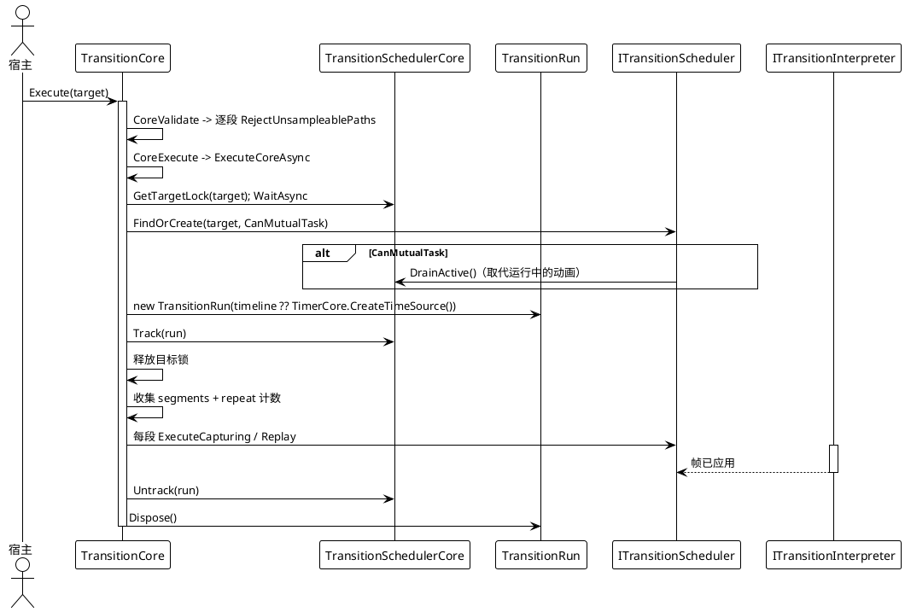

# 执行链

过渡是由 `TransitionCore` 段组成的链。每段持有帧状态、效果与插值器；`Then`、`AwaitThen`、`Repeat` 只连接段，不执行任何东西。控制从 `Execute` 开始。

## 校验与 run 注册



run 在目标控制面锁内创建并注册，因此与启动竞争的 `Exit` 要么取消这次动画，要么完全发生在它之前——绝不落在两者之间。

```csharp
var gate = TransitionSchedulerCore.GetTargetLock(target);
await gate.WaitAsync();
try
{
    scheduler = TransitionSchedulerCore<THost, TTransitionInterpreterCore, TPriorityCore>.FindOrCreate(target, CanMutualTask);
    if (CanMutualTask)
    {
        superseded.AddRange(((TransitionSchedulerCore)scheduler).DrainActive());
    }

    run = new TransitionRun(timeline ?? TimerCore.CreateTimeSource<ITimeSourceControl>());
    cts = run.Cts;

    coreScheduler = (TransitionSchedulerCore)scheduler;
    coreScheduler.Track(run);
    // ...
}
finally
{
    gate.Release();
}
```

> 来源：`Src/Core/VeloxDev.Core/TransitionSystem/Effects/Transition.cs` 第 375-409 行。

## 段执行

链被摊平成一个段数组与一个重复次数数组。段首次用 `ExecuteCapturing` 运行；之后每次迭代通过 `Replay` 复用已捕获的帧集，因此重复段从首次迭代备下的帧集开始，而不是重新读取目标。

```csharp
if (prepared[index] is { } frameSet)
{
    await chainScheduler.Replay(frameSet, (ITransitionEffect<TPriorityCore>)segments[index].Effect, cts);
}
else
{
    prepared[index] = await chainScheduler.ExecuteCapturing(
        segments[index].Interpolator,
        segments[index].State,
        (ITransitionEffect<TPriorityCore>)segments[index].Effect,
        cts);
}
```

> 来源：`Src/Core/VeloxDev.Core/TransitionSystem/Effects/Transition.cs` 第 441-452 行。

`RunRangeAsync` 展开循环：每段的 `Repeat` 从首段包到该段，`int.MaxValue` 表示永远。

```csharp
async Task RunRangeAsync(int from, int to)
{
    if (to < from)
    {
        return;
    }

    var repeat = repeats[to - 1];
    for (var iteration = 0; repeat == int.MaxValue || iteration <= repeat; iteration++)
    {
        if (cts.IsCancellationRequested) return;
        await RunBodyAsync(from, to);
    }
}
```

> 来源：`Src/Core/VeloxDev.Core/TransitionSystem/Effects/Transition.cs` 第 465-479 行。

## 控制面

`Exit`、`Pause`、`Resume`、`SetRate`、`Seek` 不创建新动画；它们作用于调度器已为目标的 run。

```csharp
public static void Pause<T>(T target, bool IncludeMutual = true, bool IncludeNoMutual = false)
    where T : class
    => ApplyToRuns(target, IncludeMutual, IncludeNoMutual, static run => run.Timeline.Pause());
```

> 来源：`Src/Core/VeloxDev.Core/TransitionSystem/Effects/Transition.cs` 第 63-65 行。

- `Exit` 在目标锁内抽走 run，释放后再取消，避免取消回调重入 `Exit` 时死锁。
- `Pause` 停放时间轴；暂停时间不计入动画。
- `SetRate(0)` 冻结时间轴但不置 `IsPaused`。
- `Seek` 重新锚定 run 的趟位置。

> 来源：`Src/Core/VeloxDev.Core/TransitionSystem/Effects/Transition.cs` 第 30-123、170-194 行。

## 错误路径

- **目标类型不符**：目标不是 `T` 时 `ExecuteCoreAsync` 抛 `InvalidDataException`。
- **无法采样的路径**：没有自定义插值器、也没有注册采样器的引用类型叶子，会在任何 run 开始前抛 `TransitionPathUnsampleableException`。
- **宿主调度器抛异常**：异常到达 `async void` 的 `CoreExecute`，通过效果的 `Error` 阶段上报，不会带走进程。
- **契约抛异常**：此处不涉及 `IRedirectable` 式宿主钩子；效果回调是上报通道。
- **取消**：`Exit` 取消 run 的令牌源；链在下一个 await 停下。

> 来源：`Src/Core/VeloxDev.Core/TransitionSystem/Effects/Transition.cs` 第 205-215、336-358、360-364 行。
