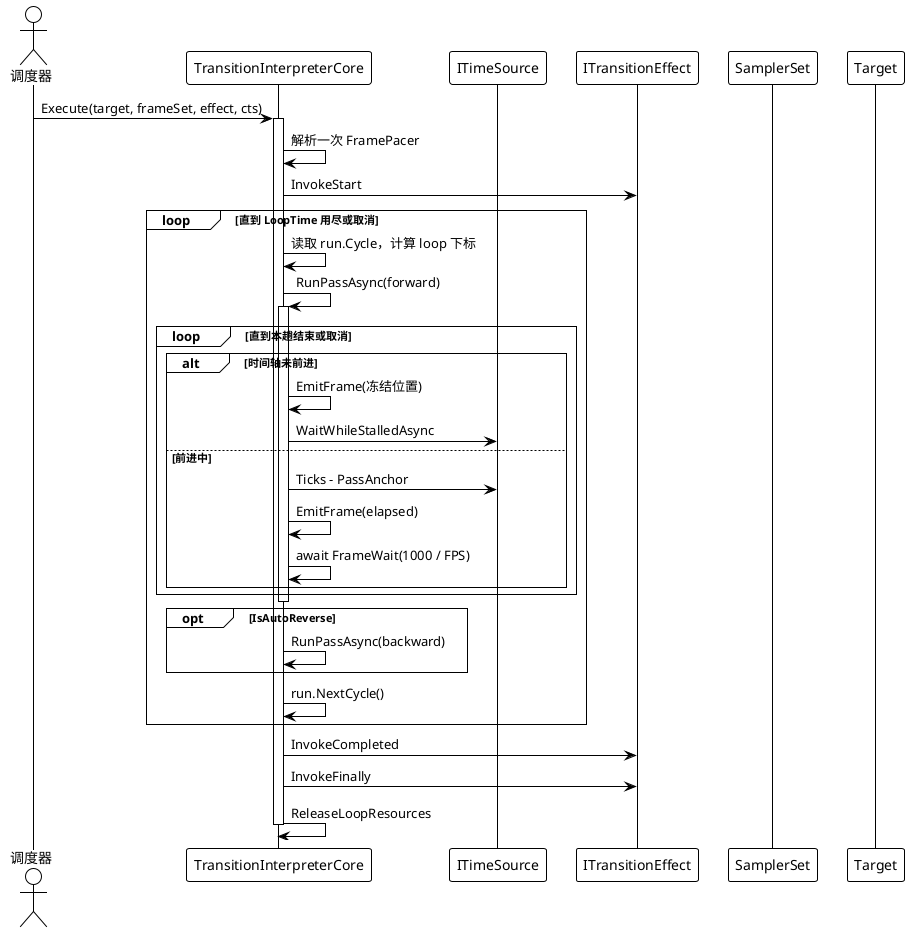

# 采样与调度

调度器解析平台相关解释器与帧集；解释器运行由时间轴驱动的采样循环。时间轴是计时权威：帧等待只决定循环多久看一次，不决定它在哪。

## 调度器准备

`ExecuteCapturing` 触发效果的 `Awake`（可通过 `Args.Handled` 否决），让插值器准备 `SamplerSet`，再把集合交给解释器。

```csharp
effect.InvokeAwake(target, newInterpreter.Args);
// ...
frameSet = producer.Prepare(target, state, effect, host);
```

> 来源：`Src/Core/VeloxDev.Core/TransitionSystem/Runtime/TransitionScheduler.cs` 第 138、159 行。

`Awake` 在 `Prepare` 之前被 await，因为 Awake 是可能把目标放进动画起始状态的钩子；`Prepare` 不能在它之前读取目标。

> 来源：`Src/Core/VeloxDev.Core/TransitionSystem/Runtime/TransitionScheduler.cs` 第 126-159 行。

## 采样循环



`EmitFrame` 把经过的 tick 换算成原始归一化时间，应用效果缓动，然后触发 `Update`、应用帧集、触发 `LateUpdate`。回调抛异常会作废该帧，并通过正常取消路径结束本趟。

```csharp
var rawT = durationMs <= 0d ? 1d : elapsedMs / durationMs;

double easedT;
if (rawT >= 1d)
{
    easedT = forward ? 1d : 0d;
}
else
{
    var easeIn = forward ? rawT : 1d - rawT;
    easedT = effect.Ease.Ease(easeIn);
}

if (Report(effect, target, Args, diagnostics, ErrorStage.Update, UpdateCallback)
    || ReportMarshaling(apply, easedT, diagnostics)
    || Report(effect, target, Args, diagnostics, ErrorStage.LateUpdate, LateUpdateCallback))
{
    throw new OperationCanceledException();
}

return rawT >= 1d;
```

> 来源：`Src/Core/VeloxDev.Core/TransitionSystem/Runtime/TransitionInterpreter.cs` 第 377-403 行。

FPS 是最大采样率，不是帧网格：循环每 `1000 / FPS` 毫秒让出一次，实际位置由时间轴决定。每趟末帧固定到精确端点，而不是依赖 `Ease(1)` 恰好为 1。

> 来源：`Src/Core/VeloxDev.Core/TransitionSystem/Runtime/TransitionInterpreter.cs` 第 155-170、377-392 行。

## 暂停与 Seek

时间轴未前进时，循环先绘制冻结位置，再停放在 `WaitWhileStalledAsync`。这就是暂停中 Seek 无需恢复也能看见的原因，也使暂停动画不消耗计时器唤醒。

```csharp
if (!timeline.IsAdvancing)
{
    EmitFrame(target, effect, durationMs, forward, ToMilliseconds(timeline, timeline.Ticks - run.PassAnchor), apply, diagnostics);
    await timeline.WaitWhileStalledAsync(cts.Token);
    continue;
}
```

> 来源：`Src/Core/VeloxDev.Core/TransitionSystem/Runtime/TransitionInterpreter.cs` 第 317-328 行。

## 资源归属

解释器拥有帧 pacer 与可复用等待，不拥有令牌源。调度器从调用方解析源，而 `Transition` 把同一个源交给每一段；在退出时取消它会让动画在第一段后结束。两类资源都在循环结束时释放。

```csharp
internal void ReleaseLoopResources()
{
    _pacer?.Dispose();
    _pacer = null;
    _pacerResolved = false;
    _wait?.Dispose();
    _wait = null;
}
```

> 来源：`Src/Core/VeloxDev.Core/TransitionSystem/Runtime/TransitionInterpreter.cs` 第 444-451 行。

## 错误与边界路径

- **回调或采样器抛异常**：在失败阶段写入 `TransitionDiagnostics`，运行沿 `Canceled` 与 `Finally` 回调展开；资源仍会释放。
- **Awake 否决**：`Args.Handled` 在 `Prepare` 之前停止动画。
- **取消**：每趟开头与每帧之前检查；循环经 `OperationCanceledException` 退出。
- **Completed/Finally 抛异常**：各自被报告，抛异常的 `Finally` 不能跳过 `ReleaseLoopResources`。
- **零时长**：`rawT` 强制为 1，本趟在第一帧结束。
- **没有 pacer**：默认使用复用的线程池计时器；宿主 pacer 在首次 await 之前、启动循环的线程上解析一次。

> 来源：`Src/Core/VeloxDev.Core/TransitionSystem/Runtime/TransitionInterpreter.cs` 第 165-168、229-256、264-280、313-341 行；`TransitionScheduler.cs` 第 138-164 行。
