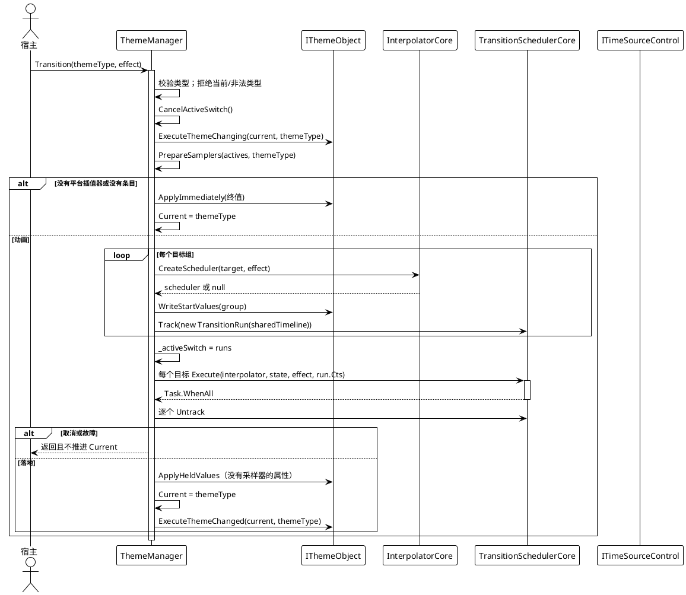

# 运行时主题

`ThemeManager` 持有已注册 `IThemeObject` 的弱引用列表。一次切换为每个目标、每个可主题化属性准备一个条目，然后要么在共享时间轴上动画这些条目，要么立即写入终值。只有切换真正落地时 `Current` 才前进。

## 注册

`InitializeTheme` 按主题对象生成并调用 `ThemeCache.RegisterType`；`Register` 把实例加入管理器的弱引用列表，因此被回收的目标无需显式注销就会消失。

```csharp
public static void Register(IThemeObject target)
{
    if (!_act_cache.TryGetValue(target, out _))
    {
        Dictionary<string, Dictionary<PropertyInfo, Dictionary<Type, object?>>>? cache = [];
        _act_cache.Add(target, cache);
        activeThemes.Add(new WeakReference<IThemeObject>(target));
    }
}
```

> 来源：`Src/Core/VeloxDev.Core/DynamicTheme/ThemeManager.cs` 第 75-83 行。

## 动画切换



`RunSwitch` 在启动任何一个目标之前先解析所有目标的调度器。无法动画的目标会让整次切换退化为瞬时切换，而不是一半在动、一半跳变。

```csharp
if (interpolator is null || groups.Count == 0)
{
    return ApplyImmediately(groups, themeType);
}

var planned = new List<(TransitionSchedulerCore Scheduler, TargetEntries Group)>(groups.Count);
foreach (var group in groups)
{
    TransitionSchedulerCore? scheduler;
    try
    {
        scheduler = interpolator.CreateScheduler(group.Target, effect);
    }
    catch (Exception ex)
    {
        Debug.WriteLine($"[ThemeManager] Error resolving the platform scheduler: {ex.Message}");
        scheduler = null;
    }

    if (scheduler is null)
    {
        return ApplyImmediately(groups, themeType);
    }
    planned.Add((scheduler, group));
}
```

> 来源：`Src/Core/VeloxDev.Core/DynamicTheme/ThemeManager.cs` 第 202-234 行。

一次切换的所有目标共享一个 `ITimeSourceControl`。因此对任一目标 `Pause` / `Resume` / `SetRate` 会移动整场切换；`Seek` 只重锚给定目标的 run，`Exit` 只取消该目标的 run。

> 来源：`Src/Core/VeloxDev.Core/DynamicTheme/ThemeManager.cs` 第 236-264 行。

## Jump

`Jump` 是无动画路径。它仍运行 changing 钩子、直接写入每个终值并推进 `Current`；既不需要 `SetPlatformInterpolator`，也不受平台 effect 类型约束。

```csharp
ApplyImmediately(PrepareSamplers(actives, themeType), themeType);

foreach (var themeObject in actives)
{
    themeObject?.ExecuteThemeChanged(current, themeType);
}
```

> 来源：`Src/Core/VeloxDev.Core/DynamicTheme/ThemeManager.cs` 第 172-187 行。

## 起始值

`StartModel` 决定动画起始值来源：

- `Reflect`：读取属性当前值。
- `Cache`：读取 `Current` 的缓存值，先查活动（按实例）缓存，再查静态缓存。

> 来源：`Src/Core/VeloxDev.Core/DynamicTheme/ThemeManager.cs` 第 490-522 行；`Src/Core/VeloxDev.Core/DynamicTheme/ThemeCache.cs` 第 71-141 行。

## 单属性 API

`IThemeObject` 还暴露直接写入与恢复，生成成员使用它们：

```csharp
public void SetThemeValue<T>(string propertyName, object? newValue) where T : ITheme;
public void RestoreThemeValue<T>(string propertyName) where T : ITheme;
```

> 来源：`Src/Core/VeloxDev.Core/Interfaces/DynamicTheme/IThemeObject.cs` 第 21-28 行。

## 错误与边界路径

- **当前或非法类型**：`Transition` 与 `Jump` 只记录并返回，不触碰目标。
- **调度器创建失败**：整次切换退化为 `ApplyImmediately`。
- **切换被取代**：`CancelActiveSwitch` 取消旧 run、唤醒暂停的时间轴，旧调用方返回且不推进 `Current`。
- **执行故障**：记录日志；切换视为停止，`Current` 不前进。
- **属性没有采样器**：`Prepare` 静默跳过；终值由 `ApplyHeldValues` 在切换落地后写入。
- **终值为 null**：主题表示“不动该属性”，跳过而不是向 null 采样。
- **缺少起始/目标值**：准备阶段跳过该属性。

> 来源：`Src/Core/VeloxDev.Core/DynamicTheme/ThemeManager.cs` 第 112-149、294-300、365-411、439-589 行；`Src/Core/VeloxDev.Core/DynamicTheme/ThemeCache.cs` 第 101-116 行。
