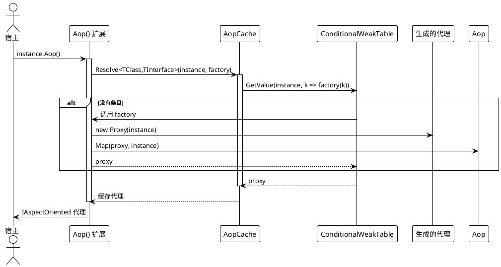
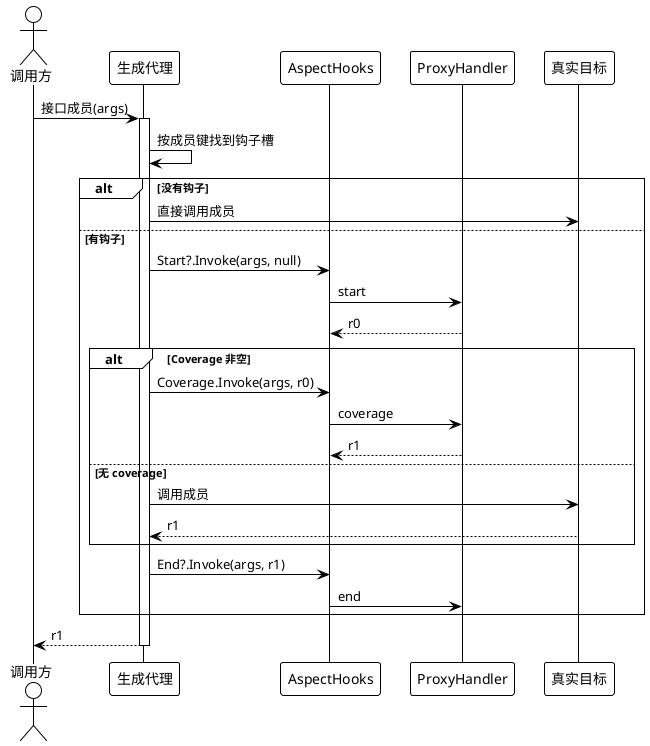

# 面向切面编程

对 `[AspectOriented]` 类型，生成器发出匹配接口、实现该接口的代理，以及返回缓存代理的 `Aop()` 扩展。通过该接口的调用会进入代理成员，在真实目标周围应用已安装的 before / replace / after 阶段。

## 获取代理



`AopCache` 为每个封闭的 `(TClass, TInterface)` 对使用一个 `ConditionalWeakTable`，因此缓存是按实例的，不会让已回收目标存活。生成的工厂还会记录 `Aop.GetTarget` 使用的代理到目标映射。

```csharp
public static TInterface Resolve<
    TClass,
    [DynamicallyAccessedMembers(DynamicallyAccessedMemberTypes.PublicParameterlessConstructor)] TInterface>(
    TClass instance,
    Func<TClass, TInterface> factory)
    where TInterface : class, IAspectOriented
    where TClass : class
{
    return Entry<TClass, TInterface>.Instances
        .GetValue(instance, k => factory(k));
}
```

> 来源：`Src/Core/VeloxDev.Core/AspectOriented/AopCache.cs` 第 41-51 行。

> 来源：`Src/Generators/VeloxDev.Core.Generator/Writers/AopWriter.cs` 第 82-93 行；`Src/Core/VeloxDev.Core/AspectOriented/Aop.cs` 第 15-27 行。

## 成员调用



生成的代理把阶段顺序写成直线代码：`Start` 收到 `null` 作为 previous 值，`Coverage` 取代成员，`End` 看到结果且其返回值被丢弃。

```csharp
var r0 = h.Start?.Invoke(args, null);
object? r1;
if (h.Coverage is null)
{
    // 调用真实成员
}
else
{
    r1 = h.Coverage.Invoke(args, r0);
}
h.End?.Invoke(args, r1);
```

> 来源：`Src/Generators/VeloxDev.Core.Generator/AopSurface.cs` 第 278-290 行。

> 来源：`Src/Generators/VeloxDev.Core.Generator/AopSurface.cs` 第 251-261、313-326 行。

## 安装

`ProxyEx.SetProxy` 为一个成员安装全部三个阶段。键是 `get_Name`、`set_Name` 或方法自身的名字；重复安装会替换整套，传 null 会清除。

```csharp
string memberKey = memberType switch
{
    ProxyMembers.Getter => "get_" + memberName,
    ProxyMembers.Setter => "set_" + memberName,
    _ => memberName,
};

hookTarget.SetHooks(memberKey, new AspectHooks(start, coverage, end));
```

> 来源：`Src/Core/VeloxDev.Core/AspectOriented/ProxyEx.cs` 第 67-74 行。

## 错误与边界路径

- **装在真身上**：`SetProxy` 抛 `InvalidOperationException`。代理永远不会经过装在目标上的钩子，因此拒绝而不是静默失效。
- **未知成员键**：生成的 `SetHooks` 抛 `ArgumentOutOfRangeException`；匹配不到成员的名称是错误，不是空操作。
- **成员没有钩子**：代理直接调用目标，不分配阶段值。
- **钩子整套设置**：无法保留已有阶段只替换另一个；传 null 钩子集清除该成员的切面。
- **无反射**：代理是普通生成代码；每次调用路径上不使用 `MethodInfo.Invoke`。
- **装箱**：`ProxyHandler` 接收并返回 `object?`，这是让生成代码免于反射或运行时动态代码生成的契约。

> 来源：`Src/Core/VeloxDev.Core/AspectOriented/ProxyEx.cs` 第 50-75 行；`Src/Core/VeloxDev.Core/AspectOriented/AspectHooks.cs` 第 17-76 行；`Src/Core/VeloxDev.Core/AspectOriented/AspectOrientedAttribute.cs` 第 6-11 行。
