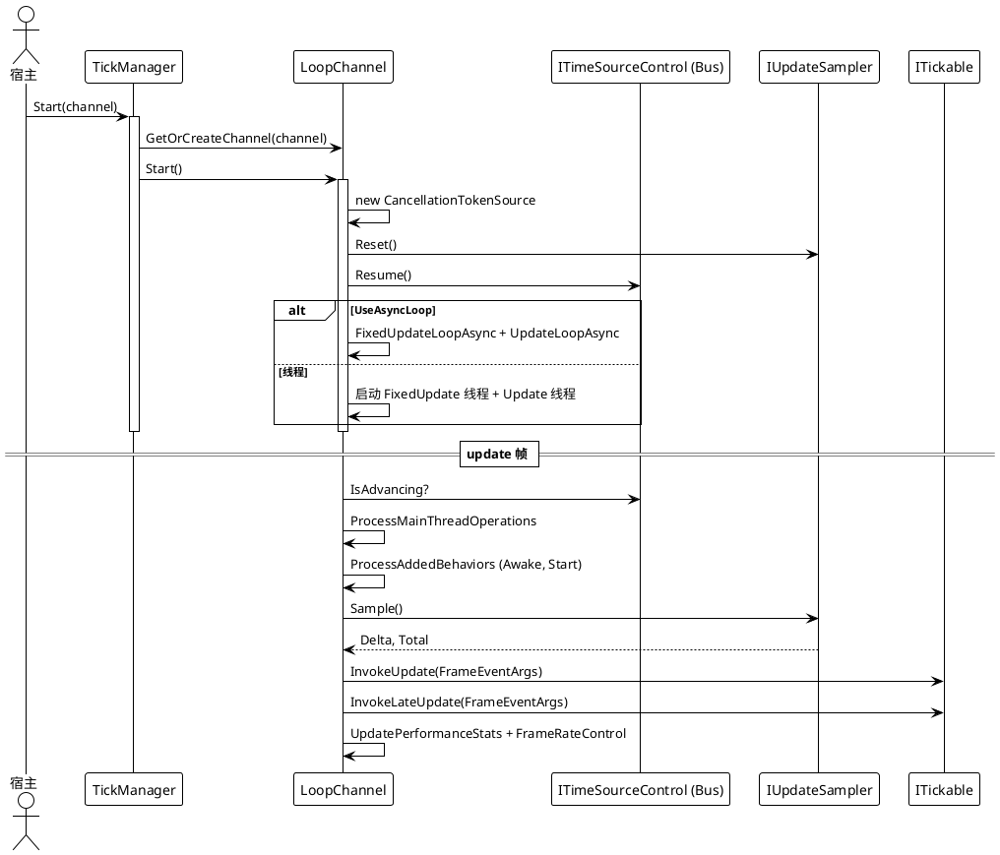

# 帧循环

`[Tickable]` 让生成器发出 `ITickable` 实现，把对象注册到命名通道。`TickManager` 每个通道跑两个循环——update 与 fixed update——并把生命周期钩子分派给每个活动行为。

## 注册

```csharp
public void InitializeTickable()
{
    TickManager.RegisterBehaviour(this, "default");
}

public void InvokeAwake() => Awake();
public void InvokeStart() => Start();
public void InvokeUpdate(FrameEventArgs e) => Update(e);
public void InvokeLateUpdate(FrameEventArgs e) => LateUpdate(e);
public void InvokeFixedUpdate(FrameEventArgs e) => FixedUpdate(e);
```

> 来源：`Src/Generators/VeloxDev.Core.Generator/Writers/TickWriter.cs` 第 86-121 行（通道取自 `[Tickable]` 的 channel；上面的占位符展示发出的形状）。

`RegisterBehaviour` 是队列写入，不是直接调用。update 循环在帧开头排空队列，然后运行一次 `Awake`、一次 `Start`，对象才变为活动。

```csharp
public void RegisterBehaviour(ITickable behavior)
{
    if (behavior != null) _addQueue.Enqueue(behavior);
}
```

> 来源：`Src/Core/VeloxDev.Core/TimeLine/TickManager.cs` 第 432-435 行。

```csharp
SafeExecute(behavior.InvokeAwake, "Awake");
SafeExecute(behavior.InvokeStart, "Start");
```

> 来源：`Src/Core/VeloxDev.Core/TimeLine/TickManager.cs` 第 798-799 行。

## 正常流程



```csharp
var sample = _updateSampler.Sample();
if (sample.Delta == TimeSpan.Zero)
{
    Sleep(TimeSpan.FromMilliseconds(MIN_SLEEP_MS), token);
    continue;
}

var frameArgs = CreateFrameEventArgs(sample.Delta, sample.Total);

ExecuteBehaviorsUpdateSync(frameArgs, token);
ExecuteBehaviorsLateUpdateSync(frameArgs, token);

_frameEventArgsPool.Return(frameArgs);
```

> 来源：`Src/Core/VeloxDev.Core/TimeLine/TickManager.cs` 第 532-544 行。

## FixedUpdate

fixed 循环使用独立采样器。`Advance` 返回当前欠下的 fixed 步数，包括停摆期间漏掉的步，因此循环会追赶而不是丢弃积压。每一步的 `TotalTime` 由步序号计算。

```csharp
var count = _fixedSampler.Advance(out var sample);
if (count > 0)
{
    var stepTicks = _fixedSampler.Step.Ticks;
    var firstStep = sample.Step - count + 1;

    for (var i = 0; i < count; i++)
    {
        var fixedFrameArgs = CreateFrameEventArgs(
            sample.Delta,
            TimeSpan.FromTicks((firstStep + i) * stepTicks));
        ExecuteBehaviorsFixedUpdateSync(fixedFrameArgs, token);
        _frameEventArgsPool.Return(fixedFrameArgs);
    }
}
```

> 来源：`Src/Core/VeloxDev.Core/TimeLine/TickManager.cs` 第 478-496 行。

`SetFixedUpdateInterval` 走队列而不是直接写，使步长变更落在拥有采样器的 fixed 线程上。

> 来源：`Src/Core/VeloxDev.Core/TimeLine/TickManager.cs` 第 459-465 行。

## 暂停、恢复与速率

总线是暂停状态的唯一事实源。总线未前进时两个循环都停放在 `WaitWhileStalledAsync`，因此暂停通道不消耗计时器唤醒；`Pause`/`Resume` 作用于总线。

> 来源：`Src/Core/VeloxDev.Core/TimeLine/TickManager.cs` 第 386-404、470-474 行。

## 错误与边界路径

- **行为抛异常**：`ExecuteBehaviors*` 捕获、经 `ReportBehaviorError` 上报，然后继续下一个行为。一个失败对象不会停掉通道。
- **`Handled`**：`FrameEventArgs.Handled` 非空时停止该帧剩余行为；循环仍然前进。
- **运行中 Start**：通道已在运行时 `Start` 立即返回。
- **暂停中 Stop**：`StopAsync` 在取消前恢复总线，下个生命周期不会一启动就停放。
- **重启**：`RestartAsync` 先停止、等待循环关闭、等待队列排空，再启动；超时则强制清理。
- **异步覆盖**：`UseAsyncLoop` 为 WASM 用异步循环替换线程；运行中不可更改。
- **主线程操作**：`ExecuteOnMainThread` 动作在采样前按有界批（每帧 64 个）排空。

> 来源：`Src/Core/VeloxDev.Core/TimeLine/TickManager.cs` 第 276-278、331-376、406-430、690-768 行；`Src/Core/VeloxDev.Core/TimeLine/TickableAttribute.cs` 第 6-18 行；`Src/Core/VeloxDev.Core/Interfaces/Tickable/ITickable.cs` 第 6-28 行。
