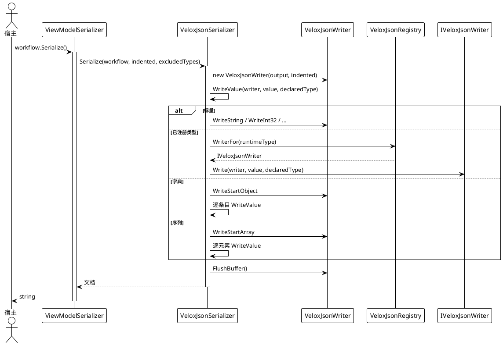

# 写入路径

`ViewModelSerializer.Serialize` 转发到 `VeloxJsonSerializer.Serialize`，后者创建一个 writer 并让 `WriteValue` 拼出整张图。标量直接写；其余按注册表分派。

## 正常流程



分派顺序很重要：已注册类型优先于容器分支，因此实现 `IEnumerable` 的类型只要生成器按对象注册，就仍按对象写入。

```csharp
if (TryWriteScalar(writer, value)) return;

var type = value.GetType();
if (VeloxJsonRegistry.WriterFor(type) is { } registered)
{
    registered.Write(writer, value, declaredType);
    return;
}

if (value is System.Collections.IDictionary map)
{
    // ...
    return;
}

if (value is System.Collections.IEnumerable sequence && value is not string)
{
    // ...
    return;
}

throw MissingWriter(type);
```

> 来源：`Src/Core/VeloxDev.Core/Serialization/VeloxJsonSerializer.cs` 第 146-185 行。

writer 是唯一接触文本的对象。`WriteValue` 从不构建中间树。

```csharp
using var text = new StringWriter();
WriteTo(text, value, indented, excludedTypes);
return text.ToString();
```

> 来源：`Src/Core/VeloxDev.Core/Serialization/VeloxJsonSerializer.cs` 第 56-63 行。

## 标量

每个 BCL 标量有一种拼法：整数与枚举写成数字，`Guid`/`DateTime`/`TimeSpan` 写成不变文化字符串，`byte[]` 写 base64。枚举写底层整数，这是既有归档的形状。

```csharp
case Enum enumeration:
    writer.WriteInt64(Convert.ToInt64(enumeration, System.Globalization.CultureInfo.InvariantCulture));
    return true;
```

> 来源：`Src/Core/VeloxDev.Core/Serialization/VeloxJsonSerializer.cs` 第 240-243 行。

## 排除

`SerializationOptions.WithExcludedPropertyTypes` 保存要丢弃的声明类型；`WriteTo` 在文档期间把它们复制进线程静态集合。生成的 writer 查询 `IsExcluded`，因此规则是环境式的，不必穿透每次调用。

```csharp
var previous = _excludedTypes;
_excludedTypes = excludedTypes is { Count: > 0 } ? [.. excludedTypes] : null;

try
{
    var writer = new VeloxJsonWriter(output, indented);
    WriteValue(writer, value, null);
    writer.FlushBuffer();
}
finally
{
    _excludedTypes = previous;
}
```

> 来源：`Src/Core/VeloxDev.Core/Serialization/VeloxJsonSerializer.cs` 第 82-96 行。

## 注册表

注册来自生成的 `[ModuleInitializer]` 方法，因此表在任何调用方到达之前就完整。没有条目的类型无法写入；这就是封闭世界。

```csharp
public static IVeloxJsonWriter? WriterFor(Type type)
{
    var snapshot = _snapshot;
    return snapshot.Writers.TryGetValue(type, out var writer) ? writer : null;
}
```

> 来源：`Src/Core/VeloxDev.Core/Serialization/VeloxJsonRegistry.cs` 第 268-282 行。

查找不加锁：注册表通过 `volatile` 字段替换发布不可变快照，读者要么看到旧整表，要么看到新整表。

> 来源：`Src/Core/VeloxDev.Core/Serialization/VeloxJsonRegistry.cs` 第 100-105 行。

## 错误路径

- **根为 null**：`Serialize` 抛 `ArgumentNullException`。
- **参数为 null**：输出或值为 null 时 `WriteTo` 抛 `ArgumentNullException`。
- **没有 writer**：生成闭包之外的运行时类型抛 `InvalidOperationException`，并指出类型与两种修复方式。
- **writer 抛异常**：`WriteTo` 不捕获；序列化在调用方失败。
- **排除类型**：声明类型被排除的成员被省略；具体类型声明不会被丢弃。
- **流输出**：创建无 BOM 的 UTF-8 `StreamWriter` 并保持打开；不先缓冲整份文档。

> 来源：`Src/Core/VeloxDev.Core/Serialization/VeloxJsonSerializer.cs` 第 56-123、671-675 行；`Src/Core/VeloxDev.Core/Serialization/ViewModelSerializer.cs` 第 28-50、59-66 行。
