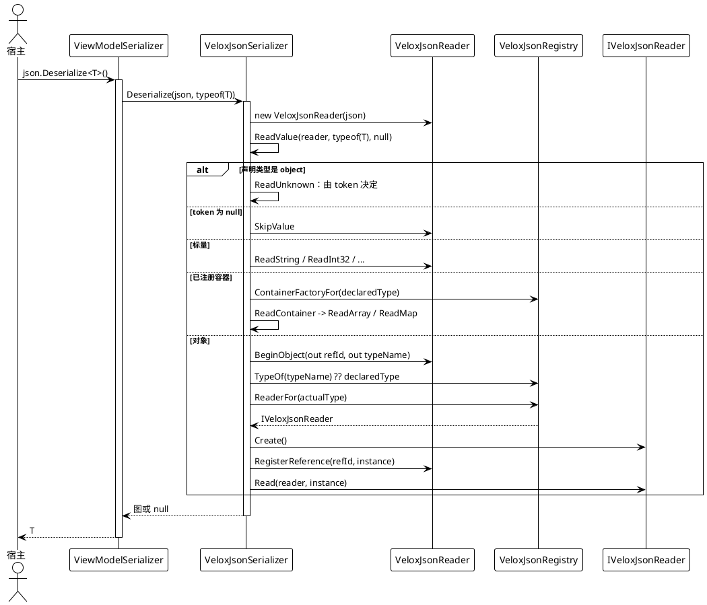

# 读取路径

`Deserialize` 打开 reader，让 `ReadValue` 构建图。声明类型决定怎么读；文档带 `$type` 时，注册表决定用哪个生成 reader 创建并填充对象。

## 正常流程



`ReadObjectValue` 在读取成员之前先登记新实例，因此文档后面的 `$ref` 能解析到它。成员已持有实例时 reader 会收到该实例，这让折叠几何对象能写回所属节点。

```csharp
var instance = existing is not null && actualType.IsInstanceOfType(existing)
    ? existing
    : registered.Create();

reader.RegisterReference(referenceId, instance);

registered.Read(reader, instance);
return instance;
```

> 来源：`Src/Core/VeloxDev.Core/Serialization/VeloxJsonSerializer.cs` 第 472-480 行。

注册表先解析类型名再取 reader；只有当声明类型是 `object` 时才容忍 reader 为 null，此时按文档形状读成普通字典或列表。

```csharp
var registered = VeloxJsonRegistry.ReaderFor(actualType);
if (registered is null && declaredType != typeof(object)) throw MissingReader(actualType, typeName);

if (registered is null)
{
    return ReadByShape(reader, referenceId);
}
```

> 来源：`Src/Core/VeloxDev.Core/Serialization/VeloxJsonSerializer.cs` 第 462-470 行。

## 集合

集合成员由它自己的生成 reader 就地填充。`ReadArray` 先清空目标，因为文档描述成员*现在有什么*，不是“再添几个”；实例身份与订阅因此保持存活。

```csharp
if (!target.IsFixedSize) target.Clear();

reader.BeginArray();
while (reader.NextElement())
{
    target.Add(ReadValue(reader, elementType, null));
}
reader.FinishArray();
```

> 来源：`Src/Core/VeloxDev.Core/Serialization/VeloxJsonSerializer.cs` 第 518-525 行。

字典遵循同一规则。接口键字典用键对象的引用 id 作为成员名，这是既有归档的形状。

> 来源：`Src/Core/VeloxDev.Core/Serialization/VeloxJsonSerializer.cs` 第 540-566、625-665 行。

## 流式读取

`TextReader` 与 `Stream` 重载只读到解析器需要的位置。格式只回指已经写出的对象，因此一次前向遍历足够，峰值内存是 reader 缓冲加图本身。

> 来源：`Src/Core/VeloxDev.Core/Serialization/VeloxJsonSerializer.cs` 第 280-334 行。

## 错误路径

- **JSON、reader 或类型为 null**：重载抛 `ArgumentNullException`。
- **未知 writer 类型**：文档命名了没有 reader 的类型且声明类型不是 `object` 时，`ReadValue` 抛出。
- **顶层数组**：声明类型不是数组却遇到数组时，`ReadValue` 抛 `InvalidOperationException`；数组文本应通过 `VeloxJsonValue.Parse` 读成树。
- **JSON 格式非法**：reader 抛出；`ViewModelSerializer.TryDeserialize` 捕获并返回 `false` 与默认值。
- **结果为 null**：文档是 JSON 字面量时 `ViewModelSerializer.Deserialize` 抛 `InvalidOperationException`。
- **回调抛异常**：生成的 reader 直接调用 `[OnDeserializing]` / `[OnDeserialized]`；回调异常上抛给调用方。
- **注册顺序**：消费者程序集的 writer/reader 不会替换声明程序集的条目，因此模块初始化顺序不能改变谁胜出。

> 来源：`Src/Core/VeloxDev.Core/Serialization/VeloxJsonSerializer.cs` 第 257-334、387-415、452-470 行；`Src/Core/VeloxDev.Core/Serialization/ViewModelSerializer.cs` 第 68-91、122-168 行；`VeloxJsonRegistry.cs` 第 188-226 行。
