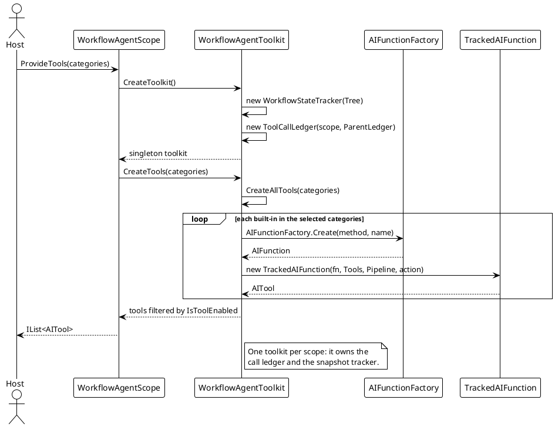
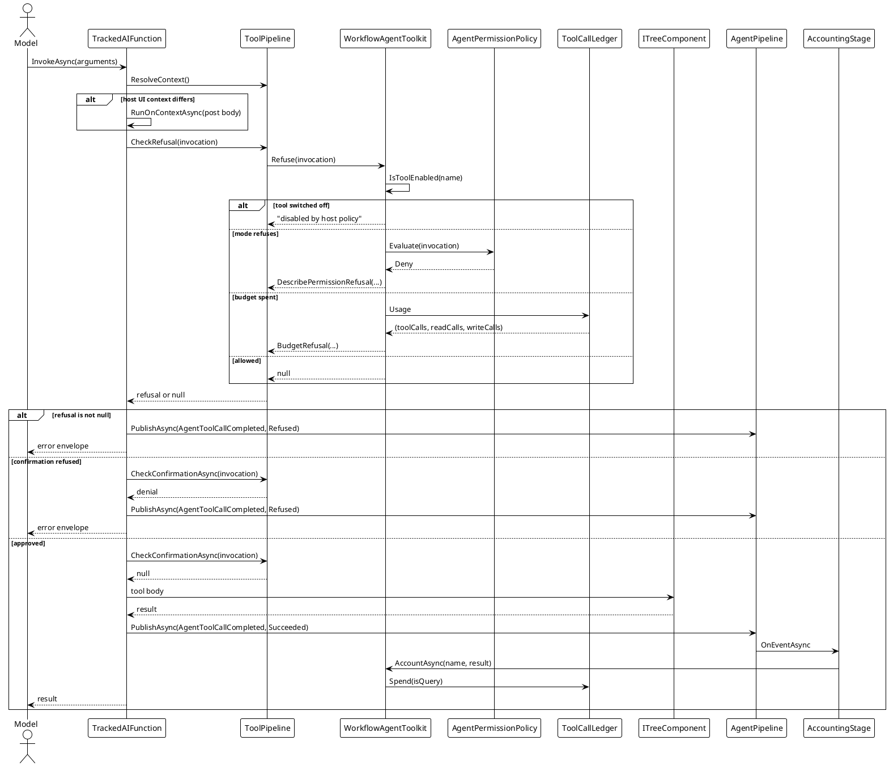
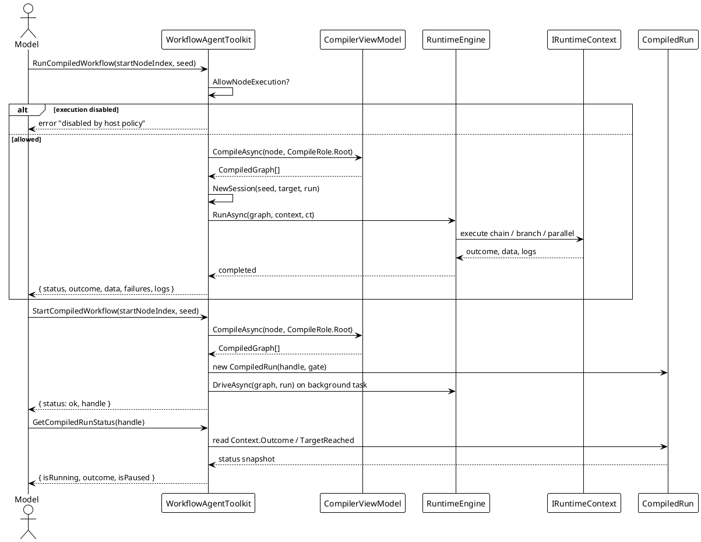

# 工作流智能体工具

本页追踪两条调用链：一棵 `ITreeComponent` 如何变成模型可调用的工具面，以及一次调用如何从模型出发，穿过权限与预算闸门进入树。

两个协作者是 `WorkflowAgentScope`（负责配置）与 `WorkflowAgentToolkit`（负责工具列表、状态跟踪器与调用账本）。

## 工具装配

`ProvideTools` 只是围绕唯一 toolkit 实例的便捷入口。toolkit 每个作用域只创建一次，因为它持有预算所依据的可变状态。

Source: `Src/Core/VeloxDev.Core.Extension/Agent/Workflow/WorkflowAgentScope.cs:1555-1594`

```csharp
public WorkflowAgentToolkit CreateToolkit() => _toolkit ??= new WorkflowAgentToolkit(this, ParentLedger);

public IList<AITool> ProvideTools() => CreateToolkit().CreateTools();

public IList<AITool> ProvideTools(WorkflowToolCategory categories) => CreateToolkit().CreateTools(categories);
```

每个内置方法在注册那一刻就被 `TrackedAIFunction` 包住，因此闸门与上报固定在同一行声明动作类别的代码上。

Source: `Src/Core/VeloxDev.Core.Extension/Agent/Workflow/Functions/WorkflowAgentToolkit.cs:88-99`

```csharp
internal IList<AITool> CreateAllTools(WorkflowToolCategory categories = WorkflowToolCategory.All)
{
    AITool T(Delegate method, string name, AgentActionCategory action)
        => new TrackedAIFunction(AIFunctionFactory.Create(method, name), Tools, _scope.Pipeline, action);

    var tools = new List<AITool>();

    void Add(WorkflowToolCategory category, params AITool[] items)
    {
        if ((categories & category) == category)
            tools.AddRange(items);
    }
```



`CreateTools` 是应用宿主逐工具开关的唯一位置；`CreateAllTools` 保持不过滤，以便宿主 UI 列出已关闭的工具并把它重新打开。

Source: `Src/Core/VeloxDev.Core.Extension/Agent/Workflow/Functions/WorkflowAgentToolkit.cs:78-81`

```csharp
public IList<AITool> CreateTools(WorkflowToolCategory categories = WorkflowToolCategory.All)
    => [.. CreateAllTools(categories).Where(t =>
        string.Equals(t.Name, ResetBudgetToolName, StringComparison.OrdinalIgnoreCase)
        || _scope.IsToolEnabled(t.Name))];
```

## 一次调用穿过闸门

包装器把整次调用编组到宿主的同步上下文，然后向共享的 `ToolPipeline` 询问两个预检决定：预算/模式拒绝与人工确认。只有被批准的调用才会进入工具主体。

Source: `Src/Core/VeloxDev.Core.Extension/Agent/TrackedAIFunction.cs:71-114`

```csharp
var invocation = new ToolInvocation(Name, _category, _source, arguments);

if (_tools.CheckRefusal(invocation) is { } refusal)
{
    await ReportAsync(refusal, AgentToolOutcome.Refused, TimeSpan.Zero, cancellationToken);
    return Error(refusal);
}

if (await _tools.CheckConfirmationAsync(invocation, cancellationToken) is { } denial)
{
    await ReportAsync(denial, AgentToolOutcome.Refused, TimeSpan.Zero, cancellationToken);
    return Error(denial);
}
```

`CheckInvocation` 先判模式、再判预算，顺序是刻意的：被模式拒绝的调用不能被描述成预算问题。

Source: `Src/Core/VeloxDev.Core.Extension/Agent/Workflow/Functions/WorkflowAgentToolkit.cs:371-411`

```csharp
if (_scope.PermissionPolicy.Evaluate(invocation) == PermissionDecision.Deny)
    return _scope.DescribePermissionRefusal(invocation);

if (_scope.PermissionPolicy.Mode != AgentPermissionMode.Bypass)
{
    var (spent, readCalls, writeCalls) = _ledger.Usage;
    if (_scope.MaxToolCalls.HasValue && spent >= _scope.MaxToolCalls.Value)
        return BudgetRefusal($"Tool call limit ({_scope.MaxToolCalls.Value}) reached.");
    // ... per-kind caps ...
}

if (_scope.MaxTokens.HasValue && _scope.TotalTokens >= _scope.MaxTokens.Value)
    return BudgetRefusal($"Token budget ({_scope.MaxTokens.Value}) reached.");
```



记账是管线的一个阶段，而不是包装器的一部分，因此它看到的 `AgentToolCallCompleted` 与所有观察者看到的是同一个。它只对 `Succeeded` 计费；被拒绝或失败的调用从未执行主体，计入就是向模型收取它没拿到的东西。

Source: `Src/Core/VeloxDev.Core.Extension/Agent/Workflow/Functions/WorkflowAgentToolkit.cs:333-345`

```csharp
if (agentEvent is AgentToolCallCompleted { Outcome: AgentToolOutcome.Succeeded } completed)
    await owner.AccountAsync(completed.ToolName, completed.Result).ConfigureAwait(false);

await next(agentEvent).ConfigureAwait(false);
```

## 图编辑与编译执行

变更工具不打包多步手势。`ConnectSlots` 派发树的两条连接命令并等待两者完成，再验证连线确实落进 `LinksMap`；框架的静默拒绝会变成结构化的 `rejected` 信封。

Source: `Src/Core/VeloxDev.Core.Extension/Agent/Workflow/Functions/WorkflowAgentToolkit.cs:934-946`, `4099-4102`

```csharp
await SendReceiveAsync(senderSlot!, receiverSlot!, cancellationToken);

bool connected = VerifyConnection(senderSlot!, receiverSlot!);
if (!connected)
{
    var rejected = (VeloxJsonObject)VeloxJsonValue.Parse(ConnectionRejected(senderSlot!, receiverSlot!,
        $"[{senderNodeIndex}][{senderSlotIndex}]", $"[{receiverNodeIndex}][{receiverSlotIndex}]"));
    // ...
    return rejected.ToJson();
}
```

```csharp
private async Task SendReceiveAsync(ISlotComponent sender, ISlotComponent receiver, CancellationToken ct)
    => await Task.WhenAll(
        Tree.SendConnectionCommand.ExecuteAndWaitAsync(sender, ct),
        Tree.ReceiveConnectionCommand.ExecuteAndWaitAsync(receiver, ct)).ConfigureAwait(false);
```

执行有两种入口形态。同步的 `RunCompiledWorkflow` 编译根节点并就地驱动引擎；`StartCompiledWorkflow` 以同样方式编译，但立刻返回句柄，并在后台驱动运行，因此之后可以暂停、恢复、停止。

Source: `Src/Core/VeloxDev.Core.Extension/Agent/Workflow/Functions/WorkflowAgentToolkit.cs:2577-2596`, `2401-2447`

```csharp
var compiler = new CompilerViewModel();
var graphs = await compiler.CompileAsync(node, role);
if (graphs.Count == 0) return Error(...);
_lastCompiledGraph = graphs[0];

var run = new CompiledRun(NextHandle(), new ManualExecutionGate());
var context = NewSession(seed, role == CompileRole.Terminal ? node : null, run);
await new RuntimeEngine().RunAsync(graphs[0], context, timeoutCts?.Token ?? ct);
```

```csharp
var graphs = await new CompilerViewModel().CompileAsync(node, CompileRole.Root);
if (graphs.Count == 0) return Error("Compile produced no graphs from this start node.");
_lastCompiledGraph = graphs[0];

var run = new CompiledRun(NextHandle(), new ManualExecutionGate());
run.Context = NewSession(seed, target: null, run);
lock (_runsGate) _runs[run.Handle] = run;
run.Task = DriveAsync(graphs[0], run, place);
```



`GetNodeResult` 使用 `CompileRole.Terminal`：当祖先锥上的路由器在运行时选中兄弟分支，目标没有被驱动，工具返回错误而不是编造结果。

Source: `Src/Core/VeloxDev.Core.Extension/Agent/Workflow/Functions/WorkflowAgentToolkit.cs:2612-2618`

```csharp
if (role == CompileRole.Terminal && !context.TargetReached)
{
    return Error(
        $"Target node '{node.GetType().Name}' (id {GetComponentId(node)}) was NOT reached in this run: " +
        "the router selected a branch that does not lead to it, so its condition was not satisfied. " +
        "No result was produced.");
}
```

## 相关

- [智能体安全与预算](../18_智能体安全与预算/index.md) —— 闸门读取的策略与账本。
- [智能体上下文与技能](../19_智能体上下文与技能/index.md) —— 描述这些工具的提示文本。
- [MCP 集成](../20_MCP集成/index.md) —— 加入同一每轮工具集的外部工具。
- [子智能体](../21_子智能体/index.md) —— 继承此 toolkit 的派发工具。
- [智能体仪表盘与转录](../22_智能体仪表盘与转录/index.md) —— 观察工具做了什么。
