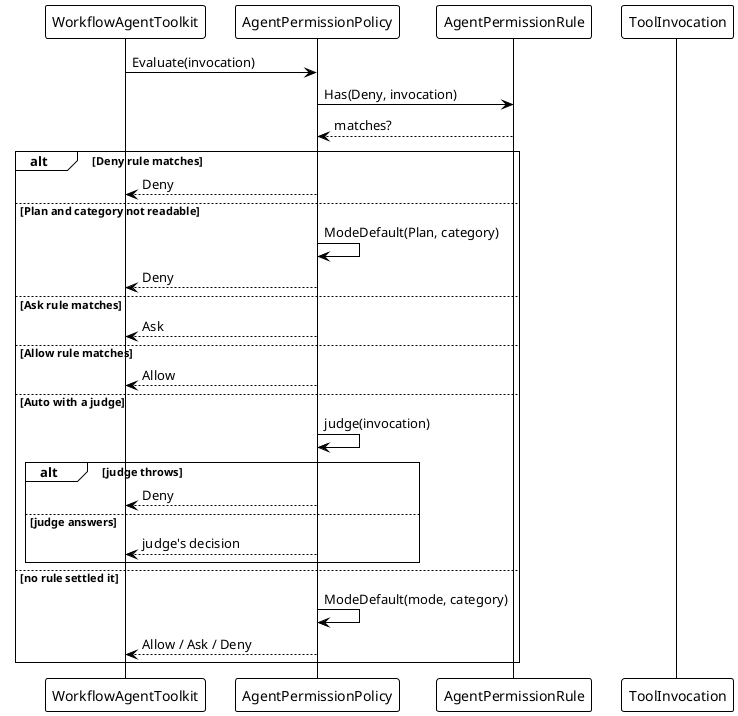
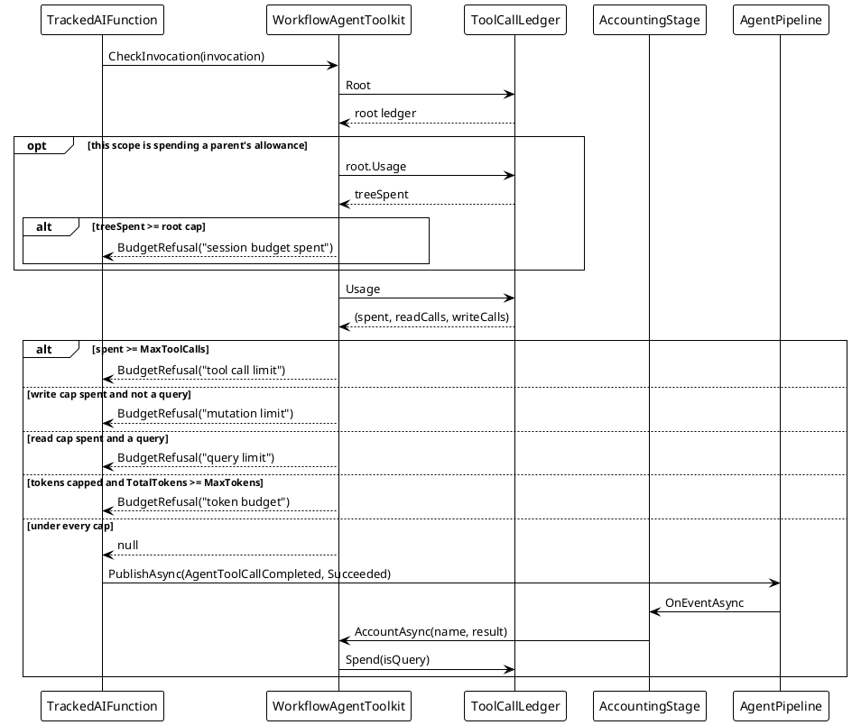

# 智能体安全与预算

本页追踪每次智能体工具调用都要穿过的两道独立闸门：权限策略决定动作是否被允许，调用账本决定会话是否还有可花额度。

两者挂在同一套 `ToolPipeline` 钩子上，因此工作流内置工具、技能工具、MCP 工具与子智能体工具都由同一段代码裁决。

## 策略评估

`AgentPermissionPolicy` 不可变。作用域上的每次 `With*` 都以原子方式替换策略引用，因此一次评估看到一组一致的规则，无需加锁。

Source: `Src/Core/VeloxDev.Core.Extension/Agent/Safety/AgentPermissionPolicy.cs:100-124`

```csharp
public PermissionDecision Evaluate(ToolInvocation invocation)
{
    if (invocation is null) throw new ArgumentNullException(nameof(invocation));

    if (Has(PermissionDecision.Deny, invocation)) return PermissionDecision.Deny;
    if (Mode == AgentPermissionMode.Plan && ModeDefault(Mode, invocation.Category) == PermissionDecision.Deny)
        return PermissionDecision.Deny;
    if (Has(PermissionDecision.Ask, invocation)) return PermissionDecision.Ask;
    if (Has(PermissionDecision.Allow, invocation)) return PermissionDecision.Allow;

    if (Mode == AgentPermissionMode.Auto && Judge is { } judge)
    {
        try { return judge(invocation); }
        catch (Exception) { return PermissionDecision.Deny; }
    }

    return ModeDefault(Mode, invocation.Category);
}
```

顺序就是契约，最强的在前：`Deny` 规则、Plan 的无条件拒绝、`Ask`、`Allow`、模式默认格。裁判只在 `Auto` 下被咨询，且抛异常的裁判回答 `Deny` 而不是放开。

Source: `Src/Core/VeloxDev.Core.Extension/Agent/Safety/AgentPermissionPolicy.cs:130-145`

```csharp
public static PermissionDecision ModeDefault(AgentPermissionMode mode, AgentActionCategory category)
{
    var read = category is AgentActionCategory.Read or AgentActionCategory.Interact;

    return mode switch
    {
        AgentPermissionMode.Plan => read ? PermissionDecision.Allow : PermissionDecision.Deny,
        AgentPermissionMode.Manual => read ? PermissionDecision.Allow : PermissionDecision.Ask,
        AgentPermissionMode.AutoEdit => category is AgentActionCategory.Read or AgentActionCategory.Interact
            or AgentActionCategory.Edit ? PermissionDecision.Allow : PermissionDecision.Ask,
        AgentPermissionMode.Auto => category == AgentActionCategory.Curate
            ? PermissionDecision.Ask
            : PermissionDecision.Allow,
        _ => PermissionDecision.Allow,
    };
}
```

规则只在一个轴上匹配，并以前缀区分：`category:Edit`、`source:mcp:*` 或工具名通配。通配器手写而非编译成正则，因为它每次调用都跑，输入还来自模型。

Source: `Src/Core/VeloxDev.Core.Extension/Agent/Safety/AgentPermissionRule.cs:47-59`

```csharp
public bool Matches(ToolInvocation invocation)
{
    if (Pattern.StartsWith(CategoryPrefix, StringComparison.OrdinalIgnoreCase))
        return CategoryMatches(invocation.Category, Pattern.Substring(CategoryPrefix.Length));

    if (Pattern.StartsWith(SourcePrefix, StringComparison.OrdinalIgnoreCase))
        return Wildcard(invocation.Source ?? string.Empty, Pattern.Substring(SourcePrefix.Length));

    return Wildcard(invocation.Name, Pattern);
}
```



结果为 `Deny` 时，toolkit 会生成一条消息，点名拦截的规则或模式，并告诉模型用户可切换到什么。模型还会被告知不要重试、也不要去找等效工具。

Source: `Src/Core/VeloxDev.Core.Extension/Agent/Workflow/WorkflowAgentScope.cs:906-929`

```csharp
internal string DescribePermissionRefusal(ToolInvocation invocation)
{
    var mode = _permission.Mode;
    var rule = _permission.Rules.FirstOrDefault(
        r => r.Decision == PermissionDecision.Deny && r.Matches(invocation));
    // ... returns a language-specific message naming the rule or the mode ...
}
```

## 预算执行

计数保存在 `ToolCallLedger`。子智能体的账本串到父账本上，`Spend` 沿链上溯，根账本的总额就是整棵树的消耗；这正是任意深度的派发树能够终止的原因。

Source: `Src/Core/VeloxDev.Core.Extension/Agent/Workflow/Functions/ToolCallLedger.cs:57-88`

```csharp
public void Spend(bool isQuery)
{
    Interlocked.Increment(ref _total);
    if (isQuery) Interlocked.Increment(ref _read);
    else Interlocked.Increment(ref _write);

    Outer?.Spend(isQuery);
}

public void ResetChain()
{
    Interlocked.Exchange(ref _total, 0);
    Interlocked.Exchange(ref _read, 0);
    Interlocked.Exchange(ref _write, 0);
    Outer?.ResetChain();
}
```

预检读取实时账本而不是快照上限，因此宿主可以在 toolkit 存在之后调用 `WithMaxToolCalls`，下一次调用就按新数字裁决。

Source: `Src/Core/VeloxDev.Core.Extension/Agent/Workflow/Functions/WorkflowAgentToolkit.cs:381-411`

```csharp
if (_scope.PermissionPolicy.Mode != AgentPermissionMode.Bypass)
{
    var root = _ledger.Root;
    if (!ReferenceEquals(root, _ledger) && root.Owner.MaxToolCalls is { } ceiling)
    {
        var (treeSpent, _, _) = root.Usage;
        if (treeSpent >= ceiling)
            return BudgetRefusal($"The session's tool-call budget ({ceiling}) is spent.");
    }

    var (spent, readCalls, writeCalls) = _ledger.Usage;
    if (_scope.MaxToolCalls.HasValue && spent >= _scope.MaxToolCalls.Value)
        return BudgetRefusal($"Tool call limit ({_scope.MaxToolCalls.Value}) reached.");
    // ...
}

if (_scope.MaxTokens.HasValue && _scope.TotalTokens >= _scope.MaxTokens.Value)
    return BudgetRefusal($"Token budget ({_scope.MaxTokens.Value}) reached.");
```



`Bypass` 是唯一既不执行调用次数限制、也不计费的模式。Token 上限仍然生效，因为那是花费上限而非调用计数。

Source: `Src/Core/VeloxDev.Core.Extension/Agent/Workflow/Functions/WorkflowAgentToolkit.cs:469-483`

```csharp
if (IsBudgetTool(toolName))
{
    await _scope.RaiseToolCalledAsync(toolName, result, _ledger.Usage.ToolCalls).ConfigureAwait(false);
    return;
}

if (_scope.PermissionPolicy.Mode != AgentPermissionMode.Bypass)
    _ledger.Spend(IsQueryTool(toolName));
```

`ResetToolCallLimit` 工具本身豁免于预算。在重置把计数器归零之后再计一次，会立刻让会话重新被拒。

## 会话中切换模式

闸门每次调用都读取 `_permission`，所以 `SetPermissionMode` 在下一次工具调用就生效；提示词在下一轮追上。没有任何智能体工具能放宽模式。智能体只能请求两个转换：进入 `Plan`，以及退回到它离开时的模式；两者都经过确认处理器。

Source: `Src/Core/VeloxDev.Core.Extension/Agent/Workflow/WorkflowAgentScope.cs:838-857`

```csharp
public WorkflowAgentScope WithPermissionMode(AgentPermissionMode mode)
{
    if (_permission.Mode == mode) return this;

    _permission = _permission.WithMode(mode);
    Interlocked.Increment(ref _permissionRevision);
    BumpVersion();
    return this;
}

public bool SetPermissionMode(AgentPermissionMode mode)
{
    if (_permission.Mode == mode) return false;
    WithPermissionMode(mode);
    return true;
}
```

## 相关

- [工作流智能体工具](../17_工作流智能体工具/index.md) —— 这些闸门裁决的 toolkit。
- [智能体上下文与技能](../19_智能体上下文与技能/index.md) —— 描述当前模式的提示词。
- [MCP 集成](../20_MCP集成/index.md) —— 同一策略也裁决 MCP 管理调用。
- [子智能体](../21_子智能体/index.md) —— 子授权是父账本的一份份额。
